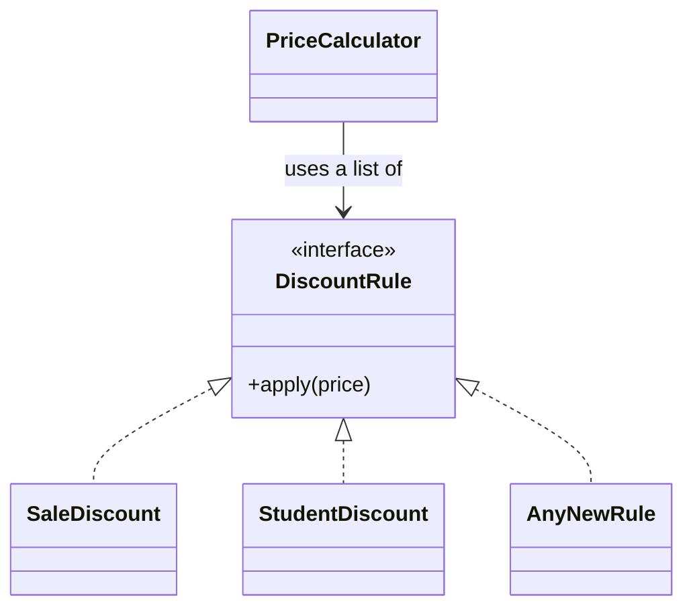

<!-- Written by `npm run lessons` from the lesson data in src/data. Edit the lesson there, not this page. -->

# SOLID: O — Open/Closed Principle

**System Design · Unit 5: Low-level design: OOP and SOLID · Lesson 4 of 9 · Must know**

> **In one line.** Code should be open for extension but closed for modification: add new behaviour by adding code, not by editing code that already works.

[Open this lesson on the site](https://learn.hamropedia.com/system-design/solid-o-open-closed-principle/) for its animation, the practice game and tap-to-explain words.

## The problem it solves

Every time a new type of thing appears (a new payment method, a new discount), developers edit the same big if/else, and each edit risks breaking cases that already worked.

## The idea

A long if/elif chain on type ('if card … elif paypal …') must be edited every time a new case appears, which risks breaking the old cases. Instead, depend on an interface and add one new class for each new case.

## How it works, step by step

1. Find the code that switches on a type: if kind == 'sale' … elif kind == 'student' …
2. Define an interface for the behaviour that varies: apply(price).
3. Move each branch into its own class that implements the interface.
4. The main code just calls rule.apply(price) for every rule it's given.
5. A new discount is a new class. The main code never changes.

## Picture it



*The calculator only knows the DiscountRule interface. A new discount is a new class plugged in at the bottom; the calculator never changes.*

## Analogy

A power strip: you add a new device by plugging it in, without rewiring the house.

**Where the analogy breaks.** A power strip has a fixed number of sockets, designed in advance. You can't predict every future change, so apply this where variation is likely, not everywhere.

## Example

A price calculator takes a list of discount rules. Adding a 'student discount' means adding one new rule class, with no change to the calculator.

## Must know

- Replace 'switch on type' with polymorphism.
- Strategy, Decorator and plug-in designs all follow this principle.
- Protects tested code from new changes.

## In code

```python
class DiscountRule:
    def apply(self, price): return price

class SaleDiscount(DiscountRule):
    def apply(self, price): return price * 0.9

class StudentDiscount(DiscountRule):        # a new rule: no edits elsewhere
    def apply(self, price): return price - 5

def final_price(price, rules):
    for rule in rules:
        price = rule.apply(price)
    return price
```

## Common mistakes

- Adding abstractions for variations that will never happen.
- Still having to edit one central if/else to create the new class. Use a registry or configuration instead.

> **Not true:** The open/closed principle says to add an abstraction for every variation you can imagine.  
> **In fact:** Every abstraction costs effort to read and maintain. Add one when a real variation appears, not for changes that may never come.

## In the interview

Open/closed means I can add behaviour without editing existing code — for example, new discount types as new classes behind a DiscountRule interface, instead of a growing if/else chain.

<details>
<summary>&lt;b>Does it mean you never edit code?&lt;/b></summary>

No. You still fix bugs and refactor. It means designing so that the variations you expect don't require changing working code.

</details>

## Practise

Try each one yourself first, then open the answer and compare.

### 1. Explain

Explain the open/closed principle with the power-strip picture.

<details>
<summary>Show one good answer</summary>

With a power strip, you add a new device by plugging it in. You don't rewire the house, and the kettle and the lamp that are already plugged in aren't affected.

The open/closed principle says code should work the same way: open for extension (you can add new behaviour), but closed for modification (you don't edit code that already works). The strip's sockets are the interface: every device has the same plug.

In code: a price calculator that loops over "discount rules", each with an apply() method. A new student discount is a new rule class plugged into the list. Compare that with a long if/elif on the discount type, which you must edit, and might break, every time a new kind appears.

</details>

### 2. Draw

Draw the DiscountRule design as a class diagram.

<details>
<summary>Show one good answer</summary>

final_price depends only on the DiscountRule interface. Each concrete rule implements apply() its own way. A new rule is a new box at the bottom; nothing above it changes.

```text
final_price(price, rules) ── uses ──► DiscountRule
                                      + apply(price)
                                           △
                     ┌─────────────────────┼─────────────────────┐
                SaleDiscount        StudentDiscount         (new rules
                apply: price × 0.9  apply: price − £5        plug in here)
```

</details>

### 3. Apply

Rewrite a shipping-cost function that uses if/elif for 'standard', 'express' and 'international', so that adding 'drone' needs no edits to existing code.

<details>
<summary>Show one good answer</summary>

Before, a single function had an if/elif branch per method, so adding "drone" meant editing it (and retesting every branch). After, each method is its own class behind a Shipping interface, and the function just looks the method up in a registry. Adding drone delivery is one new class and one line that registers it; shipping_cost and the existing methods are untouched.

```python
from abc import ABC, abstractmethod


class Shipping(ABC):
    @abstractmethod
    def cost(self, weight_kg): ...


class Standard(Shipping):
    def cost(self, weight_kg):
        return 3.0 + 0.5 * weight_kg


class Express(Shipping):
    def cost(self, weight_kg):
        return 8.0 + 1.0 * weight_kg


class International(Shipping):
    def cost(self, weight_kg):
        return 15.0 + 2.5 * weight_kg


METHODS = {"standard": Standard(), "express": Express(), "international": International()}


def shipping_cost(method, weight_kg):       # never edited again
    return METHODS[method].cost(weight_kg)


print(shipping_cost("express", 2))           # 10.0


class Drone(Shipping):                       # the new method: one class...
    def cost(self, weight_kg):
        if weight_kg > 2:
            raise ValueError("too heavy for a drone")
        return 12.0


METHODS["drone"] = Drone()                   # ...and one line to register it
print(shipping_cost("drone", 1.5))           # 12.0
```

</details>

### 4. Trade-offs

Where would applying this principle be over-engineering?

<details>
<summary>Show one good answer</summary>

• Two cases that will probably never become three: VAT on or off, a guest or a member. One if is clearer than an interface and two classes.  
• Code you own and can easily change: a private function in one service. If a third case appears, refactor then; editing your own code isn't a crime.  
• When you don't yet know how it will vary. Plug-in points built on guesses usually end up in the wrong place, and make the real change harder (YAGNI: you aren't gonna need it).  
• When it is really data, not behaviour: shipping prices that differ only in numbers belong in a table or config, not in one class per row.  
• Scripts and prototypes that will be thrown away.

Apply it where change is frequent or expected (pricing rules, payment methods, plug-ins), or where other teams or customers extend your code without being able to edit it.

</details>

## Go further (optional)

- READ · [SOLID: the first 5 principles of object-oriented design](https://www.google.com/search?q=DigitalOcean+SOLID+the+first+5+principles+of+object+oriented+design) · DigitalOcean, free
- WATCH · [SOLID principles explained with examples](https://www.youtube.com/results?search_query=SOLID+principles+explained+with+examples) · YouTube

---

[← SOLID: S — Single Responsibility Principle](solid-s-single-responsibility-principle.md) · [All lessons](../../README.md) · [SOLID: L — Liskov Substitution Principle →](solid-l-liskov-substitution-principle.md)
