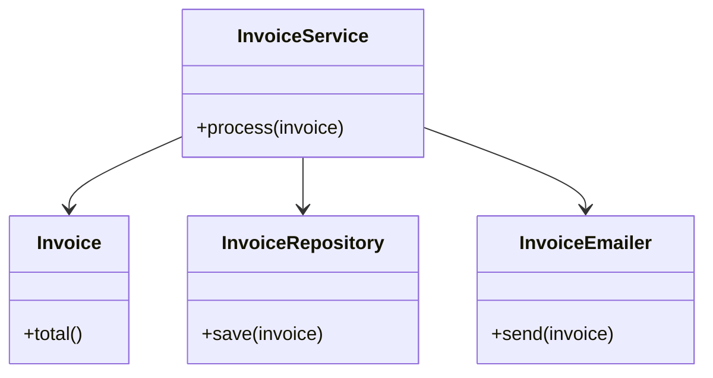

<!-- Written by `npm run lessons` from the lesson data in src/data. Edit the lesson there, not this page. -->

# SOLID: S — Single Responsibility Principle

**System Design · Unit 5: Low-level design: OOP and SOLID · Lesson 3 of 9 · Must know**

> **In one line.** A class should have one reason to change: one job.

[Open this lesson on the site](https://learn.hamropedia.com/system-design/solid-s-single-responsibility-principle/) for its animation, the practice game and tap-to-explain words.

## The problem it solves

When one class does several jobs, unrelated changes collide: a change to the email wording risks breaking the tax calculation, and every change means retesting everything.

## The idea

If one class holds the business rules, the database saving and the email sending, a change to any one of them risks breaking the others. Split it so each class does one thing well and changes for one reason.

## How it works, step by step

1. List what the class does, and who asks for changes to each part (finance, the database team, marketing).
2. Each different 'who' is a separate responsibility.
3. Move each responsibility into its own class with a clear name.
4. Connect them in a small coordinating function or service.

## Picture it



*After splitting: each class has one job, and a small service connects them.*

## Analogy

A restaurant where the chef cooks, the cashier takes payments and the cleaner cleans. If the chef also did the accounts, every new tax rule would interrupt the cooking.

**Where the analogy breaks.** In a tiny café one person does everything, and that's fine. Splitting too early into very small classes adds complexity; apply this when responsibilities really do change separately.

## Example

Invoice calculates the totals, InvoiceRepository saves it, InvoiceEmailer sends it.

## Must know

- 'A reason to change' usually means a different person or team asking for changes.
- Warning signs: huge classes, many unrelated imports, methods that never use each other's data.
- The result: smaller classes that are easier to test.

## In code

```python
# Before: one class, three reasons to change
class Invoice:
    def total(self): ...
    def save_to_db(self): ...
    def email_to_customer(self): ...

# After: one job each
class Invoice:
    def total(self): ...

class InvoiceRepository:
    def save(self, invoice): ...

class InvoiceEmailer:
    def send(self, invoice): ...
```

## Common mistakes

- Splitting by the number of methods instead of by reason to change.
- Creating dozens of tiny classes that are always changed together.

> **Not true:** Single responsibility: one method per class.  
> **In fact:** It means one reason to change: one person or team who would ask for changes. A class can have many methods that serve that one purpose.

## In the interview

Single responsibility means each class has one reason to change. For example, I'd separate invoice calculation, saving and emailing, so a change to the email template can't break the tax logic.

<details>
<summary>&lt;b>Isn't that just 'make classes small'?&lt;/b></summary>

No, it's about cohesion: things that change together stay together, and things that change for different reasons are separated.

</details>

## Practise

Try each one yourself first, then open the answer and compare.

### 1. Explain

Explain SRP with the restaurant picture.

<details>
<summary>Show one good answer</summary>

In a restaurant, the chef cooks, the cashier takes payments and the cleaner cleans. When a new tax rule arrives, only the cashier changes how they work; the kitchen carries on undisturbed.

If the chef also did the accounts, every tax change would interrupt the cooking, and a mistake in the accounts could ruin dinner service. That is a class with several responsibilities: a change for one reason (tax) risks breaking something unrelated (cooking).

The single responsibility principle says each class should have one reason to change, meaning one job, owned by one kind of change. An Invoice works out totals (changes when pricing rules change); a repository saves it (changes when the database changes); an emailer sends it (changes when the email changes).

</details>

### 2. Draw

Draw the before and after class diagrams for the Invoice example.

<details>
<summary>Show one good answer</summary>

Before, one class changes for three unrelated reasons, and a change to the email template means redeploying, and risking, the tax logic. After, each class has one reason to change, and each can be tested on its own (the repository with a test database, the emailer with a fake sender).

```text
Before: one class, three reasons to change
┌───────────────────────┐
│ Invoice               │  pricing and tax rules
│  + total()            │  the database
│  + save_to_db()       │  the email template
│  + email_to_customer()│
└───────────────────────┘

After: one reason each
┌────────────┐  ┌───────────────────┐  ┌────────────────┐
│ Invoice    │  │ InvoiceRepository │  │ InvoiceEmailer │
│  + total() │  │  + save(invoice)  │  │  + send(invoice)│
└────────────┘  └───────────────────┘  └────────────────┘
 pricing          the database           the email
```

</details>

### 3. Apply

A UserService validates input, hashes passwords, saves users and sends welcome emails. Split it, and write the new class names and methods.

<details>
<summary>Show one good answer</summary>

Four jobs, four classes, each with one reason to change:  
• UserValidator.validate(email, password): the sign-up rules.  
• PasswordHasher.hash(password): the hashing algorithm.  
• UserRepository.save(user) and exists(email): the database.  
• WelcomeEmailer.send(user): the email's wording or provider.

A thin UserRegistration.register(email, password) coordinates them in order and holds no rules of its own. Each part can be swapped or tested alone: here the repository and the emailer are in-memory stand-ins.

```python
import hashlib
import os
import re


class UserValidator:                        # changes when the sign-up rules change
    def validate(self, email, password):
        if not re.fullmatch(r"[^@\s]+@[^@\s]+\.[a-z]+", email):
            raise ValueError("invalid email")
        if len(password) < 10:
            raise ValueError("password too short")


class PasswordHasher:                       # changes when the hashing algorithm changes
    def hash(self, password):
        salt = os.urandom(16)
        key = hashlib.scrypt(password.encode(), salt=salt, n=2**14, r=8, p=1)
        return salt.hex() + "$" + key.hex()


class UserRepository:                       # changes when the database changes
    def __init__(self):
        self.users = {}

    def exists(self, email):
        return email in self.users

    def save(self, user):
        self.users[user["email"]] = user


class WelcomeEmailer:                       # changes when the email changes
    def __init__(self):
        self.sent = []

    def send(self, user):
        self.sent.append(f"Welcome, {user['email']}!")


class UserRegistration:                     # only coordinates the steps
    def __init__(self, validator, hasher, repository, emailer):
        self.validator, self.hasher = validator, hasher
        self.repository, self.emailer = repository, emailer

    def register(self, email, password):
        self.validator.validate(email, password)
        if self.repository.exists(email):
            raise ValueError("email already registered")
        user = {"email": email, "password_hash": self.hasher.hash(password)}
        self.repository.save(user)
        self.emailer.send(user)
        return user


emailer = WelcomeEmailer()
registration = UserRegistration(UserValidator(), PasswordHasher(), UserRepository(), emailer)
registration.register("priya@mail.com", "correct horse battery")
print(emailer.sent)                         # ['Welcome, priya@mail.com!']
```

</details>

### 4. Trade-offs

When does splitting classes make code worse?

<details>
<summary>Show one good answer</summary>

• When the pieces always change together. If every change touches the same three classes, they were one responsibility, and splitting them only scatters it: you now open three files to follow one idea.  
• When the classes become too small to mean anything: lots of one-method classes that just pass the call along ("ravioli code"). Following one request means jumping through ten files.  
• When you split early, on guesses. Before you know what actually changes, you will often split along the wrong lines, and then have to change several classes for every request.  
• When the wiring costs more than the class: every split adds construction, dependency passing and names to remember.

The test is "different reasons to change", meaning different people or rules that change at different times, not "this class has more than 100 lines".

</details>

## Go further (optional)

- READ · [SOLID: the first 5 principles of object-oriented design](https://www.google.com/search?q=DigitalOcean+SOLID+the+first+5+principles+of+object+oriented+design) · DigitalOcean, free
- WATCH · [SOLID principles explained with examples](https://www.youtube.com/results?search_query=SOLID+principles+explained+with+examples) · YouTube

---

[← Composition over inheritance, and interfaces](composition-over-inheritance-and-interfaces.md) · [All lessons](../../README.md) · [SOLID: O — Open/Closed Principle →](solid-o-open-closed-principle.md)
