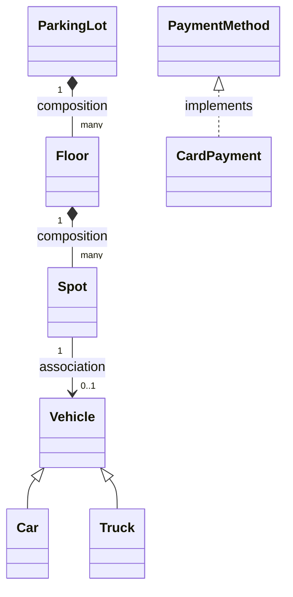

<!-- Written by `npm run lessons` from the lesson data in src/data. Edit the lesson there, not this page. -->

# UML class diagrams and relationships

**System Design · Unit 5: Low-level design: OOP and SOLID · Lesson 8 of 9 · Should know**

> **In one line.** A class diagram shows the classes, their fields and methods, and how they relate to each other.

[Open this lesson on the site](https://learn.hamropedia.com/system-design/uml-class-diagrams-and-relationships/) for its animation, the practice game and tap-to-explain words.

## The problem it solves

In an interview, you need to show the structure of your design quickly, before coding. A clear diagram lets the interviewer follow you and correct you early.

## The idea

In LLD interviews you sketch the main classes and relationships before coding. The relationships: association (uses or knows about), aggregation (has, but the part can exist alone), composition (owns; the part dies with the whole), inheritance (is-a) and realisation (implements an interface). Multiplicity (1, 0..1, \*) says how many.

## How it works, step by step

1. Draw a box for each class: its name at the top, key fields in the middle, key methods at the bottom.
2. Connect the boxes with the right line: a filled diamond for 'owns', an empty diamond for 'has', a triangle arrow for 'is a', and a dashed triangle arrow for 'implements'.
3. Add numbers at the line ends: 1, 0..1 or \* (many).
4. Talk through one use case on the diagram before you write code.

## Picture it



*A filled diamond means 'owns'; a plain arrow means 'uses'; a hollow triangle means 'is a kind of'; a dashed triangle means 'implements'. The numbers say how many.*

## Analogy

A family tree combined with an organisation chart: who is a kind of what, and who belongs to whom.

**Where the analogy breaks.** A family tree records what already happened. A class diagram is a draft: keep it simple, and change it as your design improves.

## Example

Parking lot: ParkingLot owns Floors (composition), a Floor owns Spots (composition), a Spot holds 0 or 1 Vehicle (association), and Car, Truck and Bike are kinds of Vehicle (inheritance).

## Must know

- Composition (filled diamond): the owner controls the part's lifetime.
- Aggregation (empty diamond): shared parts that can exist alone.
- Inheritance: a line with an empty triangle. Realisation: a dashed line with an empty triangle.
- In an interview, show only the important classes and methods.

## In code

```text
ParkingLot 1 ◆──── * Floor        (composition)
Floor      1 ◆──── * Spot         (composition)
Spot       1 ────── 0..1 Vehicle  (association)
Car, Truck, Bike ───▷ Vehicle     (inheritance)
CardPayment ┄┄┄▷ PaymentMethod    (implements an interface)
```

## Common mistakes

- Drawing every getter and setter in a class diagram, which buries the few methods that matter.
- Spending 20 minutes on the diagram and leaving no time to code.

> **Not true:** A good class diagram shows every getter and setter.  
> **In fact:** Listing every getter and setter buries the few methods that matter. Show only the important fields, methods and relationships.

## In the interview

I start an LLD answer by listing the main entities. Then I draw a class diagram with the key fields, methods and relationships: composition for owned parts, inheritance only for a true 'is-a', and interfaces for anything likely to vary.

<details>
<summary>&lt;b>Aggregation or composition?&lt;/b></summary>

Composition: the part dies with the whole, like a room in a house. Aggregation: the part can exist on its own, like a player in a team.

</details>

## Practise

Try each one yourself first, then open the answer and compare.

### 1. Explain

Explain the five relationship types with an everyday example of each.

<details>
<summary>Show one good answer</summary>

• Association ("uses", "knows about"): a doctor and a patient. Each exists on its own; they are linked for a while. A plain line.  
• Aggregation ("has, but the part lives on"): a football team has players. If the team folds, the players still exist and can join another team. A line with a hollow diamond at the team.  
• Composition ("owns; the part dies with the whole"): a house has rooms. Demolish the house and its rooms are gone too. A line with a filled diamond at the house.  
• Inheritance ("is a kind of"): a dog is an animal. A solid line with a hollow triangle pointing at the parent.  
• Realisation ("implements an interface"): a phone charger implements the USB-C standard; any USB-C device can use it. A dotted line with a hollow triangle pointing at the interface.

Multiplicity says how many: 1, 0..1, \* (many) or 1..\* (at least one), written at each end of the line.

</details>

### 2. Draw

Draw a class diagram for a library: Library, Book, BookCopy, Member and Loan.

<details>
<summary>Show one good answer</summary>

Book is the title in the catalogue; BookCopy is one physical copy, which is what gets lent. The library owns its catalogue (composition), but members exist without it (aggregation). A Loan links one Member to one BookCopy for a period of time (associations), and a member can have up to max_loans active loans.

```text
◆── composition   ◇── aggregation   ─── association

Library
 + lend(member, copy) → Loan
 + return_copy(loan)
   │
   ├ 1 ◆──── * Book
   │          isbn, title, author
   │            │
   │            └ 1 ◆──── 1..* BookCopy
   │                        copy_id, available
   │                              │ 1
   └ 1 ◇──── * Member             │
              member_id, name     │
              max_loans = 3       │
                │ 1               │
                └──── 0..* Loan * ┘
                       borrowed_on, due_on,
                       returned_on
```

</details>

### 3. Apply

Turn your diagram into Python class skeletons with the right attributes.

<details>
<summary>Show one good answer</summary>

Each class from the diagram becomes a dataclass with the attributes shown. Composition becomes a list the owner creates and holds (a Book's copies); association becomes a reference to an object that lives independently (a Loan's member and copy). Library.lend() enforces the two rules the diagram implies: a member can't exceed max_loans, and a copy can't be lent twice.

```python
from dataclasses import dataclass, field
from datetime import date, timedelta


@dataclass
class BookCopy:
    copy_id: str
    available: bool = True


@dataclass
class Book:
    isbn: str
    title: str
    author: str
    copies: list[BookCopy] = field(default_factory=list)      # composition


@dataclass
class Member:
    member_id: int
    name: str
    max_loans: int = 3
    loans: list["Loan"] = field(default_factory=list)


@dataclass
class Loan:
    member: Member                                            # association
    copy: BookCopy                                            # association
    borrowed_on: date
    due_on: date
    returned_on: date | None = None


@dataclass
class Library:
    books: dict[str, Book] = field(default_factory=dict)      # composition
    members: dict[int, Member] = field(default_factory=dict)  # aggregation

    def lend(self, member, copy, today):
        active = [loan for loan in member.loans if loan.returned_on is None]
        if len(active) >= member.max_loans:
            raise ValueError("loan limit reached")
        if not copy.available:
            raise ValueError("copy is already on loan")
        copy.available = False
        loan = Loan(member, copy, today, today + timedelta(days=21))
        member.loans.append(loan)
        return loan

    def return_copy(self, loan, today):
        loan.returned_on = today
        loan.copy.available = True


library = Library()
dune = Book("978-0441013593", "Dune", "Frank Herbert", [BookCopy("dune-1"), BookCopy("dune-2")])
library.books[dune.isbn] = dune
asha = Member(1, "Asha")
library.members[asha.member_id] = asha

loan = library.lend(asha, dune.copies[0], date(2024, 3, 1))
print(loan.due_on, dune.copies[0].available)     # 2024-03-22 False
library.return_copy(loan, date(2024, 3, 10))
print(dune.copies[0].available)                  # True
```

</details>

### 4. Trade-offs

How much detail should a class diagram have in a 45-minute interview?

<details>
<summary>Show one good answer</summary>

Enough to agree the design, and no more. Spend about 5 minutes on it.

Include:  
• the 5 to 8 main classes (the nouns from the use cases);  
• the attributes that matter to the problem (a Spot's size and whether it is free), not every field;  
• the methods used in the core flows (park(), leave(), calculate_fee());  
• relationships, with multiplicity where it matters ("a Floor has many Spots");  
• interfaces wherever behaviour varies (PricingStrategy), since that is where the design decisions are.

Leave out: getters and setters, private helpers, every field's type, constructors, and fine UML details (visibility symbols, exact arrow styles), unless asked.

The diagram is a tool for the conversation: sketch it, check it with the interviewer, then refine it as you code. Interviewers mark the decisions (what is a class, what varies, who owns what), not drawing precision.

</details>

## Go further (optional)

- READ · [UML class diagram tutorial](https://www.google.com/search?q=Visual+Paradigm+UML+class+diagram+tutorial) · Visual Paradigm, free
- CODE · [Awesome Low-Level Design](https://github.com/ashishps1/awesome-low-level-design) · GitHub, free

---

[← SOLID: D — Dependency Inversion Principle](solid-d-dependency-inversion-principle.md) · [All lessons](../../README.md) · [Concurrency basics: threads, locks and race conditions →](concurrency-basics-threads-locks-and-race-conditions.md)
