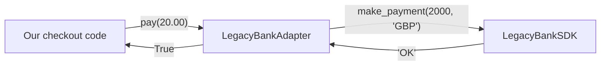

<!-- Written by `npm run lessons` from the lesson data in src/data. Edit the lesson there, not this page. -->

# Adapter

**System Design · Unit 6: Design patterns · Lesson 4 of 10 · Must know**

> **In one line.** Lets two incompatible interfaces work together, by wrapping one so it looks like the other.

[Open this lesson on the site](https://learn.hamropedia.com/system-design/adapter/) for its animation, the practice game and tap-to-explain words.

## The problem it solves

You often need a library or old system whose interface doesn't match the one your code expects, and you can't (or shouldn't) change either side.

## The idea

Your code expects pay(amount_in_pounds), but a third-party SDK offers make_payment(pence, currency). An adapter wraps the SDK and translates the calls, so your code doesn't change.

## How it works, step by step

1. Write down the interface your code expects: pay(pounds) returning True or False.
2. Write down what the other system offers: make_payment(pence, currency) returning 'OK' or an error code.
3. Create an adapter class that implements your interface and holds the other system.
4. In each method, convert the inputs (pounds → pence), call the other system, and convert the outputs (codes → True/False, or proper exceptions).

## Picture it



*The adapter translates in both directions: pounds into pence on the way in, 'OK' into True on the way out.*

## Analogy

A UK-to-EU travel plug adapter.

**Where the analogy breaks.** A plug adapter only changes the shape. Software adapters often also convert data (units, formats, errors), and a careless conversion can hide real problems.

## Example

Wrapping an old XML-based bank service so it fits your new PaymentGateway interface.

## Must know

- Use it to plug in third-party or legacy code without changing your own interface.
- Prefer wrapping an object (object adapter) over inheriting from it (class adapter).
- Keeps vendor-specific code in one place, so switching vendors is easy.

## In code

```python
class PaymentGateway:                      # what our code expects
    def pay(self, pounds: float) -> bool: ...

class LegacyBankSDK:                        # what we were given
    def make_payment(self, pence: int, currency: str) -> str:
        return "OK"

class LegacyBankAdapter(PaymentGateway):
    def __init__(self, sdk: LegacyBankSDK):
        self.sdk = sdk
    def pay(self, pounds):
        return self.sdk.make_payment(round(pounds * 100), "GBP") == "OK"
```

## Common mistakes

- Letting the third-party's types leak through the adapter into business code.
- Losing error details during the conversion.

> **Not true:** An adapter should hand the third party's own types back to the code that calls it.  
> **In fact:** The business code would then depend on the vendor after all. An adapter converts everything into your own types, so the vendor's code stays in one place.

## In the interview

Adapter wraps an incompatible class so that it matches the interface my code expects: for example, making an old bank SDK fit our PaymentGateway interface. Business code doesn't change, and vendors can be swapped.

<details>
<summary>&lt;b>Adapter or Facade?&lt;/b></summary>

An adapter makes one interface match another that's expected. A facade gives a simpler interface over a complicated set of classes.

</details>

## Practise

Try each one yourself first, then open the answer and compare.

### 1. Explain

Explain Adapter with the travel-plug picture.

<details>
<summary>Show one good answer</summary>

You bring a UK hair dryer to Spain. The dryer expects a UK socket; the wall has an EU socket. You don't rewire the hotel, and you don't take the dryer apart: you plug a travel adapter in between. It changes the shape of the connection so the two fit, and neither side has to change.

The Adapter pattern is the same in code. Your code expects an interface (pay(pounds)); a third-party SDK you can't change offers something different (make_payment(pence, currency)). An adapter class implements your interface and translates each call into the SDK's form: pounds into pence, a "GBP" argument added, the SDK's "OK" string turned into True. Your code and the SDK both stay exactly as they are.

</details>

### 2. Draw

Draw PaymentGateway, LegacyBankAdapter and LegacyBankSDK, with arrows.

<details>
<summary>Show one good answer</summary>

Our code depends only on PaymentGateway. The adapter implements that interface (dotted line) and holds the SDK it wraps (solid arrow), translating every call. Swapping to a different bank later means writing a different adapter; our code never changes.

```text
Our checkout code
   │ pay(12.50)
   ▼
«interface» PaymentGateway
 + pay(pounds) → bool
   △
   ┊ implements
LegacyBankAdapter
 - sdk
 + pay(pounds):
     make_payment(1250, "GBP") == "OK"
   │ wraps and calls
   ▼
LegacyBankSDK   (we can't change this)
 + make_payment(pence, currency) → str
```

</details>

### 3. Apply

Write an adapter so that a weather API returning Fahrenheit fits an interface that returns Celsius.

<details>
<summary>Show one good answer</summary>

Our code wants current_celsius(city name). The third-party client offers get_temp(city code) in Fahrenheit. The adapter translates both ways: the city name into the API's code on the way in, and Fahrenheit into Celsius ((F − 32) × 5 ÷ 9) on the way out. Nothing that uses TemperatureSource knows the API exists.

```python
from abc import ABC, abstractmethod


class TemperatureSource(ABC):                    # what our code expects
    @abstractmethod
    def current_celsius(self, city) -> float: ...


class AcmeWeatherAPI:                             # the third-party client we were given
    def get_temp(self, city_code):
        return {"LDN": 59.0, "NYC": 86.0}[city_code]      # Fahrenheit


class AcmeWeatherAdapter(TemperatureSource):
    CODES = {"London": "LDN", "New York": "NYC"}

    def __init__(self, api):
        self.api = api

    def current_celsius(self, city):
        fahrenheit = self.api.get_temp(self.CODES[city])
        return round((fahrenheit - 32) * 5 / 9, 1)


weather = AcmeWeatherAdapter(AcmeWeatherAPI())
print(weather.current_celsius("London"), weather.current_celsius("New York"))   # 15.0 30.0
```

</details>

### 4. Trade-offs

What can go wrong if an adapter silently converts or swallows errors?

<details>
<summary>Show one good answer</summary>

An adapter sits exactly where two systems meet, so anything it hides, nobody else sees.

Silent conversion:  
• Lost precision: £10.005 rounded to pence, or rounded twice in different places, and the totals stop matching the bank's.  
• Wrong assumptions: a timestamp assumed to be UTC that was local time, or a unit assumed to be metres that was feet. Everything "works" and the numbers are quietly wrong.  
• Missing data filled with defaults: a missing temperature becomes 0 °C, which is a real temperature.

Swallowed errors:  
• The SDK says "DECLINED" in one case and "TIMEOUT" in another, and the adapter returns False for both. The caller can't tell "the card was refused, don't retry" from "we don't know, check before retrying", and may charge twice.  
• An exception is caught and logged inside the adapter, so the caller thinks the payment failed when it went through (or the opposite).

A good adapter converts explicitly and with tests, and translates errors into your own error types that keep their meaning (PaymentDeclined, PaymentTimedOut), instead of hiding them.

</details>

## Go further (optional)

- WATCH · [Adapter pattern explained](https://www.youtube.com/results?search_query=Christopher+Okhravi+Adapter+pattern) · Christopher Okhravi · free on YouTube
- READ · [Adapter pattern](https://refactoring.guru/design-patterns/adapter) · Refactoring.Guru, free

---

[← Builder](builder.md) · [All lessons](../../README.md) · [Decorator →](decorator.md)
