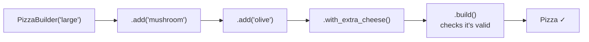

<!-- Written by `npm run lessons` from the lesson data in src/data. Edit the lesson there, not this page. -->

# Builder

**System Design · Unit 6: Design patterns · Lesson 3 of 10 · Must know**

> **In one line.** Builds a complex object step by step, instead of using a constructor with a dozen parameters.

[Open this lesson on the site](https://learn.hamropedia.com/system-design/builder/) for its animation, the practice game and tap-to-explain words.

## The problem it solves

Objects with many optional settings lead to long, confusing constructors, where it's easy to pass arguments in the wrong order.

## The idea

When an object has many optional parts, a constructor like Pizza(size, cheese, olives, ham, …) is unreadable and easy to get wrong. A builder sets each part with a clearly named method, then build() checks everything and returns the finished object.

## How it works, step by step

1. Create a builder with sensible defaults for every setting.
2. Each method sets one thing and returns the builder, so calls can be chained.
3. build() checks the combination is valid: required fields set, values in range.
4. build() returns the finished object, which can then be read-only.

## Picture it



*Each step sets one part; build() checks everything and returns the finished object.*

## Analogy

Ordering a custom sandwich at a counter: choose the bread, then the fillings, then the sauce, then say 'done'.

**Where the analogy breaks.** At the counter you can choose in any order. Some objects need steps in a valid order, or have required parts, so build() must check before returning anything.

## Example

Building an HTTP request: Request.builder().url(...).method('POST').header(...).body(...).timeout(5).build().

## Must know

- Use it for objects with many optional settings, or multi-step construction.
- Fluent style: each step returns the builder, so calls can be chained.
- Validate in build(); the finished object can then be unchangeable.
- In Python, keyword arguments with defaults often solve the same problem; in Java, Builder is very common.

## In code

```python
class Pizza:
    def __init__(self, size, toppings, extra_cheese):
        self.size, self.toppings, self.extra_cheese = size, toppings, extra_cheese

class PizzaBuilder:
    def __init__(self, size):
        self.size, self.toppings, self.extra_cheese = size, [], False

    def add(self, topping):
        self.toppings.append(topping)
        return self                     # return self to chain calls

    def with_extra_cheese(self):
        self.extra_cheese = True
        return self

    def build(self):
        if not self.toppings:
            raise ValueError("a pizza needs at least one topping")
        return Pizza(self.size, list(self.toppings), self.extra_cheese)

pizza = PizzaBuilder("large").add("mushroom").add("olive").with_extra_cheese().build()
```

## Common mistakes

- Letting the half-built object escape before build() is called.
- Using a builder for objects with only two or three fields.

> **Not true:** A builder is the right way to create an object with two fields.  
> **In fact:** For two or three fields, a plain constructor is shorter and clearer. A builder pays off when there are many optional settings, or several steps.

## In the interview

Builder constructs a complex object step by step through readable, named methods, then validates it and returns it, instead of a constructor with many parameters. I'd use it for things like requests or reports with lots of optional settings.

<details>
<summary>&lt;b>Why is Builder less needed in Python?&lt;/b></summary>

Keyword arguments with defaults already make optional settings readable. Builder still helps when construction has several steps or needs validation.

</details>

## Practise

Try each one yourself first, then open the answer and compare.

### 1. Explain

Explain Builder with the sandwich-counter picture.

<details>
<summary>Show one good answer</summary>

At a sandwich counter you don't shout the whole order in one breath. You build it step by step: "white bread", "chicken", "lettuce", "no mayo", and then "that's it". Each choice is clearly named, you can skip what you don't want, and when you say "done", the person behind the counter checks it makes sense ("you didn't pick a bread") before making it.

A builder does the same for objects with many optional parts. Instead of Pizza("large", None, True, False, ["olive"], …), where nobody can remember which position means what, you call clearly named methods, one per part, each returning the builder so they chain: PizzaBuilder("large").add("olive").with_extra_cheese(). Finally build() checks the rules and returns the finished, complete object.

</details>

### 2. Draw

Draw PizzaBuilder and Pizza as a class diagram.

<details>
<summary>Show one good answer</summary>

The builder holds the parts while they are being chosen, and every setter returns the builder itself, which is what lets the calls chain. Only build() creates the Pizza, after checking the rules, so a half-finished pizza can never escape.

```text
PizzaBuilder                          Pizza
 - size                                - size
 - toppings: list                      - toppings
 - extra_cheese: bool                  - extra_cheese
 + add(topping): PizzaBuilder ─┐
 + with_extra_cheese():         ├ return self,
     PizzaBuilder ─────────────┘ so calls chain
 + build(): Pizza ── checks the rules,
                     then creates ──►  Pizza
```

</details>

### 3. Apply

Write an EmailBuilder (to, cc, subject, body, attachments) whose build() fails if there's no recipient.

<details>
<summary>Show one good answer</summary>

Each part has its own named method that returns self, so the calls chain and read like a sentence. to(), cc() and attach() can be called several times. build() enforces the one hard rule, at least one recipient, and hands back copies of the lists, so changing the builder afterwards can't change an email already built.

```python
class Email:
    def __init__(self, to, cc, subject, body, attachments):
        self.to, self.cc, self.subject = to, cc, subject
        self.body, self.attachments = body, attachments


class EmailBuilder:
    def __init__(self):
        self._to, self._cc, self._attachments = [], [], []
        self._subject = self._body = ""

    def to(self, *addresses):
        self._to.extend(addresses)
        return self

    def cc(self, *addresses):
        self._cc.extend(addresses)
        return self

    def subject(self, text):
        self._subject = text
        return self

    def body(self, text):
        self._body = text
        return self

    def attach(self, filename):
        self._attachments.append(filename)
        return self

    def build(self):
        if not self._to:
            raise ValueError("an email needs at least one recipient")
        return Email(list(self._to), list(self._cc), self._subject, self._body, list(self._attachments))


email = (EmailBuilder()
         .to("priya@mail.com")
         .cc("tom@mail.com")
         .subject("Invoice 105")
         .body("Your invoice is attached.")
         .attach("invoice-105.pdf")
         .build())
print(email.to, email.attachments)            # ['priya@mail.com'] ['invoice-105.pdf']

try:
    EmailBuilder().subject("Nobody to send to").build()
except ValueError as error:
    print(error)                              # an email needs at least one recipient
```

</details>

### 4. Trade-offs

Builder or keyword arguments: when is each the better choice?

<details>
<summary>Show one good answer</summary>

In Python, keyword arguments with defaults (or a dataclass) already solve the main problem the pattern was invented for in Java: Pizza(size="large", toppings=["olive"], extra_cheese=True) is readable, needs no extra class, and a __post_init__ can check the rules. That is the better choice most of the time.

A builder is the better choice when:  
• the object is assembled step by step, across several places or in a loop ("add a header if…", "attach each file"), not in one call;  
• validation spans several parts and should run once, at the end (build());  
• the result should be immutable, but getting there takes many steps;  
• you want a fluent, readable language for complex things: SQL query builders, HTTP request builders, test-data builders;  
• the language has no named or default arguments (Java, older C++).

</details>

## Go further (optional)

- WATCH · [Builder pattern explained](https://www.youtube.com/results?search_query=Christopher+Okhravi+Builder+pattern) · Christopher Okhravi · free on YouTube
- READ · [Builder pattern](https://refactoring.guru/design-patterns/builder) · Refactoring.Guru, free

---

[← Factory: Factory Method and Abstract Factory](factory-factory-method-and-abstract-factory.md) · [All lessons](../../README.md) · [Adapter →](adapter.md)
