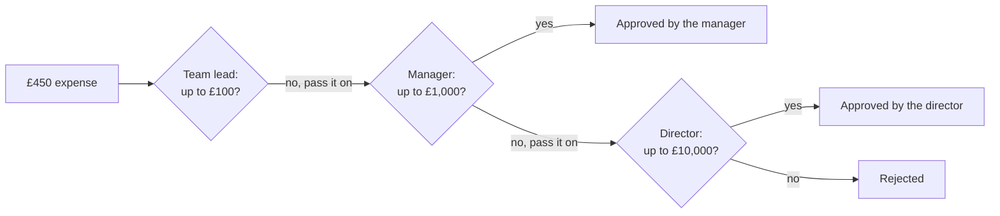

<!-- Written by `npm run lessons` from the lesson data in src/data. Edit the lesson there, not this page. -->

# Chain of Responsibility

**System Design · Unit 6: Design patterns · Lesson 9 of 10 · Should know**

> **In one line.** Passes a request along a chain of handlers; each one either deals with it or passes it on to the next.

[Open this lesson on the site](https://learn.hamropedia.com/system-design/chain-of-responsibility/) for its animation, the practice game and tap-to-explain words.

## The problem it solves

A request may need to pass several checks, or be handled by one of several handlers depending on its details. Hard-coding that sequence in one function makes it long and rigid.

## The idea

Good for pipelines of checks or approvals: authentication → rate limit → validation → handler; or expense approval: a team lead up to £100, a manager up to £1,000, a director above that. Each handler is independent, and the chain can be reordered.

## How it works, step by step

1. Define a handler interface: handle(request).
2. Each handler decides: deal with the request, or pass it to the next handler it holds.
3. Link the handlers into a chain, in the order you want.
4. Send the request to the first handler; it travels along until someone deals with it.
5. End the chain with a default handler that rejects or logs anything unhandled.

## Picture it



*The request travels along the chain until a handler can deal with it.*

## Analogy

A customer-support line: first-line support, then a specialist, then a manager, each stepping in only if the one before can't solve it.

**Where the analogy breaks.** A support line always ends with someone. In code, a request can fall off the end with nobody handling it, so add a final default handler.

## Example

Web framework middleware, logging levels, and an ATM paying out £50 notes, then £20s, then £10s.

## Must know

- Decouples whoever sends the request from whichever handler deals with it.
- Handlers can be added, removed or reordered.
- Make sure something handles the end of the chain.
- Middleware pipelines are the everyday example.

## In code

```python
class Approver:
    def __init__(self, name, limit, next_approver=None):
        self.name, self.limit, self.next = name, limit, next_approver

    def approve(self, amount):
        if amount <= self.limit:
            return f"{self.name} approved £{amount}"
        if self.next:
            return self.next.approve(amount)
        return "Rejected: over every limit"

chain = Approver("Team lead", 100, Approver("Manager", 1_000, Approver("Director", 10_000)))
chain.approve(450)        # 'Manager approved £450'
```

## Common mistakes

- No default at the end, so requests disappear silently.
- Very long chains that are hard to trace.

> **Not true:** A request that no handler accepts is reported as an error automatically.  
> **In fact:** Unless you add a default handler at the end, the request falls off the chain and disappears silently. Always handle the end of the chain.

## In the interview

Chain of Responsibility passes a request through a sequence of handlers until one deals with it — like expense approvals by amount, or middleware for auth, rate limiting and validation. It keeps each handler small and lets me reorder the chain.

<details>
<summary>&lt;b>Where have you seen it?&lt;/b></summary>

Middleware in web frameworks (Express, Django, Spring filters), and events bubbling up through a web page.

</details>

## Practise

Try each one yourself first, then open the answer and compare.

### 1. Explain

Explain the pattern with the support-line picture.

<details>
<summary>Show one good answer</summary>

You phone customer support. First-line support takes the call. If they can answer, done. If not, they pass you to a specialist; if the specialist can't, to a manager. Each person either handles the problem or hands it to the next, and you only deal with "support"; you don't choose who answers.

Chain of Responsibility links handlers in a line. A request goes to the first; each handler decides "can I deal with this?" and either handles it or passes it on. An expense of £450 goes to the team lead (limit £100), who passes it to the manager (limit £1,000), who approves it. The sender doesn't know who will handle it, each handler is independent, and the chain can be reordered or extended without changing the others. Web middleware works the same way: authentication, then rate limiting, then validation, then the handler.

</details>

### 2. Draw

Draw the approval chain and trace a £450 request and a £20,000 request through it.

<details>
<summary>Show one good answer</summary>

Each approver either handles the request or passes it to the next. A request that reaches the end of the chain unhandled must get a clear answer (here a rejection), never silence.

```text
Team lead ──► Manager ──► Director ──► (end of the chain)
≤ £100        ≤ £1,000    ≤ £10,000

£450
  Team lead: over £100, pass it on
  Manager:   £450 ≤ £1,000 ✓
  → "Manager approved £450"

£20,000
  Team lead: pass → Manager: pass → Director:
  over £10,000, and nobody is left
  → "Rejected: over every limit"
```

</details>

### 3. Apply

Write an ATM dispenser chain for £50, £20 and £10 notes that pays out £180.

<details>
<summary>Show one good answer</summary>

Each dispenser handles one note size: it pays as many of its notes as fit (divmod), and passes the remainder to the next dispenser. £180 is three £50s (£150), then one £20, then one £10. An amount the chain can't finish, such as £185, ends with a clear error instead of paying the wrong sum.

One honest limit of this greedy approach: with only £50 and £20 notes, £60 would fail (£50, then £10 left over), although three £20s would work. A real ATM checks the combination before paying anything out.

```python
class NoteDispenser:
    def __init__(self, note, next_dispenser=None):
        self.note, self.next = note, next_dispenser

    def dispense(self, amount, paid=None):
        paid = {} if paid is None else paid
        count, remainder = divmod(amount, self.note)
        if count:
            paid[self.note] = count
        if remainder == 0:
            return paid
        if self.next is None:
            raise ValueError(f"can't pay the last £{remainder} in notes")
        return self.next.dispense(remainder, paid)


atm = NoteDispenser(50, NoteDispenser(20, NoteDispenser(10)))
print(atm.dispense(180))      # {50: 3, 20: 1, 10: 1}

try:
    atm.dispense(185)
except ValueError as error:
    print(error)              # can't pay the last £5 in notes
```

</details>

### 4. Trade-offs

What makes a long chain hard to debug?

<details>
<summary>Show one good answer</summary>

• It isn't obvious who handled a request. The answer depends on the order of the chain, which is set up somewhere else, so reading the sender's code tells you nothing.  
• A request can disappear. If a handler neither handles the request nor passes it on (a missing "else: pass it on"), or the chain ends without a final handler, nothing happens and nobody is told.  
• Order bugs: putting validation before authentication, or the £1,000 approver before the £100 one, changes the results without any error.  
• Hidden side effects: each handler may change the request on the way through, so the last handler sees something different from what was sent.  
• Long chains add a little work to every request, and very long recursive chains get deep stack traces.

Mitigations: build the chain in one visible place; log which handler took each request; put a final handler at the end that fails loudly; keep each handler small and test it on its own.

</details>

## Go further (optional)

- WATCH · [Chain of Responsibility pattern explained](https://www.youtube.com/results?search_query=Christopher+Okhravi+Chain+of+Responsibility+pattern) · Christopher Okhravi · free on YouTube
- READ · [Chain of Responsibility pattern](https://refactoring.guru/design-patterns/chain-of-responsibility) · Refactoring.Guru, free

---

[← Observer](observer.md) · [All lessons](../../README.md) · [State →](state.md)
