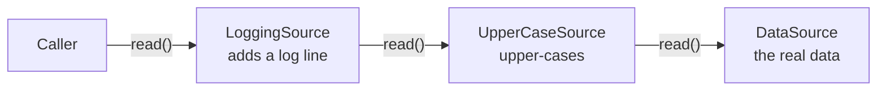

<!-- Written by `npm run lessons` from the lesson data in src/data. Edit the lesson there, not this page. -->

# Decorator

**System Design · Unit 6: Design patterns · Lesson 5 of 10 · Must know**

> **In one line.** Adds behaviour to an object by wrapping it in another object with the same interface, without changing the original class.

[Open this lesson on the site](https://learn.hamropedia.com/system-design/decorator/) for its animation, the practice game and tap-to-explain words.

## The problem it solves

You want to add extras like logging, caching or retries to some objects, in different combinations, without writing a subclass for every combination.

## The idea

Instead of a subclass for every combination (LoggedCachedRetryingClient and so on), you stack small wrappers: a retry wrapper around a cache wrapper around the real client. Each wrapper adds one feature and passes the call along.

## How it works, step by step

1. Start with an object that implements an interface: read().
2. Write a wrapper class that implements the same interface and holds another object of that interface.
3. In its read(), do the extra work (write a log line, check a cache), then call the inner object's read().
4. Wrap again for more features: Logging(Caching(Real())).
5. Callers can't tell they're talking to a wrapper; they just call read().

## Picture it



*Each wrapper adds one feature and passes the call inward. The caller only sees read().*

## Analogy

Wrapping a present in layers: paper, then ribbon, then a card. It's still the same present underneath, and you can add or skip any layer.

**Where the analogy breaks.** Gift layers don't affect each other. Code wrappers do, so the order matters: caching outside retries behaves differently from retries outside caching.

## Example

Java's file streams (a BufferedInputStream around a FileInputStream), and Python's @decorators for logging or timing functions.

## Must know

- Same interface as the wrapped object, so wrappers can stack.
- Avoids an explosion of subclasses for every feature combination.
- Follows open/closed: add features without editing classes.
- Python's @ syntax is a related idea for functions.

## In code

```python
class DataSource:
    def read(self): return "data"

class LoggingSource:
    def __init__(self, inner): self.inner = inner
    def read(self):
        print("reading…")
        return self.inner.read()

class UpperCaseSource:
    def __init__(self, inner): self.inner = inner
    def read(self):
        return self.inner.read().upper()

source = LoggingSource(UpperCaseSource(DataSource()))   # stack the features
source.read()       # prints "reading…", returns "DATA"
```

## Common mistakes

- Wrappers that change what the method means, rather than just adding to it.
- Wrapping in the wrong order (for example, caching errors).

> **Not true:** The order in which decorators are stacked never changes the result.  
> **In fact:** Order matters: with the cache in the wrong place, a failure is stored and served again and again. Choose the order on purpose.

## In the interview

Decorator wraps an object with another that has the same interface and adds one behaviour, like logging, caching or retries. Wrappers can be stacked in any combination, which avoids an explosion of subclasses.

<details>
<summary>&lt;b>Decorator or inheritance?&lt;/b></summary>

Inheritance fixes behaviour for a whole class when you write the code. Decorators add it to individual objects at runtime, and combine freely.

</details>

## Practise

Try each one yourself first, then open the answer and compare.

### 1. Explain

Explain Decorator with the present-wrapping picture.

<details>
<summary>Show one good answer</summary>

You wrap a present in layers: paper, then a ribbon, then a card. Each layer adds one thing; underneath it is still the same present, and you can add or leave out any layer, in any order.

A decorator does that to an object. Each decorator holds the object inside it, has the same methods (so it looks exactly like the thing it wraps), adds one feature, and passes the call on: a logging layer prints "reading…", an upper-case layer changes the result, a cache layer remembers it. You stack the features you need, LoggingSource(UpperCaseSource(DataSource())), instead of writing a subclass for every combination (LoggedUpperCaseCachedSource…). With three features, that is three small classes instead of seven combinations.

</details>

### 2. Draw

Draw the stack of wrappers around DataSource.

<details>
<summary>Show one good answer</summary>

The call goes down through each layer to the real source, and the result comes back up through them. Every layer has the same read() method as the thing it wraps, so any layer can wrap any other, and the caller can't tell how many layers there are.

```text
caller
  │ read()                        ▲ "DATA"
  ▼                               │
LoggingSource   prints "reading…" │
  │ inner.read()                  │ "DATA"
  ▼                               │
UpperCaseSource                   │ upper-cases
  │ inner.read()                  │ "data" → "DATA"
  ▼                               │
DataSource ───── returns "data" ──┘
```

</details>

### 3. Apply

Write a TimingDecorator and a RetryDecorator for an HTTP client class, and stack them in both orders. What changes?

<details>
<summary>Show one good answer</summary>

Both decorators have the same get() method as the client, so they stack either way. A fake clock and a client that fails twice make the results repeatable.

The order changes what is measured. Timing outside retry measures the whole call, retries included: one entry of 0.3 s, which is what the user waited. Retry outside timing measures each attempt separately: three entries of 0.1 s, which tells you how fast the server is but hides that the user waited three times as long. Neither is wrong; they answer different questions, so choose the order on purpose (or keep both).

```python
class Clock:                                     # a fake clock, so the times are repeatable
    def __init__(self):
        self.now = 0.0


class FlakyClient:
    """Times out twice, then works. Each call takes 0.1 s on the fake clock."""

    def __init__(self, clock):
        self.clock, self.calls = clock, 0

    def get(self, url):
        self.calls += 1
        self.clock.now += 0.1
        if self.calls <= 2:
            raise TimeoutError(url)
        return f"200 OK {url}"


class TimingDecorator:
    def __init__(self, inner, clock, log):
        self.inner, self.clock, self.log = inner, clock, log

    def get(self, url):
        start = self.clock.now
        try:
            return self.inner.get(url)
        finally:
            self.log.append(f"took {self.clock.now - start:.1f} s")


class RetryDecorator:
    def __init__(self, inner, attempts=3):
        self.inner, self.attempts = inner, attempts

    def get(self, url):
        for attempt in range(1, self.attempts + 1):
            try:
                return self.inner.get(url)
            except TimeoutError:
                if attempt == self.attempts:
                    raise


for order in ("timing outside retry", "retry outside timing"):
    clock, log = Clock(), []
    client = FlakyClient(clock)
    if order == "timing outside retry":
        stack = TimingDecorator(RetryDecorator(client), clock, log)
    else:
        stack = RetryDecorator(TimingDecorator(client, clock, log))
    print(order, "|", stack.get("/orders"), "|", log)
# timing outside retry | 200 OK /orders | ['took 0.3 s']
# retry outside timing | 200 OK /orders | ['took 0.1 s', 'took 0.1 s', 'took 0.1 s']
```

</details>

### 4. Trade-offs

When do many layers of decorators make debugging hard?

<details>
<summary>Show one good answer</summary>

• The stack is invisible where it is used: the caller just sees "a client". What it actually does depends on how many layers were wrapped around it, in what order, somewhere else (often in start-up code).  
• Order changes behaviour, silently: retry inside a cache behaves differently from cache inside retry, and timing inside or outside retry measures different things.  
• Layers change things on the way through: a retry layer hides the first two failures, a cache returns old data, an error-handling layer turns an exception into a default. When the result is wrong, you have to work out which layer produced it.  
• Stack traces get deep, full of near-identical wrapper frames.  
• Duplicated layers multiply: a retry around a client that already retries means 3 × 3 = 9 attempts.  
• Identity is lost: isinstance checks and attribute access stop working on the wrapped object.

Keep the stack short, build it in one obvious place, give each layer a clear name, and have each log what it did.

</details>

## Go further (optional)

- READ · [Decorator pattern](https://refactoring.guru/design-patterns/decorator) · Refactoring.Guru, free
- READ · [Primer on Python Decorators](https://www.google.com/search?q=Real+Python+primer+on+Python+decorators) · Real Python

---

[← Adapter](adapter.md) · [All lessons](../../README.md) · [Facade →](facade.md)
