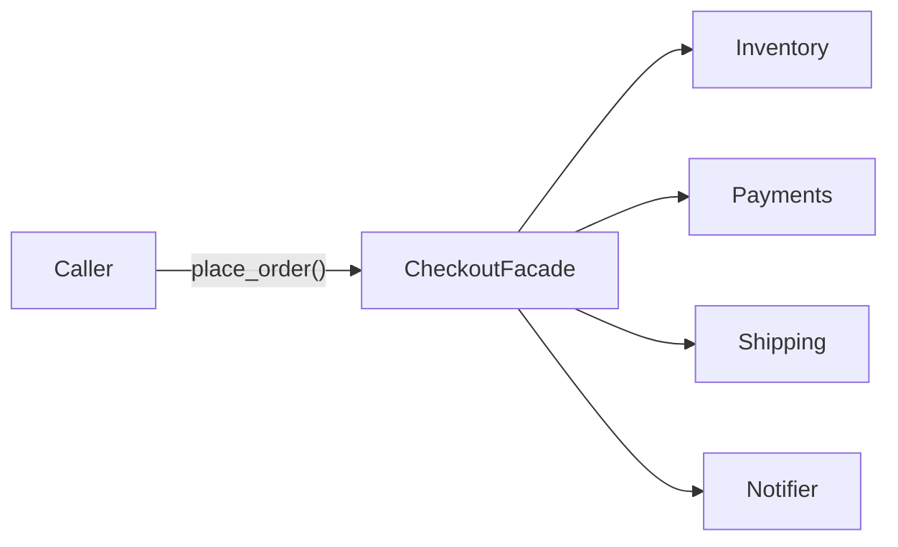

<!-- Written by `npm run lessons` from the lesson data in src/data. Edit the lesson there, not this page. -->

# Facade

**System Design · Unit 6: Design patterns · Lesson 6 of 10 · Should know**

> **In one line.** Gives one simple interface to a complicated set of classes.

[Open this lesson on the site](https://learn.hamropedia.com/system-design/facade/) for its animation, the practice game and tap-to-explain words.

## The problem it solves

Using a complex subsystem directly means every caller must know many classes and the right order to call them, and that knowledge gets copied everywhere.

## The idea

Placing an order may involve inventory, payment, shipping and notification classes. A CheckoutFacade with one place_order() method hides those steps, so callers use one method.

## How it works, step by step

1. Identify the task callers keep repeating: placing an order.
2. Create a facade class that holds the subsystem objects.
3. Give it one method per common task, which calls the subsystem pieces in the right order.
4. Callers use the facade; advanced callers can still use the subsystem directly.

## Picture it



*One simple call from the caller; the facade deals with the four subsystems in the right order.*

## Analogy

A hotel concierge: you ask for 'dinner and a taxi at 8', and they deal with the restaurant and the taxi company.

**Where the analogy breaks.** A concierge knows everything. A facade that keeps growing becomes a 'god class' that does too much, so keep it thin and let it delegate to the subsystems.

## Example

A video-conversion library: convert(file, 'mp4') hides the codecs, buffers and audio mixing.

## Must know

- Simplifies a subsystem; the subsystem stays available for advanced use.
- Reduces coupling between callers and many classes.
- Keep it thin: coordination, not business logic.

## In code

```python
class CheckoutFacade:
    def __init__(self, inventory, payments, shipping, notifier):
        self.inventory, self.payments = inventory, payments
        self.shipping, self.notifier = shipping, notifier

    def place_order(self, order):
        self.inventory.reserve(order.items)
        self.payments.charge(order.customer, order.total)
        self.shipping.schedule(order)
        self.notifier.send(order.customer, "Order confirmed")
```

## Common mistakes

- Putting business rules into the facade.
- Forcing every caller through the facade even when they need fine control.

> **Not true:** A facade adds new features to the subsystem it wraps.  
> **In fact:** A facade adds no features. It offers a simpler way in to what the subsystem already does.

## In the interview

Facade gives callers one simple method, like place_order(), over a complex subsystem of inventory, payment and shipping classes, which reduces coupling. I keep it thin so it doesn't become a god class.

<details>
<summary>&lt;b>Facade or API gateway?&lt;/b></summary>

The same idea at different levels: a facade simplifies classes inside one program; an API gateway simplifies many services for outside clients.

</details>

## Practise

Try each one yourself first, then open the answer and compare.

### 1. Explain

Explain Facade with the concierge picture.

<details>
<summary>Show one good answer</summary>

A hotel concierge. You say "dinner for two at 8, and a taxi there". You don't phone the restaurant, check the menu, book the table, then call the taxi firm and give the address. The concierge does all of that, in the right order, and you deal with one person.

A facade is the concierge for a set of classes. Placing an order involves inventory, payments, shipping and notifications, each with its own methods and its own order of calls. A CheckoutFacade offers one method, place_order(order), which makes those calls in the right sequence. Callers get a simple front door; the subsystems stay as they are, and anyone with an unusual need can still talk to them directly, the way you could still phone the restaurant yourself.

</details>

### 2. Draw

Draw the facade and the four subsystems it calls.

<details>
<summary>Show one good answer</summary>

The facade only coordinates: it calls each subsystem in the right order and holds no business rules of its own. The subsystems don't know the facade exists, and callers can still use them directly for anything unusual.

```text
Caller
  │ place_order(order)
  ▼
CheckoutFacade
  │ 1. reserve(items) ────────────► Inventory
  │ 2. charge(customer, total) ───► Payments
  │ 3. schedule(order) ───────────► Shipping
  │ 4. send(customer, "confirmed") ► Notifier
```

</details>

### 3. Apply

Write a HomeTheaterFacade with watch_movie() that switches on the projector, amplifier and player in the right order.

<details>
<summary>Show one good answer</summary>

The facade switches things on in the order that matters: the projector and its input first, then the amplifier at a sensible volume, and the player last, so the film doesn't start before there is a picture and sound. end_movie() switches off in the reverse order. Anyone using the facade needs one call, not six.

```python
class Projector:
    def on(self): return "projector on"
    def input(self, source): return f"projector input: {source}"
    def off(self): return "projector off"


class Amplifier:
    def on(self): return "amplifier on"
    def volume(self, level): return f"volume {level}"
    def off(self): return "amplifier off"


class Player:
    def on(self): return "player on"
    def play(self, film): return f"playing {film}"
    def off(self): return "player off"


class HomeTheaterFacade:
    def __init__(self, projector, amplifier, player):
        self.projector, self.amplifier, self.player = projector, amplifier, player

    def watch_movie(self, film):
        return [
            self.projector.on(),
            self.projector.input("player"),
            self.amplifier.on(),
            self.amplifier.volume(5),
            self.player.on(),
            self.player.play(film),               # last: picture and sound are ready
        ]

    def end_movie(self):                          # the reverse order
        return [self.player.off(), self.amplifier.off(), self.projector.off()]


theater = HomeTheaterFacade(Projector(), Amplifier(), Player())
print(" → ".join(theater.watch_movie("Dune")))
# projector on → projector input: player → amplifier on → volume 5 → player on → playing Dune
print(" → ".join(theater.end_movie()))
# player off → amplifier off → projector off
```

</details>

### 4. Trade-offs

How do you stop a facade from turning into a god class?

<details>
<summary>Show one good answer</summary>

• Keep it thin: it coordinates calls in the right order and nothing more. Business rules ("orders over £1,000 need a fraud check") belong in the subsystems; if you find yourself writing ifs about the business in the facade, move them out.  
• One facade per task or use case, not one for the whole system. A CheckoutFacade and a ReturnsFacade stay small; an OrderSystemFacade grows forever.  
• Don't make it the only way in. Other code may use the subsystems directly for unusual needs, so the facade doesn't have to grow a method for every case.  
• Watch the method count and the number of dependencies: when it holds ten subsystems and twenty methods, split it.  
• Test the subsystems on their own, so the facade's tests only check the order of calls.

</details>

## Go further (optional)

- WATCH · [Facade pattern explained](https://www.youtube.com/results?search_query=Christopher+Okhravi+Facade+pattern) · Christopher Okhravi · free on YouTube
- READ · [Facade pattern](https://refactoring.guru/design-patterns/facade) · Refactoring.Guru, free

---

[← Decorator](decorator.md) · [All lessons](../../README.md) · [Strategy →](strategy.md)
