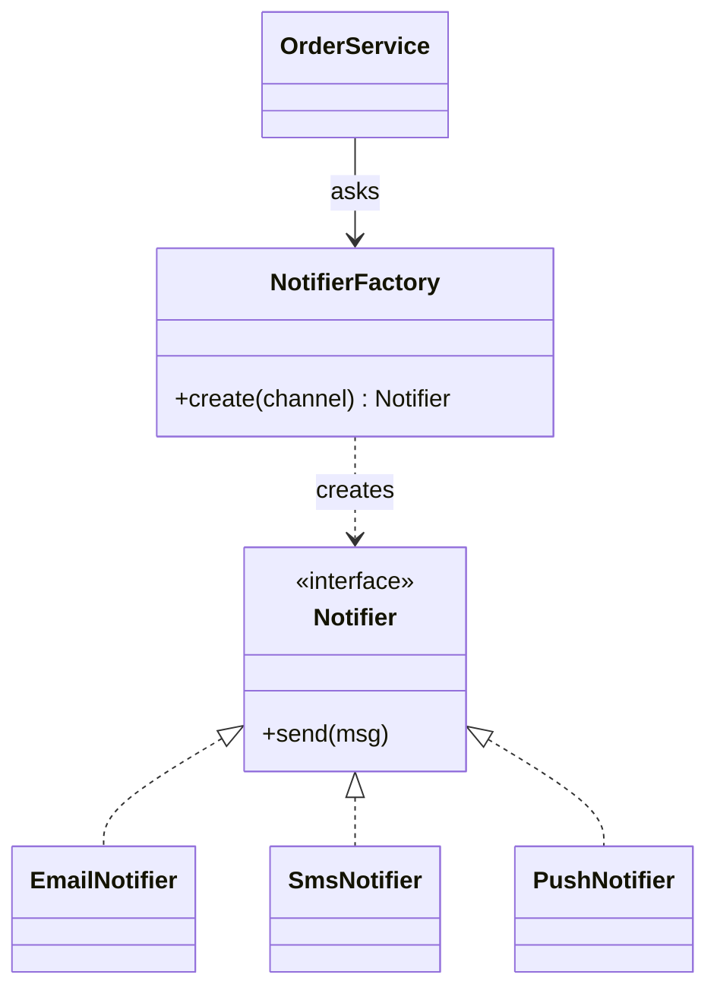

<!-- Written by `npm run lessons` from the lesson data in src/data. Edit the lesson there, not this page. -->

# Factory: Factory Method and Abstract Factory

**System Design · Unit 6: Design patterns · Lesson 2 of 10 · Must know**

> **In one line.** A factory creates objects for you, so the calling code asks for 'a notifier' without knowing which concrete class gets built.

[Open this lesson on the site](https://learn.hamropedia.com/system-design/factory-factory-method-and-abstract-factory/) for its animation, the practice game and tap-to-explain words.

## The problem it solves

If the code that uses an object also decides which concrete class to create, every new type means editing that code in many places.

## The idea

Factory Method: one method decides which class to create. Abstract Factory: creates whole families of related objects that must match, such as all dark-theme or all light-theme UI parts. Both keep 'new ConcreteClass()' in one place.

## How it works, step by step

1. Define a common interface: Notifier with send(message).
2. Implement it in EmailNotifier, SmsNotifier and PushNotifier.
3. Put the 'which class?' decision in one factory, using a dictionary from name to class.
4. Callers ask the factory for 'sms' and use the result only through the interface.
5. Adding a WhatsAppNotifier means one new class and one new dictionary entry.

## Picture it



*The order service asks the factory for a notifier and only ever sees the Notifier interface. Only the factory knows the concrete classes.*

## Analogy

Ordering from a car factory: you ask for 'a family car', and the factory decides the exact model and parts.

**Where the analogy breaks.** A car factory has a fixed catalogue. If every new type means editing one big if/else inside the factory, you've just moved the problem. A registry of creators keeps it open for extension.

## Example

NotifierFactory.create('sms') returns an SmsNotifier, and the order service just calls notifier.send().

## Must know

- Use it when the exact class depends on input or configuration.
- Factory Method: one product, a method decides. Abstract Factory: families of related products.
- A registry dictionary avoids long if/else chains.
- The 'simple factory' (one create function) is the usual interview version.

## In code

```python
class EmailNotifier:
    def send(self, msg): return f"email: {msg}"

class SmsNotifier:
    def send(self, msg): return f"sms: {msg}"

class NotifierFactory:
    _registry = {"email": EmailNotifier, "sms": SmsNotifier}

    @classmethod
    def create(cls, channel):
        return cls._registry[channel]()    # callers never name a concrete class

NotifierFactory.create("sms").send("Your order has shipped")
```

## Common mistakes

- A factory that's just a giant if/else edited for every new type.
- Factories for objects that only ever have one type.

> **Not true:** A factory written as one long if/else is easy to extend with new types.  
> **In fact:** Every new type then means editing that same if/else. A registry (a dictionary from a name to a class) lets a new type be added without touching the factory.

## In the interview

A factory centralises object creation: callers ask for a type by name or configuration and get an object behind a common interface, so adding a new type doesn't change the calling code. Abstract Factory extends this to whole families of matching objects.

<details>
<summary>&lt;b>Factory or Builder?&lt;/b></summary>

A factory picks which class to create, in one step. A builder assembles one complex object step by step.

</details>

## Practise

Try each one yourself first, then open the answer and compare.

### 1. Explain

Explain Factory Method and Abstract Factory with one example each.

<details>
<summary>Show one good answer</summary>

Both put the decision "which concrete class do I create?" in one place, so the rest of the code never names a concrete class.

Factory Method: a single method creates one product and decides which class it is. NotifierFactory.create("sms") returns an SmsNotifier; the order service only knows it got "a notifier" and calls send(). Adding a channel changes the factory, not the callers.

Abstract Factory: an object that creates a whole family of related products that must match. A UI has a DarkThemeFactory that makes a dark button, a dark checkbox and a dark menu, and a LightThemeFactory that makes the light versions. The screen asks its factory for parts, so it can never mix a dark button with a light checkbox. Switching theme means switching one factory.

</details>

### 2. Draw

Draw NotifierFactory, the Notifier interface and three notifiers.

<details>
<summary>Show one good answer</summary>

The caller talks to the factory and to the Notifier interface only. The factory's registry maps a channel name to a class; each notifier implements the same send() method, so whichever one comes back is used the same way.

```text
OrderService ── create("sms") ──► NotifierFactory
     │                             - _registry:
     │                               "email" → EmailNotifier
     │                               "sms"   → SmsNotifier
     │                               "push"  → PushNotifier
     │                             + create(channel): Notifier
     │ uses
     ▼
«interface» Notifier
 + send(msg)
   △            △             △
   ┊            ┊             ┊
EmailNotifier  SmsNotifier  PushNotifier
```

</details>

### 3. Apply

Add a 'push' notifier without changing the logic inside create().

<details>
<summary>Show one good answer</summary>

create() is exactly the lesson's one line. The factory gains a register() method, used as a decorator, so a new notifier registers itself where it is defined. Adding "push" touches no existing code: one new class, marked with the channel name.

```python
class EmailNotifier:
    def send(self, msg): return f"email: {msg}"


class SmsNotifier:
    def send(self, msg): return f"sms: {msg}"


class NotifierFactory:
    _registry = {"email": EmailNotifier, "sms": SmsNotifier}

    @classmethod
    def register(cls, channel):
        def add(notifier_class):
            cls._registry[channel] = notifier_class
            return notifier_class
        return add

    @classmethod
    def create(cls, channel):
        return cls._registry[channel]()          # unchanged


@NotifierFactory.register("push")                # the new notifier registers itself
class PushNotifier:
    def send(self, msg): return f"push: {msg}"


print(NotifierFactory.create("push").send("Your order has shipped"))   # push: Your order has shipped
print(NotifierFactory.create("sms").send("Code 4821"))                 # sms: Code 4821
```

</details>

### 4. Trade-offs

When is a factory just unnecessary indirection?

<details>
<summary>Show one good answer</summary>

• There is only one concrete class, and no real prospect of another: just call its constructor.  
• The caller already knows exactly which class it needs: a factory that takes "email" and returns EmailNotifier() adds a lookup and a file for no gain.  
• Construction is trivial: a factory that only wraps a constructor is a layer to read through, not a design.  
• In Python, a class is already a factory: you can pass the class itself (or a function) to whoever needs to create objects, without a Factory class around it.

A factory earns its place when the choice depends on something only known at runtime (configuration, user input, the country), when creating the object is complicated (several steps, dependencies to wire), or when a family of objects must match (Abstract Factory).

</details>

## Go further (optional)

- READ · [Factory pattern](https://refactoring.guru/design-patterns/factory-method) · Refactoring.Guru, free
- READ · [Abstract Factory pattern](https://refactoring.guru/design-patterns/abstract-factory) · Refactoring.Guru, free

---

[← Singleton](singleton.md) · [All lessons](../../README.md) · [Builder →](builder.md)
