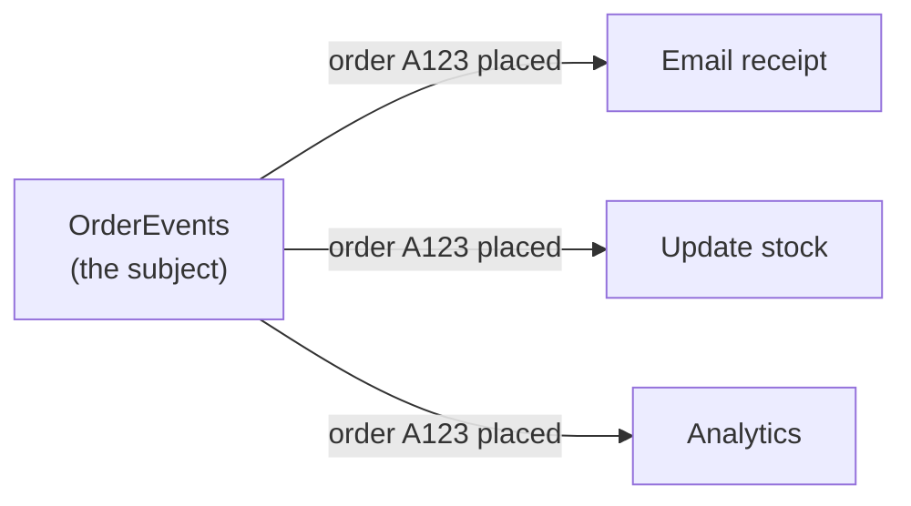

<!-- Written by `npm run lessons` from the lesson data in src/data. Edit the lesson there, not this page. -->

# Observer

**System Design · Unit 6: Design patterns · Lesson 8 of 10 · Must know**

> **In one line.** Lets objects subscribe to another object's events, and get notified automatically when something happens.

[Open this lesson on the site](https://learn.hamropedia.com/system-design/observer/) for its animation, the practice game and tap-to-explain words.

## The problem it solves

When one event must trigger several reactions, the code that raises the event ends up calling every reacting component directly, so adding a new reaction means editing it.

## The idea

When an order is placed, email, analytics and stock might all need to react. Instead of the order code calling each one, they subscribe; the order publishes 'order placed', and every subscriber is notified. It's the in-program version of publish/subscribe.

## How it works, step by step

1. The subject keeps a list of subscribers.
2. Components that care call subscribe(callback).
3. When the event happens, the subject loops through the list and calls each callback with the event's details.
4. New reactions subscribe themselves; the subject never changes.
5. Subscribers can unsubscribe when they no longer care.

## Picture it



*One event, many subscribers. The subject doesn't know what each subscriber does with it.*

## Analogy

Subscribing to a YouTube channel: when a new video is published, every subscriber is told, and the channel doesn't need to know who they are.

**Where the analogy breaks.** YouTube handles millions of subscribers reliably. A simple in-memory list of observers is lost if the program crashes, and one slow subscriber can slow the publisher. Across services, you'd use a message broker instead.

## Example

Button click listeners in user interfaces, stock-price updates, event systems.

## Must know

- Decouples the publisher from its listeners.
- Subscribers can be added and removed at runtime.
- Watch for memory leaks (forgotten subscribers) and slow or failing subscribers.
- At system level, the same idea becomes pub/sub with a message broker.

## In code

```python
class OrderEvents:
    def __init__(self):
        self._subscribers = []
    def subscribe(self, callback):
        self._subscribers.append(callback)
    def publish(self, order_id):
        for notify in self._subscribers:
            notify(order_id)

events = OrderEvents()
events.subscribe(lambda oid: print(f"email the receipt for {oid}"))
events.subscribe(lambda oid: print(f"update stock for {oid}"))
events.publish("A123")
```

## Common mistakes

- Never unsubscribing an observer: the subject keeps a reference to it, so it is never freed (a memory leak).
- Letting one subscriber's error stop the others from being notified.
- Relying on subscribers being called in a particular order.

> **Not true:** Observers are called in the order in which they subscribed, and code can rely on that.  
> **In fact:** The pattern promises no order, and a design that depends on one is fragile. If the order matters, make it explicit.

## In the interview

Observer lets listeners subscribe to an object's events, so the publisher notifies all of them without knowing who they are — like 'order placed' triggering an email and a stock update. Across services I'd use the same idea with a message broker, for durability.

<details>
<summary>&lt;b>Observer or pub/sub?&lt;/b></summary>

With Observer, subscribers register directly with the subject, usually inside one program. With pub/sub, a broker sits in between, so publishers and subscribers don't know each other, often across services.

</details>

## Practise

Try each one yourself first, then open the answer and compare.

### 1. Explain

Explain Observer with the YouTube-subscription picture.

<details>
<summary>Show one good answer</summary>

When you subscribe to a YouTube channel, the channel doesn't need to know who you are or what you'll do with the notification. When a new video is published, YouTube tells every subscriber. People can subscribe and unsubscribe at any time, and the channel keeps publishing the same way.

Observer is that pattern inside a program. The subject (OrderEvents) keeps a list of subscribers. When something happens ("order A123 placed"), it calls each of them. Email sends a receipt, stock is reduced, analytics records the sale, but the order code doesn't call those three things by name; it just publishes. Adding a fourth reaction means subscribing one more function, without touching the order code.

</details>

### 2. Draw

Draw the subject, its list of subscribers, and three observers.

<details>
<summary>Show one good answer</summary>

The subject only holds a list of things to call, so it never depends on email, stock or analytics code. New observers subscribe themselves; the publish loop doesn't change.

```text
  OrderEvents (the subject)
   - subscribers: [send_receipt, update_stock, record_sale]
   + subscribe(callback)
   + publish(order_id) ── calls each subscriber
          │
  ┌───────┼──────────────────┐
  ▼       ▼                  ▼
Email   Stock              Analytics
send    reduce the         record
receipt stock levels       the sale
```

</details>

### 3. Apply

Build a StockTicker that notifies subscribers only when a price changes by more than 1%.

<details>
<summary>Show one good answer</summary>

The ticker remembers, for each stock, the last price it told subscribers about, and stays quiet unless the new price is more than 1% away from it. Comparing with the last notified price (not the last price seen) means a slow drift still gets reported once it adds up to more than 1%.

From 100.0: 100.5 is a 0.5% move, so it is ignored; 101.2 is 1.2% above 100.0, so it is sent; 99.9 is 1.3% below 101.2; 98.8 is 1.1% below 99.9.

```python
class StockTicker:
    def __init__(self, threshold=0.01):
        self.threshold = threshold
        self.last_sent = {}                       # symbol -> last price subscribers were told
        self.subscribers = []

    def subscribe(self, callback):
        self.subscribers.append(callback)

    def update(self, symbol, price):
        last = self.last_sent.get(symbol)
        if last is not None and abs(price - last) / last <= self.threshold:
            return                                # 1% or less: stay quiet
        self.last_sent[symbol] = price
        for notify in self.subscribers:
            notify(symbol, price)


alerts = []
ticker = StockTicker()
ticker.subscribe(lambda symbol, price: alerts.append(f"{symbol} {price}"))
for price in [100.0, 100.5, 101.2, 99.9, 98.8]:
    ticker.update("ACME", price)
print(alerts)        # ['ACME 100.0', 'ACME 101.2', 'ACME 99.9', 'ACME 98.8']
```

</details>

### 4. Trade-offs

What happens if one subscriber throws an error or is very slow? How would you protect the publisher?

<details>
<summary>Show one good answer</summary>

In the simple loop, subscribers run one after another, inside publish():  
• One throws: the error comes back into the publisher, so placing an order can fail because analytics broke, and the subscribers after it in the list are never called.  
• One is slow: publish() waits for it, so the order request waits, and everything after it is delayed.

Protecting the publisher:  
• Wrap each call in try/except, log the error, and carry on with the next subscriber.  
• Run subscribers asynchronously, on a thread pool or a queue, with a timeout, so publish() returns straight away.  
• Across services, use a real message queue (publish/subscribe): each subscriber gets its own queue, with its own retries and a dead-letter queue, and a broken subscriber can't affect the publisher or the others.  
• Decide what must not be an observer: if the order can't be placed without reserving stock, that is part of the main flow, not a fire-and-forget notification.

</details>

## Go further (optional)

- WATCH · [Observer pattern explained](https://www.youtube.com/results?search_query=Christopher+Okhravi+Observer+pattern) · Christopher Okhravi · free on YouTube
- READ · [Observer pattern](https://refactoring.guru/design-patterns/observer) · Refactoring.Guru, free

---

[← Strategy](strategy.md) · [All lessons](../../README.md) · [Chain of Responsibility →](chain-of-responsibility.md)
