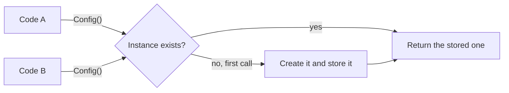

<!-- Written by `npm run lessons` from the lesson data in src/data. Edit the lesson there, not this page. -->

# Singleton

**System Design · Unit 6: Design patterns · Lesson 1 of 10 · Must know**

> **In one line.** Makes sure a class has only one instance, and gives one global way to reach it.

[Open this lesson on the site](https://learn.hamropedia.com/system-design/singleton/) for its animation, the practice game and tap-to-explain words.

## The problem it solves

Some things should exist exactly once per program, like one configuration or one connection pool. Creating several wastes resources or causes conflicting settings.

## The idea

Used for a shared resource like a configuration object or a connection pool. The class controls its own creation. Downsides: it's global state, hides dependencies, makes testing harder, and needs care with threads.

## How it works, step by step

1. The class keeps a hidden class-level variable for its single instance.
2. When asked for an instance, it checks that variable. If it's empty, it creates the instance and stores it.
3. With threads, two could check at the same moment, so creation is wrapped in a lock (and the variable is checked again inside the lock).
4. Every later request returns the stored instance.

## Picture it



*Whoever asks, and however often, they all get the same single object.*

## Analogy

A country has one official government, and everyone refers to the same one.

**Where the analogy breaks.** You can't replace a country's government in a test, but code should be replaceable. Many teams prefer creating one instance at start-up and injecting it, which gives 'only one' without the global.

## Example

A logging configuration, or a database connection pool created once per process.

## Must know

- Use it for a truly single, shared resource.
- Make creation thread-safe (double-checked locking), or create the instance eagerly.
- In Python, a module is already a natural singleton.
- Often criticised as global state; prefer injecting one shared instance.

## In code

```python
import threading

class Config:
    _instance = None
    _lock = threading.Lock()

    def __new__(cls):
        if cls._instance is None:
            with cls._lock:                 # thread-safe creation
                if cls._instance is None:
                    cls._instance = super().__new__(cls)
                    cls._instance.settings = {}
        return cls._instance

Config() is Config()        # True: always the same object
```

## Common mistakes

- Using Singleton for things that aren't truly single, like 'the current user'.
- Hidden dependencies: code reaches for the global instead of receiving what it needs.

> **Not true:** Singleton is a good fit for anything used all over the code, such as the current user.  
> **In fact:** Many users can be active at the same moment, so 'the current user' is not truly single. Keep Singleton for one shared resource, and pass everything else in.

## In the interview

Singleton guarantees one instance with one access point, for things like configuration or a connection pool. I'd make creation thread-safe, but I usually prefer creating one instance at start-up and injecting it, because a global singleton hides dependencies and makes testing harder.

<details>
<summary>&lt;b>Why is Singleton sometimes called an anti-pattern?&lt;/b></summary>

It's global, changeable state: hidden dependencies, hard to replace in tests, and tricky lifetimes.

</details>

## Practise

Try each one yourself first, then open the answer and compare.

### 1. Explain

Explain Singleton and its main criticism.

<details>
<summary>Show one good answer</summary>

A Singleton is a class that makes sure only one instance of itself ever exists in the program, and gives everyone the same one: the class controls its own creation, and asking for "a new one" returns the existing one. It is used for something there should genuinely be one of, such as the app's configuration or a database connection pool.

The main criticism: it is global state in disguise. Any code can reach for Config() from anywhere, so:  
• dependencies are hidden: you can't tell from a class's constructor that it secretly uses the config or the database;  
• testing is hard: the one instance carries state from one test to the next, and you can't easily hand a test a fake version;  
• "there will only ever be one" often turns out to be false (a second database, a per-tenant config), and then every caller has to change;  
• creating it safely from several threads needs care.

</details>

### 2. Draw

Draw its class diagram: the stored instance and the method that returns it.

<details>
<summary>Show one good answer</summary>

The instance is stored on the class itself (a class-level field, shown underlined in UML), not on any object. The creation method checks it first: if it is empty, it creates the instance (inside a lock), and either way it returns the stored one.

```text
┌───────────────────────────────────┐
│ Config                            │
├───────────────────────────────────┤
│ - _instance: Config = None        │ ← the one stored
│ - _lock: Lock                     │   instance (class-level)
│ - settings: dict                  │
├───────────────────────────────────┤
│ + __new__(): Config               │ ← returns _instance,
│   (or get_instance() in Java)     │   creating it only the
└───────────────────────────────────┘   first time
          ▲         ▲         ▲
       Config()  Config()  Config()
      every caller gets the same object
```

</details>

### 3. Apply

Implement the thread-safe Singleton below and prove with 10 threads that only one instance is ever created.

<details>
<summary>Show one good answer</summary>

A barrier releases all 10 threads at the same moment, and a short sleep inside creation widens the window where a race could happen. The safe version is created exactly once and all 10 threads get the same object.

The check-lock-check-again ("double-checked locking") matters: the first check skips the lock once the instance exists (fast), and the second check, inside the lock, stops a thread that was waiting from creating a second one. Without the lock, the same test creates several instances.

```python
import threading
import time


class Config:
    _instance = None
    _lock = threading.Lock()
    created = 0

    def __new__(cls):
        if cls._instance is None:
            with cls._lock:                       # one thread at a time past here
                if cls._instance is None:         # check again: another thread may have won
                    time.sleep(0.01)              # slow creation makes a race likely
                    cls._instance = super().__new__(cls)
                    cls._instance.settings = {}
                    cls.created += 1
        return cls._instance


class UnsafeConfig:                               # the same, without the lock
    _instance = None
    created = 0

    def __new__(cls):
        if cls._instance is None:
            time.sleep(0.01)
            cls._instance = super().__new__(cls)
            cls.created += 1
        return cls._instance


def ten_threads(cls):
    start = threading.Barrier(10)                 # release all 10 at the same moment
    got = []

    def grab():
        start.wait()
        got.append(cls())

    threads = [threading.Thread(target=grab) for _ in range(10)]
    for t in threads:
        t.start()
    for t in threads:
        t.join()
    return cls.created, len({id(obj) for obj in got})


print(ten_threads(Config))                        # (1, 1): created once, one shared object
print(ten_threads(UnsafeConfig)[0] > 1)           # True: without the lock, several were created
```

</details>

### 4. Trade-offs

Singleton or injecting one shared instance: compare testing and flexibility.

<details>
<summary>Show one good answer</summary>

Both give the program one shared instance. The difference is who decides that, and how other code gets hold of it.

Singleton: the class enforces "only one", and code fetches it from anywhere with Config().  
• Testing: the instance is global, so state leaks between tests, and swapping in a fake means monkey-patching the class.  
• Flexibility: "exactly one" is baked in; needing two later (a second database, one config per customer) means changing every caller.  
• Hidden dependencies: you can't see from a constructor what a class really uses.  
• Convenience: no wiring at all.

Injecting one shared instance: create one Config at start-up (in main) and pass it into the classes that need it.  
• Testing: each test passes its own fresh or fake instance. Nothing leaks.  
• Flexibility: making two is just calling the constructor twice.  
• Dependencies are visible in every constructor.  
• Cost: a little wiring code.

In most designs, injection is better: you get "one instance" by choice at start-up, without the downsides of the pattern.

</details>

## Go further (optional)

- WATCH · [Singleton pattern explained](https://www.youtube.com/results?search_query=Christopher+Okhravi+Singleton+pattern) · Christopher Okhravi · free on YouTube
- READ · [Singleton pattern](https://refactoring.guru/design-patterns/singleton) · Refactoring.Guru, free

---

[← Concurrency basics: threads, locks and race conditions](../unit-5-oop-solid/concurrency-basics-threads-locks-and-race-conditions.md) · [All lessons](../../README.md) · [Factory: Factory Method and Abstract Factory →](factory-factory-method-and-abstract-factory.md)
