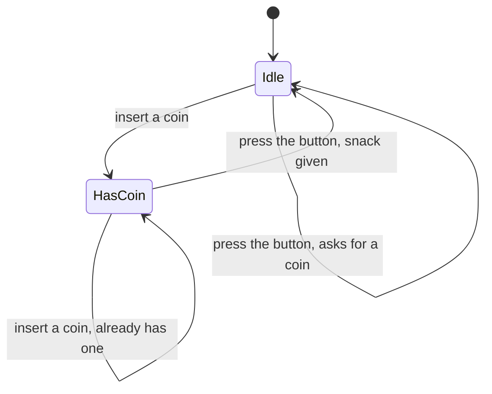

<!-- Written by `npm run lessons` from the lesson data in src/data. Edit the lesson there, not this page. -->

# State

**System Design · Unit 6: Design patterns · Lesson 10 of 10 · Should know**

> **In one line.** Lets an object change its behaviour when its internal state changes, by putting each state's behaviour in its own class.

[Open this lesson on the site](https://learn.hamropedia.com/system-design/state/) for its animation, the practice game and tap-to-explain words.

## The problem it solves

Objects with modes (an order that's paid or shipped, a machine that's idle or dispensing) often end up with if/else on a status field in every method, and invalid actions slip through.

## The idea

A vending machine reacts differently to 'insert coin' when it's idle, when it already has money, or when it's sold out. Instead of an if/elif on a status variable inside every method, each state is a class that handles the events and decides the next state.

## How it works, step by step

1. Draw the state diagram: states as circles, events as arrows between them.
2. Create one class per state, with one method per event.
3. Each method does what's valid in that state, and may move the object to a new state.
4. The main object holds its current state and forwards every event to it.
5. An event that isn't valid in a state returns a clear 'not allowed' instead of doing something wrong.

## Picture it



*Circles are states; arrows are events. The same event (pressing the button) does different things depending on the current state.*

## Analogy

A traffic light: what happens on the next tick depends on whether it's red, amber or green, and each colour knows which comes next.

**Where the analogy breaks.** A traffic light has three simple states. Real systems can have many states and transitions, so draw the state diagram first, or the classes become hard to follow.

## Example

An order's life (created → paid → shipped → delivered, or cancelled), vending machines, elevators, network connections.

## Must know

- Each state class handles the events that are valid in that state.
- Transitions are explicit; invalid actions get a clear response.
- Start by drawing a state diagram: the states, and which event moves you from one to the next.
- A cousin of Strategy, but here the object changes its own behaviour.

## In code

```python
class Idle:
    def insert_coin(self, machine):
        machine.state = HasCoin()
        return "coin accepted"
    def press(self, machine):
        return "insert a coin first"

class HasCoin:
    def insert_coin(self, machine):
        return "already has a coin"
    def press(self, machine):
        machine.state = Idle()
        return "here is your snack"

class VendingMachine:
    def __init__(self): self.state = Idle()
    def insert_coin(self): return self.state.insert_coin(self)
    def press(self): return self.state.press(self)
```

## Common mistakes

- States that know too much about each other.
- Forgetting some events in some states (like cancel while dispensing).

> **Not true:** In the State pattern, one big if/else on a status string decides what each method does.  
> **In fact:** That is the code the pattern removes. Each state becomes its own class, and the object passes every event to its current state.

## In the interview

State moves each state's behaviour into its own class. A vending machine or an order then behaves correctly for its current state, and the transitions are explicit. It replaces an if/else on a status field in every method.

<details>
<summary>&lt;b>When is an enum and a switch enough?&lt;/b></summary>

When there are only a few states and events. The State pattern pays off as the states and rules grow.

</details>

## Practise

Try each one yourself first, then open the answer and compare.

### 1. Explain

Explain State with the traffic-light picture.

<details>
<summary>Show one good answer</summary>

A traffic light reacts to the same event, "tick", differently depending on its colour: red goes to red-and-amber, green goes to amber, amber goes to red. Each colour knows what comes after it. You don't need one big rule book that says "if red and tick, then…, if green and tick, then…"; the current colour decides.

The State pattern does this in code. An object (a vending machine) behaves differently in different situations (idle, has a coin, sold out). Instead of an if/elif on a status variable inside every method, each state is a class with a method for each event. The machine forwards each event to its current state object, and that state does the right thing and decides which state comes next. A new state is a new class, and each state's rules are in one place.

</details>

### 2. Draw

Draw the state diagram for an order: created, paid, shipped, delivered, cancelled, with the allowed transitions.

<details>
<summary>Show one good answer</summary>

Only the arrows shown are allowed; any other event in a state is refused with a clear message. An order can be cancelled before it ships (with a refund once paid); after shipping it is a return, not a cancellation. Delivered and cancelled are final.

```text
created ──pay──► paid ──ship──► shipped ──deliver──► delivered
   │               │
   │ cancel        │ cancel (refund the payment)
   ▼               ▼
cancelled ◄────────┘

Final states: delivered, cancelled
Refused, for example:
  ship   while created  (not paid yet)
  cancel while shipped  (use a return instead)
  pay    while cancelled
```

</details>

### 3. Apply

Extend the vending machine below with a SoldOut state and a refund action.

<details>
<summary>Show one good answer</summary>

Every state now handles three events: insert_coin, press and refund. HasCoin.press() sells the snack, reduces the stock and moves to SoldOut if it was the last one, otherwise back to Idle. SoldOut refuses coins (handing them back) and presses. HasCoin.refund() returns the coin. The machine itself contains no if statements about its status: it just forwards each event to its current state.

```python
class Idle:
    def insert_coin(self, machine):
        machine.state = HasCoin()
        return "coin accepted"

    def press(self, machine):
        return "insert a coin first"

    def refund(self, machine):
        return "no coin to return"


class HasCoin:
    def insert_coin(self, machine):
        return "already has a coin"

    def press(self, machine):
        machine.stock -= 1
        machine.state = SoldOut() if machine.stock == 0 else Idle()
        return "here is your snack"

    def refund(self, machine):
        machine.state = Idle()
        return "coin returned"


class SoldOut:
    def insert_coin(self, machine):
        return "sold out: coin returned"

    def press(self, machine):
        return "sold out"

    def refund(self, machine):
        return "no coin to return"


class VendingMachine:
    def __init__(self, stock):
        self.stock = stock
        self.state = Idle() if stock > 0 else SoldOut()

    def insert_coin(self): return self.state.insert_coin(self)
    def press(self): return self.state.press(self)
    def refund(self): return self.state.refund(self)


machine = VendingMachine(stock=1)
for event in ["insert_coin", "refund", "insert_coin", "press", "insert_coin", "press"]:
    print(event, "→", getattr(machine, event)())
# insert_coin → coin accepted
# refund → coin returned
# insert_coin → coin accepted
# press → here is your snack
# insert_coin → sold out: coin returned
# press → sold out
```

</details>

### 4. Trade-offs

State classes or a transition table (a dictionary of state → event → next state)?

<details>
<summary>Show one good answer</summary>

A transition table, a dictionary of state → event → next state (for example {"created": {"pay": "paid", "cancel": "cancelled"}, …}), is better when:  
• states mostly differ in which events are allowed and where they lead, not in what they do (an order's status, a ticket's workflow);  
• you want to see every transition at once, check it, draw it, or load it from configuration;  
• non-programmers need to read or change the rules.  
It is compact and data-driven, and any action can be looked up by name.

State classes are better when:  
• each state really behaves differently (handling money, timers, different data), with real logic per event;  
• the behaviour per state keeps growing, and you want each state's code in one place, easy to test alone.  
The cost: the transitions are spread across classes, so the overall picture is harder to see.

A common mix: a table for the allowed transitions, plus small functions or classes for the actions that run on each one.

</details>

## Go further (optional)

- WATCH · [State pattern explained](https://www.youtube.com/results?search_query=Christopher+Okhravi+State+pattern) · Christopher Okhravi · free on YouTube
- READ · [State pattern](https://refactoring.guru/design-patterns/state) · Refactoring.Guru, free

---

[← Chain of Responsibility](chain-of-responsibility.md) · [All lessons](../../README.md) · [Design a parking lot →](../unit-7-lld-practice/design-a-parking-lot.md)
