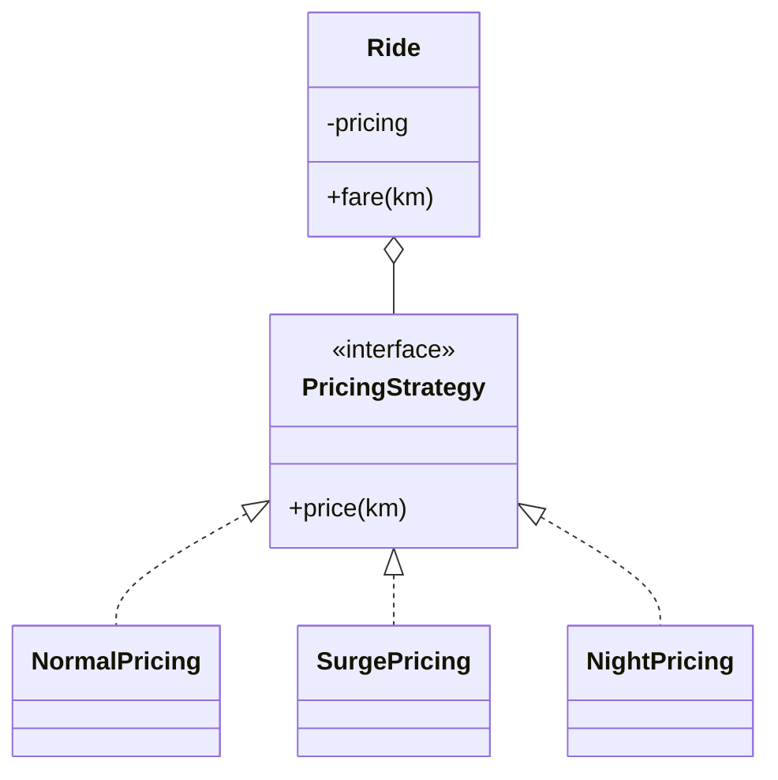

<!-- Written by `npm run lessons` from the lesson data in src/data. Edit the lesson there, not this page. -->

# Strategy

**System Design · Unit 6: Design patterns · Lesson 7 of 10 · Must know**

> **In one line.** Puts a family of interchangeable algorithms behind one interface, so you can choose one at runtime.

[Open this lesson on the site](https://learn.hamropedia.com/system-design/strategy/) for its animation, the practice game and tap-to-explain words.

## The problem it solves

When an algorithm can vary (pricing, sorting, routing), putting every variant in one method with if/else makes it long, hard to test and risky to extend.

## The idea

Instead of an if/elif on pricing type inside checkout, each pricing rule is its own class (or function) with the same method. Checkout holds one strategy and can swap it.

## How it works, step by step

1. Define the interface: price(distance_km).
2. Write one class per algorithm: NormalPricing, SurgePricing, NightPricing.
3. The context (Ride) holds one strategy object and calls it.
4. Choose the strategy at runtime: from configuration, a factory, or the time of day.

## Picture it



*Ride holds one pricing strategy and can swap it for any other that implements the same interface.*

## Analogy

Choosing a route in a maps app: fastest, shortest or avoiding tolls. Same journey, different strategy.

**Where the analogy breaks.** The maps app chooses for you when you tap a button. In code, something still has to decide which strategy to use, often a factory or configuration.

## Example

Payment fees, sorting, compression formats, and ride pricing (normal or surge).

## Must know

- Replaces 'which algorithm?' conditionals with polymorphism.
- A strategy can be swapped while the program runs, because the caller only knows the shared interface.
- In Python, plain functions can be strategies.
- Very common in LLD answers: pricing, payment, parking fees.

## In code

```python
class NormalPricing:
    def price(self, distance_km): return 2 + 1.2 * distance_km

class SurgePricing:
    def __init__(self, multiplier): self.multiplier = multiplier
    def price(self, distance_km): return (2 + 1.2 * distance_km) * self.multiplier

class Ride:
    def __init__(self, pricing): self.pricing = pricing    # a swappable strategy
    def fare(self, km): return round(self.pricing.price(km), 2)

Ride(NormalPricing()).fare(10)        # 14.0
Ride(SurgePricing(1.5)).fare(10)      # 21.0
```

## Common mistakes

- Strategies that need lots of the context's private data (a sign the interface is wrong).
- Creating strategy classes for one fixed algorithm.

> **Not true:** Every algorithm deserves its own strategy class, even when there will only ever be one.  
> **In fact:** With one fixed algorithm there is nothing to swap, so the pattern only adds classes. Use Strategy when several algorithms are interchangeable.

## In the interview

Strategy puts each interchangeable algorithm, like normal or surge pricing, behind one interface, so the class using it can switch algorithms at runtime, and new ones are added without editing it.

<details>
<summary>&lt;b>Strategy or State?&lt;/b></summary>

Both swap behaviour objects. With Strategy, the caller chooses the algorithm. With State, the object changes its own state as events happen.

</details>

## Practise

Try each one yourself first, then open the answer and compare.

### 1. Explain

Explain Strategy with the route-choice picture.

<details>
<summary>Show one good answer</summary>

In a maps app, the journey is the same, from home to the airport, but you choose how the route is worked out: fastest, shortest, or avoiding tolls. The app doesn't care which you pick; it asks the chosen option for a route and follows it. You can switch options without changing anything else.

Strategy is that idea in code. One job (working out a ride's price) has several interchangeable ways of being done (normal pricing, surge pricing). Each way is its own class (or function) with the same method, price(distance). The Ride holds one strategy and calls it, without knowing which one it has. Swapping the strategy changes the behaviour; adding a new one needs no change to Ride. It replaces an if/elif on "pricing type" in the middle of the business code.

</details>

### 2. Draw

Draw Ride with a PricingStrategy interface and two implementations.

<details>
<summary>Show one good answer</summary>

Ride holds one PricingStrategy and only ever calls price(). Each implementation is interchangeable. Night pricing is added as one more box at the bottom, without touching Ride.

```text
Ride
 - pricing: PricingStrategy  ◆──► «interface» PricingStrategy
 + fare(km)                         + price(distance_km)
                                      △          △           △
                                      ┊          ┊           ┊
                           NormalPricing   SurgePricing   NightPricing
                           2 + 1.2 × km    normal × 1.5   normal + £3
                                                          (added later)
```

</details>

### 3. Apply

Add a 'night pricing' strategy without changing Ride, and write tests for all three.

<details>
<summary>Show one good answer</summary>

NightPricing is one new class with the same price() method: here a flat £3 on top of the normal fare. Ride is not changed. Each strategy gets a test for a 10 km ride: normal £14.00, surge (× 1.5) £21.00, night £17.00, and one more test checks that strategies can be swapped on the same ride.

```python
class NormalPricing:
    def price(self, distance_km): return 2 + 1.2 * distance_km


class SurgePricing:
    def __init__(self, multiplier): self.multiplier = multiplier
    def price(self, distance_km): return (2 + 1.2 * distance_km) * self.multiplier


class NightPricing:                               # new: Ride is not changed
    def price(self, distance_km): return NormalPricing().price(distance_km) + 3


class Ride:
    def __init__(self, pricing): self.pricing = pricing
    def fare(self, km): return round(self.pricing.price(km), 2)


def test_normal():
    assert Ride(NormalPricing()).fare(10) == 14.0


def test_surge():
    assert Ride(SurgePricing(1.5)).fare(10) == 21.0


def test_night():
    assert Ride(NightPricing()).fare(10) == 17.0


def test_strategy_can_be_swapped():
    ride = Ride(NormalPricing())
    ride.pricing = NightPricing()
    assert ride.fare(10) == 17.0


for test in (test_normal, test_surge, test_night, test_strategy_can_be_swapped):
    test()
print("all 4 tests passed")                       # all 4 tests passed
```

</details>

### 4. Trade-offs

When is a simple if/else better than Strategy?

<details>
<summary>Show one good answer</summary>

• Two or three options that rarely change, each only a line or two: an if/else is shorter and easier to read than an interface and three classes.  
• The choice is used in one place only, so nothing else would reuse the strategies.  
• The behaviour never needs to be swapped at runtime, configured, or tested separately.  
• It is really data, not behaviour: if the options only differ in numbers (a rate per km), a table of numbers is enough.

In Python there is also a lighter middle ground: functions are already strategies. Pass a function, or keep a dictionary from name to function, without writing classes.

Move to Strategy when the options multiply, when each grows its own logic, when other teams add options, or when you want to test each option on its own.

</details>

## Go further (optional)

- WATCH · [Strategy pattern explained](https://www.youtube.com/results?search_query=Christopher+Okhravi+Strategy+pattern) · Christopher Okhravi · free on YouTube
- READ · [Strategy pattern](https://refactoring.guru/design-patterns/strategy) · Refactoring.Guru, free

---

[← Facade](facade.md) · [All lessons](../../README.md) · [Observer →](observer.md)
