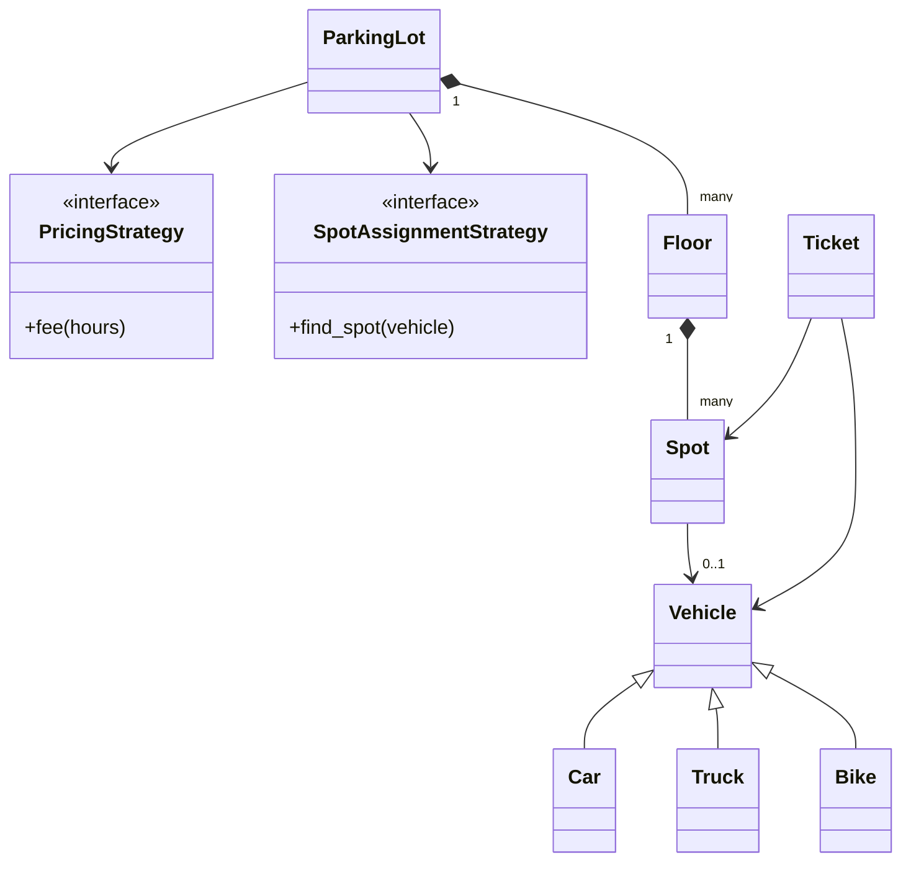

<!-- Written by `npm run lessons` from the lesson data in src/data. Edit the lesson there, not this page. -->

# Design a parking lot

**System Design · Unit 7: Low-level design questions · Lesson 1 of 6 · Must know**

> **In one line.** Design the classes for a multi-floor car park that assigns spots, issues tickets and charges fees.

[Open this lesson on the site](https://learn.hamropedia.com/system-design/design-a-parking-lot/) for its animation, the practice game and tap-to-explain words.

## Why interviewers ask it

It's the classic first LLD question: the entities are clear, there are natural places for patterns (pricing, spot assignment), and there's a real concurrency problem.

## Functional requirements

- Several floors, with spots of different sizes (small, compact, large).
- Vehicles (bike, car, truck) park in a suitable free spot.
- Issue a ticket on entry; calculate the fee on exit; take payment.
- Show free spots per floor on display boards.

## Non-functional requirements

- Two vehicles must never get the same spot, even at different gates.
- Easy to add new vehicle types or pricing rules.

## Classes

- ParkingLot: floors and gates; finds and assigns spots.
- Floor: its spots, and free counts by size.
- Spot: id, size, current vehicle (or none).
- Vehicle (abstract) → Bike, Car, Truck: each says which spot size it needs.
- Ticket: id, vehicle, spot, entry time.
- SpotAssignmentStrategy: for example, nearest free spot first.
- PricingStrategy: hourly, weekend, and so on.
- Payment: amount, method, status.

## Patterns used

- Strategy (spot assignment, pricing)
- Factory (creating vehicles and spots)
- Observer (display boards)
- Singleton or one injected ParkingLot

## From version 1 to the final design

1. Version 1: one floor, one gate, one spot size, a flat fee. Classes: ParkingLot, Spot, Vehicle, Ticket.
2. Version 2: several spot sizes and vehicle types, a rule for which vehicle fits which spot, and pricing as a strategy.
3. Version 3: several floors and gates, with display boards observing the free counts.
4. Version 4: concurrency — claiming a spot atomically — and storing state in a database so gates on different servers agree.

## The design, step by step

1. Entry: a vehicle arrives → the assignment strategy finds a free spot that fits → the spot is marked taken in one atomic step → a ticket is issued.
2. Exit: scan the ticket → the pricing strategy works out the fee from the time parked → payment → the spot is freed.
3. Display boards subscribe to spot changes (Observer) and update their counts.

## Picture it



*The car park owns floors, floors own spots, and each spot holds at most one vehicle. Pricing and spot assignment are pluggable strategies.*

## Deep dives

- Concurrency: two gates assigning the same spot. Use a lock (per floor, or for the whole lot), or an atomic compare-and-set on the spot.
- Fit rules: can a bike use a car spot when bike spots are full? Decide, and say it out loud.
- Lost ticket: charge the maximum daily fee.
- Extensibility: electric-car charging spots become a new spot type with their own pricing strategy.

## In code

```python
from enum import Enum
from datetime import datetime
import threading, uuid

class Size(Enum):
    SMALL = 1
    COMPACT = 2
    LARGE = 3

class Vehicle:
    size = Size.COMPACT

class Car(Vehicle):
    size = Size.COMPACT

class Truck(Vehicle):
    size = Size.LARGE

class Spot:
    def __init__(self, spot_id, size):
        self.id, self.size, self.vehicle = spot_id, size, None

class Ticket:
    def __init__(self, vehicle, spot):
        self.id, self.vehicle, self.spot = uuid.uuid4().hex, vehicle, spot
        self.entry = datetime.now()

class ParkingLot:
    def __init__(self, spots, pricing):
        self.spots, self.pricing = spots, pricing
        self._lock = threading.Lock()

    def park(self, vehicle):
        with self._lock:                      # no two vehicles get the same spot
            spot = next((s for s in self.spots
                         if s.vehicle is None and s.size.value >= vehicle.size.value), None)
            if spot is None:
                raise RuntimeError("car park full")
            spot.vehicle = vehicle
        return Ticket(vehicle, spot)

    def leave(self, ticket):
        hours = (datetime.now() - ticket.entry).total_seconds() / 3600
        fee = self.pricing.fee(hours)
        ticket.spot.vehicle = None
        return fee
```

## Common mistakes

- Putting pricing logic inside Ticket or Vehicle.
- Ignoring two gates acting at the same moment.
- Vehicle subclasses that override lots of behaviour instead of just declaring their size.

> **Not true:** Pricing rules: kept inside the Ticket class.  
> **In fact:** Prices change often, and for many reasons. Keep them in a separate pricing strategy, so that a new tariff does not touch Ticket or Vehicle.

## In the interview

Core classes: ParkingLot, Floor, Spot, the Vehicle types, Ticket and Payment. Spot assignment and pricing are strategies, so the rules can change without touching the rest. Parking is one atomic step — a lock or a compare-and-set — so two gates can't take the same spot. Display boards observe spot changes.

<details>
<summary>&lt;b>How would this work with gates on different servers?&lt;/b></summary>

Keep spot state in a database and claim a spot with a conditional update (UPDATE … WHERE spot_id = ? AND vehicle_id IS NULL), trying another spot if no row changed.

</details>

<details>
<summary>&lt;b>How would you add electric-car charging?&lt;/b></summary>

A new spot type with a charger, plus a pricing strategy that adds the energy cost. No existing classes change.

</details>

## Practise

Try each one yourself first, then open the answer and compare.

### 1. Explain

Explain your class design in 2 minutes, naming the patterns you used.

<details>
<summary>Show one good answer</summary>

"A ParkingLot has several Floors, and each Floor has Spots of three sizes: small, compact and large. A Vehicle is abstract; Bike, Car and Truck each say which spot size they need. When a vehicle arrives, the lot asks a SpotAssignmentStrategy for a free spot that fits, for example the nearest one, marks it taken and issues a Ticket with the entry time. On exit, a PricingStrategy works out the fee from the time parked, a Payment is taken, and the spot is freed.

The patterns, and why: Strategy for spot assignment and for pricing, because those are the rules most likely to change (nearest-first, weekend rates, EV charging). A Factory creates vehicles and spots from input. Display boards are Observers of spot changes, so they update their free counts without the lot knowing about them. There is one ParkingLot, created at start-up and injected.

The key risk is concurrency: two gates assigning the same spot. Finding and taking a spot happens in one atomic step under a lock. To extend it, an EV charging spot is a new spot type with its own pricing strategy; nothing else changes."

</details>

### 2. Draw

Draw the class diagram with relationships and multiplicities.

<details>
<summary>Show one good answer</summary>

Composition (the filled diamond) marks parts that belong to one whole: a lot's floors, a floor's spots. A Spot holds at most one Vehicle, and a Ticket links one Vehicle to one Spot. The two strategies are interfaces the lot holds, so they can be swapped.

```text
ParkingLot
 + park(vehicle): Ticket
 + leave(ticket): fee
 - assigner: SpotAssignmentStrategy ──► «interface»
 - pricing:  PricingStrategy ──┐         + find_spot(floors, vehicle)
   │ 1                         │           △ NearestFirst
   ◆                           └──► «interface»
   │ 1..*                            + fee(hours)
 Floor                                 △ Hourly, Weekend
  + free_count(size)
   │ 1
   ◆
   │ 1..*
 Spot ── 0..1 ── Vehicle «abstract»
  id, size,       + size
  vehicle           △ Bike, Car, Truck
   ▲ 1
   │
 Ticket ── 1 ── Vehicle
  id, entry time

 Payment ── 1 ── Ticket (amount, method, status)
 DisplayBoard ┄┄ observes ┄┄► Floor
```

</details>

### 3. Apply

Complete the code with a PricingStrategy (first hour £2, then £1.50 per hour) and test parking 3 vehicles.

<details>
<summary>Show one good answer</summary>

The pricing strategy charges £2 for the first hour, then £1.50 for each extra hour or part of one, all in pence to keep money exact. A fake clock makes the fees testable without waiting hours.

Three vehicles park in three spots of the right size; a fourth gets "car park full". The bike leaves after 45 minutes and pays £2.00; the car leaves after two and a half hours (3 started hours) and pays £2 + 2 × £1.50 = £5.00. A new car then gets the compact spot the old car freed, not the bike's small spot.

```python
import math
import threading
import uuid
from enum import Enum


class Size(Enum):
    SMALL = 1
    COMPACT = 2
    LARGE = 3


class Vehicle:
    size = Size.COMPACT


class Bike(Vehicle):
    size = Size.SMALL


class Car(Vehicle):
    size = Size.COMPACT


class Truck(Vehicle):
    size = Size.LARGE


class Spot:
    def __init__(self, spot_id, size):
        self.id, self.size, self.vehicle = spot_id, size, None


class Ticket:
    def __init__(self, vehicle, spot, entry):
        self.id, self.vehicle, self.spot, self.entry = uuid.uuid4().hex, vehicle, spot, entry


class PricingStrategy:
    def fee_pence(self, hours):
        raise NotImplementedError


class HourlyPricing(PricingStrategy):
    """£2 for the first hour, then £1.50 for each extra hour or part of one."""

    def fee_pence(self, hours):
        started_hours = max(1, math.ceil(hours))
        return 200 + 150 * (started_hours - 1)


class ParkingLot:
    def __init__(self, spots, pricing, clock):
        self.spots, self.pricing, self.clock = spots, pricing, clock
        self._lock = threading.Lock()

    def park(self, vehicle):
        with self._lock:                         # find and take a spot in one step
            spot = next((s for s in self.spots
                         if s.vehicle is None and s.size.value >= vehicle.size.value), None)
            if spot is None:
                raise RuntimeError("car park full")
            spot.vehicle = vehicle
        return Ticket(vehicle, spot, self.clock())

    def leave(self, ticket):
        hours = (self.clock() - ticket.entry) / 3600
        fee = self.pricing.fee_pence(hours)
        with self._lock:
            ticket.spot.vehicle = None
        return fee


now = [0]                                        # a fake clock, in seconds
lot = ParkingLot([Spot("S1", Size.SMALL), Spot("C1", Size.COMPACT), Spot("L1", Size.LARGE)],
                 HourlyPricing(), clock=lambda: now[0])

tickets = [lot.park(vehicle) for vehicle in (Bike(), Car(), Truck())]
print([t.spot.id for t in tickets])              # ['S1', 'C1', 'L1']

try:
    lot.park(Car())
except RuntimeError as error:
    print(error)                                 # car park full

now[0] = 45 * 60                                 # 45 minutes after entry
print(lot.leave(tickets[0]))                     # 200: the first hour
now[0] = int(2.5 * 3600)                         # 2.5 hours after entry
print(lot.leave(tickets[1]))                     # 500: £2 + 2 × £1.50
print(lot.park(Car()).spot.id)                   # C1: the bike's spot is too small
```

</details>

### 4. Trade-offs

One lock for the whole car park, one per floor, or a compare-and-set per spot: compare them.

<details>
<summary>Show one good answer</summary>

• One lock for the whole car park: the simplest, and obviously correct. Every gate waits its turn to assign a spot, but assigning takes microseconds and a car park has a handful of gates, so the waiting is negligible. The right default.  
• One lock per floor: gates on different floors can assign at the same time. But a vehicle that doesn't fit on one floor must move on to the next, and taking locks in different orders invites deadlock, so you need a fixed lock order. More complexity, for contention that a real car park doesn't have.  
• Compare-and-set per spot: no locks at all. Each gate scans for a free spot and claims it only if it is still free ("set vehicle if currently empty", atomically); if another gate won, it tries the next spot. The most concurrent, but subtler: retries, and it needs an atomic primitive, which in a distributed system is a conditional database update.

In the interview: start with one lock and say why it is enough. If the gates are separate machines, the lock moves into the database as a conditional update (UPDATE spots SET vehicle = … WHERE id = … AND vehicle IS NULL), which is really compare-and-set per spot.

</details>

## Go further (optional)

- CODE · [Awesome Low-Level Design (questions and solutions)](https://github.com/ashishps1/awesome-low-level-design) · GitHub, free
- WATCH · [Parking lot low-level design](https://www.youtube.com/results?search_query=parking+lot+low+level+design+interview) · YouTube

---

[← State](../unit-6-patterns/state.md) · [All lessons](../../README.md) · [Design an elevator system →](design-an-elevator-system.md)
