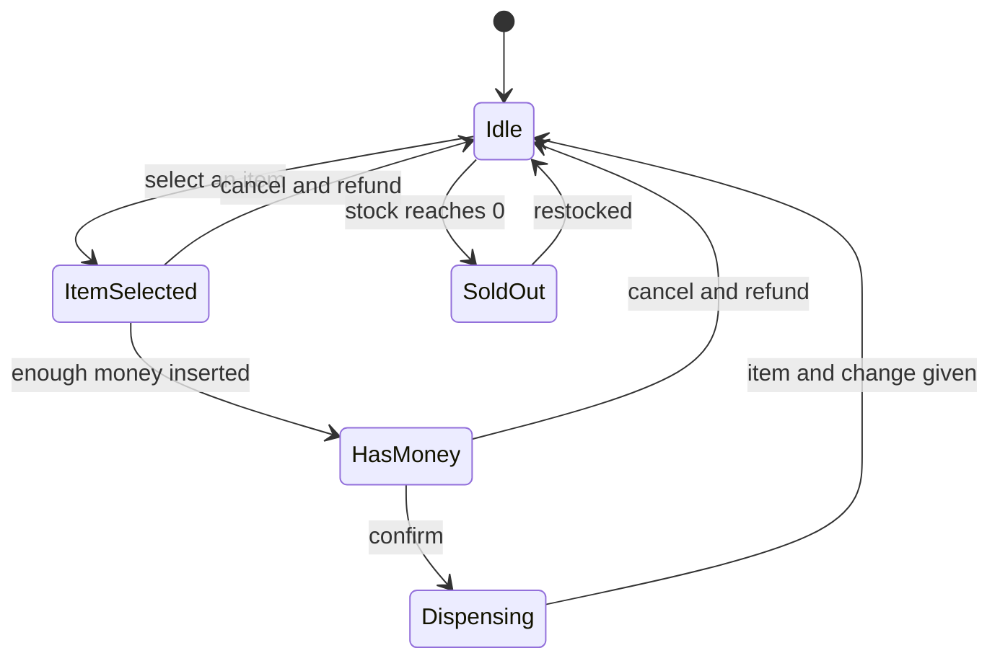

<!-- Written by `npm run lessons` from the lesson data in src/data. Edit the lesson there, not this page. -->

# Design a vending machine

**System Design · Unit 7: Low-level design questions · Lesson 4 of 6 · Should know**

> **In one line.** Design a vending machine that sells items, accepts coins and gives change.

[Open this lesson on the site](https://learn.hamropedia.com/system-design/design-a-vending-machine/) for its animation, the practice game and tap-to-explain words.

## Why interviewers ask it

It's the clearest test of the State pattern: every action means something different depending on the machine's state.

## Functional requirements

- Select an item, insert money, get the item and any change.
- Cancel and get a refund.
- Restock items and coins (admin).

## Non-functional requirements

- Never hand out an item without enough money, and never lose money.
- Clear behaviour in every state.

## Classes

- VendingMachine: current state, inventory, coin box.
- State (interface) → Idle, ItemSelected, HasMoney, Dispensing, SoldOut.
- Inventory: slot → item and count.
- Item: name, price.
- ChangeCalculator: the coins to give back.

## Patterns used

- State (the core of the design)
- Strategy (payment method: coins or card)

## From version 1 to the final design

1. Version 1: one item, exact coins only.
2. Version 2: several items, an inventory, and change-making.
3. Version 3: a State class for each mode, plus cancel and refund.
4. Version 4: card payments as a strategy, admin restocking, and recovery after a power cut.

## The design, step by step

1. Idle → select an item → ItemSelected → insert money → HasMoney (once paid ≥ price) → Dispensing → give change → Idle.
2. Cancel while in ItemSelected or HasMoney → refund → Idle.
3. An item with no stock left → SoldOut for that item.

## Picture it



*Every state allows only the actions that make sense in it, so the machine can never hand out an item without enough money.*

## Deep dives

- Change-making: the greedy method works for UK coins when you have plenty of each, but with limited coins it can fail even when exact change is possible (60p with one 50p and three 20p coins). Use dynamic programming, or refuse the sale.
- Keep money in whole pence (integers), never floats, so that sums are exact.
- Power cut mid-sale: record the transaction before dispensing, so it can be recovered.

## In code

```python
COINS = [200, 100, 50, 20, 10, 5, 2, 1]          # pence

def make_change(amount, available):
    """available: coin -> count. Returns the coins to give, or None."""
    given = {}
    for coin in COINS:
        use = min(amount // coin, available.get(coin, 0))
        if use:
            given[coin] = use
            amount -= coin * use
    return given if amount == 0 else None     # None: can't make exact change
```

## Common mistakes

- An if/else on a status string in every method.
- Taking money for an item that's sold out.
- Assuming change can always be made.

> **Not true:** Change: as long as the machine holds some coins, the right change can be given.  
> **In fact:** With limited coins some amounts cannot be made: 30p of change is impossible with only 20p and 50p coins. Check that change can be made before taking the money.

## In the interview

I'd model the machine with the State pattern — Idle, ItemSelected, HasMoney, Dispensing, SoldOut — so every action is only valid in the right state. Money is in pence; change is worked out from the coins actually available, and the sale is refused if exact change isn't possible.

<details>
<summary>&lt;b>Why the State pattern here?&lt;/b></summary>

Every action (insert, select, cancel) behaves differently in each state; state classes avoid an if/else on a status field in every method.

</details>

<details>
<summary>&lt;b>Is greedy change-making always right?&lt;/b></summary>

Yes for UK coins with an unlimited supply, but not with limited coin counts. Then use dynamic programming.

</details>

## Practise

Try each one yourself first, then open the answer and compare.

### 1. Explain

Walk through one purchase, naming each state change.

<details>
<summary>Show one good answer</summary>

Buying crisps priced at 120p:

1. Idle: the screen says "select an item".  
2. You press A3. A3 is in stock, so: Idle → ItemSelected. The screen shows "120p".  
3. You insert £1. 100p is less than 120p, so it stays in ItemSelected and shows "20p to pay".  
4. You insert 50p. 150p is now at least 120p, so: ItemSelected → HasMoney.  
5. HasMoney → Dispensing, straight away: the sale is recorded first (so a power cut can't lose it), then the crisps drop, and A3's count goes down by one.  
6. Change: 150 − 120 = 30p, worked out from the coins in the machine (a 20p and a 10p) and paid out. Dispensing → Idle.

If A3 had been the last packet, it is now marked sold out, and the next person who presses A3 is told "sold out" instead of being taken to ItemSelected. Pressing cancel in ItemSelected or HasMoney refunds every coin inserted and returns to Idle.

</details>

### 2. Draw

Draw the state diagram, including cancel and sold-out.

<details>
<summary>Show one good answer</summary>

Money is only taken in ItemSelected, so a coin inserted while Idle is simply returned. Dispensing can only be reached once the price is covered, and a cancel before that refunds everything.

```text
             select item (in stock)
Idle ───────────────────────────► ItemSelected
 ▲  │                                │ insert coin, paid < price:
 │  │ select item (none left)        │   stay (show what is left)
 │  ▼                                │ insert coin, paid ≥ price
 │ SoldOut message ── back to Idle   ▼
 │                                HasMoney
 │                                   │ automatic
 │ give change                       ▼
 └─────────────────────────────── Dispensing
                                  (record the sale,
                                   drop the item)

cancel in ItemSelected or HasMoney
  → refund every coin inserted → Idle
```

</details>

### 3. Apply

Implement make_change, find a case where greedy fails with limited coins, and fix it with dynamic programming.

<details>
<summary>Show one good answer</summary>

The greedy method takes the biggest coin that fits, as many as allowed, then moves on. With plenty of every coin, that works for UK coins. With limited coins it can fail: to give 60p from one 50p and three 20p coins, greedy takes the 50p, and then needs 10p, which the machine doesn't have. But three 20p coins would have worked.

The dynamic-programming version builds up every amount it can reach, using each physical coin at most once, and keeps the way that uses the fewest coins. It finds 3 × 20p for 60p, and agrees with greedy when greedy works.

```python
COINS = [200, 100, 50, 20, 10, 5, 2, 1]          # pence


def greedy_change(amount, available):
    given = {}
    for coin in COINS:
        use = min(amount // coin, available.get(coin, 0))
        if use:
            given[coin] = use
            amount -= coin * use
    return given if amount == 0 else None        # None: can't make exact change


def dp_change(amount, available):
    """The fewest coins that make exactly amount, using at most available[coin] of each."""
    best = {0: {}}                               # amount reached -> coins used
    for coin in COINS:
        for _ in range(available.get(coin, 0)):  # each physical coin at most once
            for total, used in list(best.items()):
                new_total = total + coin
                if new_total > amount:
                    continue
                candidate = {**used, coin: used.get(coin, 0) + 1}
                if new_total not in best or sum(candidate.values()) < sum(best[new_total].values()):
                    best[new_total] = candidate
    return best.get(amount)


limited = {50: 1, 20: 3}
print(greedy_change(60, limited), dp_change(60, limited))      # None {20: 3}

plenty = {coin: 10 for coin in COINS}
print(greedy_change(80, plenty), dp_change(80, plenty))        # {50: 1, 20: 1, 10: 1} {50: 1, 20: 1, 10: 1}
```

</details>

### 4. Trade-offs

State classes or a transition table for this machine?

<details>
<summary>Show one good answer</summary>

For this machine, state classes, with a short table kept as documentation.

The states here don't just decide the next state; they do real work that differs by state: ItemSelected adds up coins and compares with the price, HasMoney must handle cancel by refunding, Dispensing must record the sale before driving the motor and must recover after a power cut, and SoldOut hands coins straight back. Keeping each state's logic in its own class keeps money handling in one place per state and makes each one testable alone, which matters because mistakes here lose real money.

A transition table (state → event → next state) would be the better choice if the machine were mostly a list of allowed moves with little behaviour, or if the rules had to be configured without new code. It is also the best way to show the whole machine at once, which is why it is worth drawing even when the code uses classes.

</details>

## Go further (optional)

- READ · [State pattern](https://refactoring.guru/design-patterns/state) · Refactoring.Guru, free
- CODE · [Awesome Low-Level Design (questions and solutions)](https://github.com/ashishps1/awesome-low-level-design) · GitHub, free

---

[← Design Splitwise (expense sharing)](design-splitwise-expense-sharing.md) · [All lessons](../../README.md) · [Design an LRU cache →](design-an-lru-cache.md)
