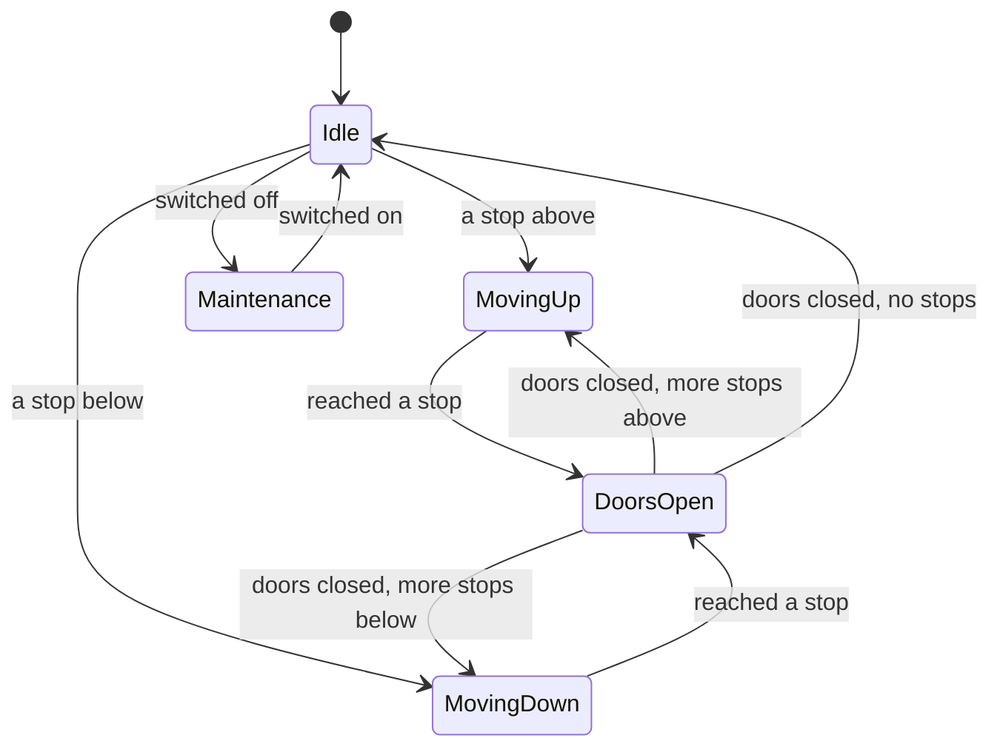

<!-- Written by `npm run lessons` from the lesson data in src/data. Edit the lesson there, not this page. -->

# Design an elevator system

**System Design · Unit 7: Low-level design questions · Lesson 2 of 6 · Should know**

> **In one line.** Design the classes and scheduling logic for a building's lifts.

[Open this lesson on the site](https://learn.hamropedia.com/system-design/design-an-elevator-system/) for its animation, the practice game and tap-to-explain words.

## Why interviewers ask it

It tests state machines, scheduling and concurrency, and there's no single right answer, so your reasoning is what gets marked.

## Functional requirements

- Hall calls (up and down buttons on each floor) and car calls (floor buttons inside the lift).
- Several lifts; each hall call is assigned to one lift.
- Doors open and close; show the current floor and direction.
- Emergency stop and maintenance mode.

## Non-functional requirements

- Short waiting times; far floors must not be starved.
- Safety: never move with the doors open.

## Classes

- ElevatorController: receives calls and dispatches them.
- Elevator: id, current floor, direction, state, and its up and down stops.
- Request: floor, direction, type (hall call or car call).
- DispatchStrategy: chooses a lift for each hall call.
- Door, Display, Button: simple parts.

## Patterns used

- State (Idle, MovingUp, MovingDown, DoorsOpen, Maintenance)
- Strategy (the dispatch algorithm)
- Observer (displays and buttons)

## From version 1 to the final design

1. Version 1: one lift with a list of requested floors, visited in order of arrival.
2. Version 2: one lift using LOOK scheduling: sweep up, then down.
3. Version 3: several lifts and a controller that gives each hall call to the lowest-cost lift.
4. Version 4: safety states (doors, overload, maintenance) and strategies for busy times.

## The design, step by step

1. Each lift serves its stops with the LOOK algorithm: keep going in one direction, serving stops on the way, then turn around — like a lift operator sweeping up and down.
2. A controller assigns each hall call to the best lift: idle and near, or already moving towards that floor in the same direction.
3. Each lift has a state machine that enforces safety: doors must be closed before moving.

## Picture it



*One lift's state machine. There's no arrow from DoorsOpen straight to moving without the doors closing, which is how safety is guaranteed.*

## Deep dives

- Dispatch cost = distance + stops on the way + a penalty for the wrong direction.
- Peak times: in the morning rush, send idle lifts back to the ground floor.
- Concurrency: requests arrive from many buttons at once, so use a thread-safe queue into the controller.
- Overload sensor: the doors stay open.

## In code

```python
import heapq

class Elevator:
    def __init__(self, eid):
        self.id, self.floor, self.direction = eid, 0, 0     # -1 down, 0 idle, 1 up
        self.up_stops, self.down_stops = [], []             # simplified: two heaps

    def add_stop(self, floor):
        if floor >= self.floor:
            heapq.heappush(self.up_stops, floor)
        else:
            heapq.heappush(self.down_stops, -floor)

    def next_stop(self):
        if self.direction >= 0 and self.up_stops:
            self.direction = 1
            return heapq.heappop(self.up_stops)
        if self.down_stops:
            self.direction = -1
            return -heapq.heappop(self.down_stops)
        if self.up_stops:
            self.direction = 1
            return heapq.heappop(self.up_stops)
        self.direction = 0
        return None

def pick_elevator(elevators, floor, direction):
    def cost(e):
        heading_there = e.direction == direction and (floor - e.floor) * direction >= 0
        return abs(e.floor - floor) + (0 if e.direction == 0 or heading_there else 10)
    return min(elevators, key=cost)
```

## Common mistakes

- Serving requests first-come, first-served: the lift zig-zags between floors instead of picking people up on its way.
- No state machine, so 'moving with the doors open' is possible.
- Over-complicating the dispatch algorithm before the basics work.

> **Not true:** Dispatch: serving calls strictly in the order they were made keeps the lift's travel shortest.  
> **In fact:** The lift then zig-zags between floors. Picking up the calls that lie on its way, in its current direction, moves more people with less travel.

## In the interview

A controller receives hall calls and gives each one to the lift with the lowest cost: near, idle, or already heading that way. Each lift serves its stops with the LOOK algorithm — continue in one direction, then reverse. A state machine per lift guarantees the doors are closed before it moves.

<details>
<summary>&lt;b>Why not first come, first served?&lt;/b></summary>

The lift would zig-zag between floors. Sweeping in one direction serves more people per trip and avoids starving any floor.

</details>

<details>
<summary>&lt;b>How would you test it?&lt;/b></summary>

Simulate time in steps with scripted requests, check the safety rules (never moving with the doors open) and measure the average wait.

</details>

## Practise

Try each one yourself first, then open the answer and compare.

### 1. Explain

Explain how LOOK scheduling works, using the lift-operator picture.

<details>
<summary>Show one good answer</summary>

Picture an old-fashioned lift operator. They don't rush to whichever button was pressed last. They pick a direction, say up, and keep going, stopping at every floor where someone inside wants to get off or someone outside wants to go up. When there are no more requests above, they turn around and do the same on the way down.

That is LOOK. Each lift keeps two sorted lists of stops: those above it and those below it. While moving up it serves the up stops in order, from the nearest; when none are left above, it switches direction and serves the down stops. Unlike its cousin SCAN, it doesn't travel to the top floor if nobody needs it there; it only goes as far as the last request (it "looks" ahead).

Why it works: every request is served within one sweep, so nobody on a far floor waits forever, and the lift doesn't zigzag between nearby requests while others wait. Serving the nearest request first, by contrast, can starve far floors under heavy traffic.

</details>

### 2. Draw

Draw the lift's state diagram and the class diagram.

<details>
<summary>Show one good answer</summary>

The state machine enforces the safety rule: the lift only moves from DoorsOpen after the doors are confirmed closed. Maintenance can be entered from any state and serves no calls. The controller holds the lifts and a swappable dispatch strategy.

```text
Lift states
  Idle ── call above ──► MovingUp
  Idle ── call below ──► MovingDown
  Idle ── call on this floor ──► DoorsOpen
  MovingUp / MovingDown ── reached a stop ──► DoorsOpen
  DoorsOpen ── timer, doors closed ──►
      MovingUp / MovingDown (more stops) or Idle (none)
  any state ── maintenance key ──► Maintenance ── key off ──► Idle
  (never move unless "doors closed" is confirmed)

Classes
  ElevatorController 1 ◆── * Elevator
   + request(floor, direction)    - id, floor, direction
   - dispatch: DispatchStrategy   - state: ElevatorState
                                  - up_stops, down_stops
                                  + add_stop(floor), step()
  «interface» DispatchStrategy    Elevator 1 ◆── 1 Door
   + choose(elevators, request)   Elevator 1 ◆── 1 Display
     △ NearestCar, ZoneDispatch
  Request: floor, direction, kind (hall | car)
```

</details>

### 3. Apply

Write a small simulation with 3 lifts and 20 random requests; print each lift's path and the average wait.

<details>
<summary>Show one good answer</summary>

Time moves in ticks: in each tick a lift travels one floor. Each lift follows LOOK (keep going while there are stops ahead, then turn). Each new request is given to a lift with the lesson's pick_elevator cost: distance, plus a penalty of 10 if the lift is busy heading the other way. Passengers board when their lift reaches their floor; their wait is the number of ticks since they pressed the button, and their destination becomes a new stop.

20 requests arrive at random times on a 15-floor building, with a fixed seed so the run is repeatable. The printout shows every floor each lift stopped at, and the average and longest wait. Try changing the penalty in the cost function, or using one lift, and watch the waits change.

```python
import random


class Elevator:
    def __init__(self, eid):
        self.id, self.floor, self.direction = eid, 0, 0    # -1 down, 0 idle, 1 up
        self.stops = set()
        self.path = [0]                                     # every floor it stopped at

    def add_stop(self, floor):
        if floor != self.floor:
            self.stops.add(floor)

    def step(self):                                         # one tick: LOOK
        if not self.stops:
            self.direction = 0
            return
        above = any(s > self.floor for s in self.stops)
        below = any(s < self.floor for s in self.stops)
        self.direction = 1 if (self.direction >= 0 and above) or not below else -1
        self.floor += self.direction
        if self.floor in self.stops:
            self.stops.discard(self.floor)
            self.path.append(self.floor)


def pick_elevator(elevators, floor, direction):
    def cost(e):
        heading_there = e.direction == direction and (floor - e.floor) * direction >= 0
        return abs(e.floor - floor) + (0 if e.direction == 0 or heading_there else 10)
    return min(elevators, key=cost)


random.seed(4)
FLOORS = 15
requests = []
while len(requests) < 20:
    start, end = random.sample(range(FLOORS), 2)            # two different floors
    requests.append((random.randrange(40), start, end))     # (time, from, to)
requests.sort()

lifts = [Elevator(i) for i in range(3)]
waiting = {lift.id: {} for lift in lifts}                   # lift -> floor -> [(time, destination)]
waits = []


def board(lift, tick):
    for asked_at, destination in waiting[lift.id].pop(lift.floor, []):
        waits.append(tick - asked_at)
        lift.add_stop(destination)


tick = 0
while requests or any(lift.stops or waiting[lift.id] for lift in lifts):
    while requests and requests[0][0] == tick:
        asked_at, start, end = requests.pop(0)
        lift = pick_elevator(lifts, start, 1 if end > start else -1)
        waiting[lift.id].setdefault(start, []).append((asked_at, end))
        lift.add_stop(start)
    for lift in lifts:
        board(lift, tick)                                   # already on that floor
        lift.step()
        board(lift, tick)                                   # just arrived
    tick += 1

for lift in lifts:
    print(f"lift {lift.id}:", lift.path)
print("average wait:", round(sum(waits) / len(waits), 1), "ticks; longest:", max(waits))
# lift 0: [0, 13, 4, 3, 2, 0, 4, 11, 14, 4]
# lift 1: [0, 4, 14, 4, 1, 10, 13, 3, 1, 0, 6, 8, 13]
# lift 2: [0, 2, 1, 5, 8, 4, 3, 5, 7, 10, 11, 6, 1, 13]
# average wait: 6.8 ticks; longest: 19
```

</details>

### 4. Trade-offs

Nearest-lift dispatch or zone-based dispatch (each lift serves certain floors): pros and cons.

<details>
<summary>Show one good answer</summary>

Nearest-lift dispatch (any lift can serve any floor; pick the cheapest by distance and direction):  
• Pros: simple; adapts to whatever traffic appears; every lift is useful all the time; short average waits in low and medium buildings.  
• Cons: lifts bunch together and chase the same calls; trips mix short and long journeys, so someone going to floor 40 stops at 5, 9 and 12; under heavy load, waits become unpredictable.

Zone-based dispatch (lifts 1–2 serve floors 1–15, lifts 3–4 serve floors 16–30, often running express through the other zone):  
• Pros: fewer stops per trip and faster journeys to high floors; predictable; works well in tall buildings and in the morning rush.  
• Cons: an idle lift in one zone can't help a busy zone, so capacity is wasted; when a zone's lifts are busy, its passengers wait even though other lifts are free; changing floors between zones may need a transfer.

Real systems mix them: zones (or destination dispatch, where you enter your floor in the lobby and are told which lift to take) at peak times, and nearest-lift the rest of the day.

</details>

## Go further (optional)

- CODE · [Awesome Low-Level Design (questions and solutions)](https://github.com/ashishps1/awesome-low-level-design) · GitHub, free
- WATCH · [Elevator system low-level design](https://www.youtube.com/results?search_query=elevator+system+low+level+design+interview) · YouTube

---

[← Design a parking lot](design-a-parking-lot.md) · [All lessons](../../README.md) · [Design Splitwise (expense sharing) →](design-splitwise-expense-sharing.md)
