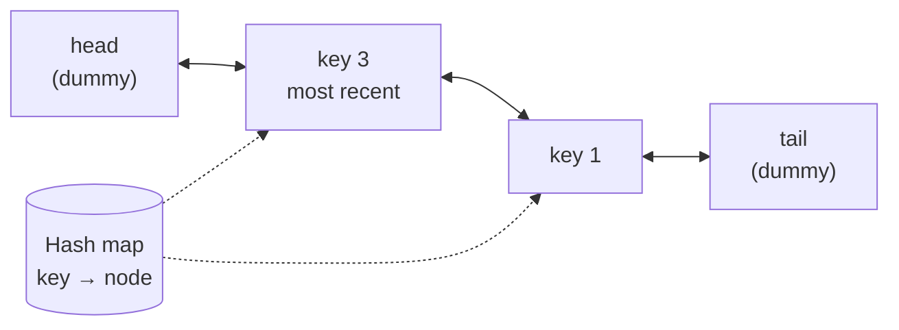

<!-- Written by `npm run lessons` from the lesson data in src/data. Edit the lesson there, not this page. -->

# Design an LRU cache

**System Design · Unit 7: Low-level design questions · Lesson 5 of 6 · Must know**

> **In one line.** Design a fixed-size cache that removes the least recently used item when full, with get and put in O(1).

[Open this lesson on the site](https://learn.hamropedia.com/system-design/design-an-lru-cache/) for its animation, the practice game and tap-to-explain words.

## Why interviewers ask it

It tests data-structure design under a strict time limit (O(1) operations), and it's asked both as a coding question and as a design question.

## Functional requirements

- get(key): return the value, or nothing if missing; it counts as a use.
- put(key, value): insert or update; if the cache is full, remove the least recently used item.

## Non-functional requirements

- Both operations in O(1) time.
- Optionally thread-safe.

## Classes

- LRUCache: capacity, a hash map from key to node, and a doubly linked list.
- Node: key, value, previous, next.

## Patterns used

- Composition (map plus list)
- Strategy, if the eviction policy should be swappable

## From version 1 to the final design

1. Naive: a list kept in order of use. get is O(n), because you must find and move the item.
2. Better: a dictionary for lookups, but keeping the order still costs O(n).
3. Final: a dictionary plus a doubly linked list, so both operations are O(1).
4. Extensions: a TTL per entry, thread safety, or LFU instead of LRU.

## The design, step by step

1. A hash map finds a key's node in O(1).
2. A doubly linked list keeps items in order of use: most recent at the front, least recent at the back.
3. get: move the node to the front. put: update and move to the front, or insert at the front and remove the back node if over capacity.

## Picture it



*The list keeps usage order (most recent next to the head) and the map finds any node instantly. When full, the node next to the tail is removed.*

## Deep dives

- Dummy head and tail nodes remove the edge cases.
- Thread safety: one lock around get and put (or several locks for parts of the cache).
- In Python, OrderedDict with move_to_end does the same in a few lines; know both versions.

## In code

```python
class Node:
    def __init__(self, key=None, val=None):
        self.key, self.val, self.prev, self.next = key, val, None, None

class LRUCache:
    def __init__(self, capacity):
        self.cap, self.map = capacity, {}
        self.head, self.tail = Node(), Node()        # dummy ends
        self.head.next, self.tail.prev = self.tail, self.head

    def _remove(self, node):
        node.prev.next, node.next.prev = node.next, node.prev

    def _add_front(self, node):
        node.prev, node.next = self.head, self.head.next
        self.head.next.prev = node
        self.head.next = node

    def get(self, key):
        if key not in self.map:
            return None
        node = self.map[key]
        self._remove(node)
        self._add_front(node)
        return node.val

    def put(self, key, val):
        if key in self.map:
            self._remove(self.map[key])
        node = Node(key, val)
        self.map[key] = node
        self._add_front(node)
        if len(self.map) > self.cap:
            lru = self.tail.prev
            self._remove(lru)
            del self.map[lru.key]
```

## Common mistakes

- A singly linked list, which can't remove a node in O(1).
- Forgetting to update the order on get.
- Forgetting to delete the evicted key from the dictionary.

> **Not true:** get: reads the value and leaves the key's place in the eviction order as it was.  
> **In fact:** A read is a use: get must move the key to the most recent end. Otherwise a key that is read all the time would be evicted as if nobody used it.

## In the interview

A hash map from key to node gives O(1) lookup, and a doubly linked list keeps items in order of use. get moves the node to the front; put inserts at the front and removes the back node when over capacity. Dummy head and tail nodes keep the code simple.

<details>
<summary>&lt;b>Why doubly linked?&lt;/b></summary>

To remove a node from the middle in O(1), you need to reach the node before it.

</details>

<details>
<summary>&lt;b>LRU or LFU?&lt;/b></summary>

LRU removes the item used longest ago; LFU removes the item used least often. LFU protects popular items better but is more complex.

</details>

## Practise

Try each one yourself first, then open the answer and compare.

### 1. Explain

Explain why you need both a hash map and a doubly linked list.

<details>
<summary>Show one good answer</summary>

An LRU cache needs two things to be fast:  
1. Find an item by its key: is "user:42" in the cache?  
2. Know the order of use, and change it cheaply: move an item to "most recently used" on every get, and remove the least recently used one when full.

A hash map does the first in O(1), but has no useful order. A list keeps the order, but finding a key in it takes O(n). So you use both: the map goes from key to the item's node in the list, and the list keeps the nodes in order of use.

Why doubly linked: to move a node to the front, you must unlink it from wherever it is in the middle, which means fixing its neighbours' pointers. With a link back to the previous node, that is O(1). A singly linked list would have to walk from the start to find the previous node, which is O(n). The back of the list (just before the tail sentinel) is always the least recently used item, so eviction is O(1) too.

</details>

### 2. Draw

Draw the list after put(1), put(2), get(1), put(3), with capacity 2.

<details>
<summary>Show one good answer</summary>

Front means most recently used. get(1) moves node 1 to the front, so node 2 becomes the least recently used, and it is the one evicted when put(3) overflows the capacity of 2. The map always points at exactly the nodes in the list.

```text
Capacity 2. Front of the list = most recently used.

put(1):  head ⇄ [1:a] ⇄ tail
put(2):  head ⇄ [2:b] ⇄ [1:a] ⇄ tail
get(1):  head ⇄ [1:a] ⇄ [2:b] ⇄ tail     1 moves to the front
put(3):  head ⇄ [3:c] ⇄ [1:a] ⇄ tail     full: 2 (at the back)
                                         is evicted
map after put(3): {1 → node 1, 3 → node 3}
```

</details>

### 3. Apply

Implement it from memory, then again with OrderedDict, and test both with the same sequence of calls.

<details>
<summary>Show one good answer</summary>

The first version is the lesson's hash map plus doubly linked list. The second uses OrderedDict, which is exactly that structure built in: move_to_end() marks a key as most recent, and popitem(last=False) removes the oldest.

Both run the same sequence of calls and give the same results. A second check runs 10,000 random gets and puts against both, with a fixed seed, and confirms they always agree.

```python
import random
from collections import OrderedDict


class Node:
    def __init__(self, key=None, val=None):
        self.key, self.val, self.prev, self.next = key, val, None, None


class LRUCache:                                  # from memory: hash map + doubly linked list
    def __init__(self, capacity):
        self.cap, self.map = capacity, {}
        self.head, self.tail = Node(), Node()
        self.head.next, self.tail.prev = self.tail, self.head

    def _remove(self, node):
        node.prev.next, node.next.prev = node.next, node.prev

    def _add_front(self, node):
        node.prev, node.next = self.head, self.head.next
        self.head.next.prev = node
        self.head.next = node

    def get(self, key):
        if key not in self.map:
            return None
        node = self.map[key]
        self._remove(node)
        self._add_front(node)
        return node.val

    def put(self, key, val):
        if key in self.map:
            self._remove(self.map[key])
        node = Node(key, val)
        self.map[key] = node
        self._add_front(node)
        if len(self.map) > self.cap:
            lru = self.tail.prev
            self._remove(lru)
            del self.map[lru.key]


class OrderedLRU:                                # the same with OrderedDict
    def __init__(self, capacity):
        self.cap, self.data = capacity, OrderedDict()

    def get(self, key):
        if key not in self.data:
            return None
        self.data.move_to_end(key)               # most recent at the end
        return self.data[key]

    def put(self, key, val):
        self.data[key] = val
        self.data.move_to_end(key)
        if len(self.data) > self.cap:
            self.data.popitem(last=False)        # least recent is at the start


def run(cache, ops):
    return [cache.get(op[1]) if op[0] == "get" else cache.put(op[1], op[2]) for op in ops]


ops = [("put", 1, "a"), ("put", 2, "b"), ("get", 1), ("put", 3, "c"), ("get", 2),
       ("get", 3), ("put", 1, "A"), ("put", 4, "d"), ("get", 3), ("get", 1), ("get", 4)]
gets = [r for op, r in zip(ops, run(LRUCache(2), ops)) if op[0] == "get"]
print(gets)                                      # ['a', None, 'c', None, 'A', 'd']
print(run(LRUCache(2), ops) == run(OrderedLRU(2), ops))   # True

random.seed(0)
ops = [("get", random.randrange(20)) if random.random() < 0.5 else ("put", random.randrange(20), i)
       for i in range(10_000)]
print(run(LRUCache(5), ops) == run(OrderedLRU(5), ops))   # True: 10,000 random calls agree
```

</details>

### 4. Trade-offs

How would you make it thread-safe, and what does that cost?

<details>
<summary>Show one good answer</summary>

The simple way: one lock around both get and put. get has to be inside the lock too, because it changes the list (it moves the node to the front); two threads moving nodes at once would corrupt the pointers. (Python's GIL doesn't help: a get is many steps, and a thread can switch between them.)

What it costs:  
• Every operation, even a read, waits its turn, so under heavy concurrency the cache handles one request at a time and threads queue at the lock.  
• A read-write lock doesn't help, because every get is a write to the order.

Ways to reduce the cost:  
• Shard it: N independent LRU caches, each with its own lock, chosen by a hash of the key. Contention drops by about N; the price is that eviction is only "least recently used" within each shard.  
• Approximate the order: record reads in a buffer and apply them in batches (as Java's Caffeine does), or use a CLOCK-style "recently used" bit instead of moving nodes. Redis samples a few keys and evicts the oldest of them.  
• Use a well-tested concurrent cache library instead of writing your own.

</details>

## Go further (optional)

- CODE · [146. LRU Cache](https://leetcode.com/problems/lru-cache/) · LeetCode
- WATCH · [LRU Cache solution](https://www.youtube.com/results?search_query=NeetCode+LRU+cache) · NeetCode

---

[← Design a vending machine](design-a-vending-machine.md) · [All lessons](../../README.md) · [Design an order-matching engine (stock exchange) →](design-an-order-matching-engine-stock-exchange.md)
