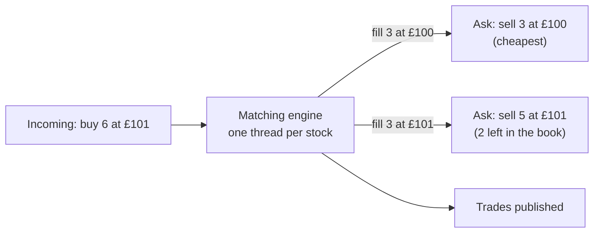

<!-- Written by `npm run lessons` from the lesson data in src/data. Edit the lesson there, not this page. -->

# Design an order-matching engine (stock exchange)

**System Design · Unit 7: Low-level design questions · Lesson 6 of 6 · Bonus**

> **In one line.** Design the core of a stock exchange: an order book that matches buy and sell orders.

[Open this lesson on the site](https://learn.hamropedia.com/system-design/design-an-order-matching-engine-stock-exchange/) for its animation, the practice game and tap-to-explain words.

## Why interviewers ask it

It tests data structures (heaps and queues), fairness rules, and why a single-threaded design can be both the fastest and the safest.

## Functional requirements

- Place limit orders (buy or sell at a price or better).
- Match orders by price, then time; allow partial fills.
- Cancel orders; publish trades.

## Non-functional requirements

- Very low latency; fair and deterministic ordering.
- Never lose an order or fill it twice.

## Classes

- Order: id, side, price, quantity, time.
- OrderBook (one per stock): bids and asks, first in first out at each price.
- MatchingEngine: processes incoming orders against the book.
- Trade: buyer, seller, price, quantity.

## Patterns used

- Command (orders as objects in a sequenced log)
- Observer (the market-data feed)
- Strategy (order types)

## From version 1 to the final design

1. Version 1: one list of orders, scanned for a match every time (slow).
2. Version 2: buy and sell heaps ordered by price, first in first out at each price.
3. Version 3: partial fills, cancels and market orders.
4. Version 4: one single-threaded engine per stock, fed by a queue, with an event log for replay.

## The design, step by step

1. An incoming buy order fills against the cheapest sell orders while their price is at or below the buy price, oldest first at each price.
2. Any quantity left over rests in the book.
3. Each stock's book is processed by one thread, in sequence, fed by a queue, so no locks are needed inside the book.

## Picture it



*The buy order fills against the cheapest sell orders first, until its price limit or quantity runs out.*

## Deep dives

- Price-time priority: better price first; at the same price, the earliest order first.
- One thread per stock gives determinism and avoids locks; parallelism comes from different stocks.
- Log every order before processing it, so the book can be rebuilt by replay after a crash.

## In code

```python
import heapq, itertools

class OrderBook:
    def __init__(self):
        self.bids, self.asks = [], []        # heaps of (price key, time, qty, id)
        self.clock = itertools.count()

    def buy(self, order_id, price, qty):
        trades = []
        while qty and self.asks and self.asks[0][0] <= price:
            ask_price, t, ask_qty, ask_id = heapq.heappop(self.asks)
            fill = min(qty, ask_qty)
            trades.append((order_id, ask_id, ask_price, fill))
            qty -= fill
            if ask_qty > fill:
                heapq.heappush(self.asks, (ask_price, t, ask_qty - fill, ask_id))
        if qty:
            heapq.heappush(self.bids, (-price, next(self.clock), qty, order_id))
        return trades
```

## Common mistakes

- Ignoring time priority at the same price.
- Using locks inside the matching loop instead of processing in sequence.
- Storing prices as floats: rounding makes equal prices compare as different. Use integers, such as whole pence.

> **Not true:** Several threads on one stock: a faster engine that gives the same results.  
> **In fact:** Matching depends on order, so threads on one stock need locks and can give different results on each run. One thread per stock stays deterministic.

## In the interview

Each stock has an order book with bids in a max-heap and asks in a min-heap, first in first out within a price. A matching engine processes one stock's orders in sequence on a single thread: an incoming order fills against the best opposite prices while they cross, and any remainder rests in the book. Every order is logged first, so the book can be rebuilt.

<details>
<summary>&lt;b>Why single-threaded?&lt;/b></summary>

Matching must be strictly ordered and repeatable. One thread per stock avoids locks and is very fast.

</details>

<details>
<summary>&lt;b>What is price-time priority?&lt;/b></summary>

Better prices match first; at the same price, the order that arrived first matches first.

</details>

## Practise

Try each one yourself first, then open the answer and compare.

### 1. Explain

Explain price-time priority with a small example of 3 sell orders.

<details>
<summary>Show one good answer</summary>

Three sell orders are waiting in the book:  
• S1: sell 5 shares at £101, placed at 09:00.  
• S2: sell 3 at £100, placed at 09:01.  
• S3: sell 4 at £100, placed at 09:02.

A buy order arrives: buy 10 at up to £101.

Price-time priority means the best price goes first, and at the same price, the earliest order goes first. For a buyer the best price is the lowest, so the £100 level goes before £101, even though S1 was placed first.  
1. £100 level, oldest first: S2 fills 3 (7 still wanted), then S3 fills 4 (3 still wanted).  
2. £101 level: S1 fills 3 of its 5.

Trades: 3 @ £100, 4 @ £100, 3 @ £101. Each trade happens at the price of the order that was already waiting. S1 stays in the book with 2 shares left.

The rule is what makes the exchange fair and deterministic: improving your price gets you served first, and at equal prices, whoever came first wins.

</details>

### 2. Draw

Draw the order book (bids and asks by price level) before and after a large buy order.

<details>
<summary>Show one good answer</summary>

Asks (sell orders) are listed from the cheapest upwards, bids (buy orders) from the highest down; the gap between the best ask and the best bid is the spread. The incoming buy at £101 takes everything at £100 and part of £101; the bids are untouched, and the £102 sellers are above the buyer's limit, so they stay.

```text
Before                          After "buy 10 @ £101"

 ASKS (sell orders)              ASKS
  £102 │ 6 (S4)                   £102 │ 6 (S4)
  £101 │ 5 (S1)                   £101 │ 2 (S1: 3 filled)
  £100 │ 3 (S2), 4 (S3)           £100 │ —   (both filled)
───────┼──── spread ────        ───────┼──── spread ────
   £99 │ 2 (B1)                    £99 │ 2 (B1)
   £98 │ 7 (B2)                    £98 │ 7 (B2)
 BIDS (buy orders)               BIDS

Trades: S2 3 @ £100, S3 4 @ £100, S1 3 @ £101
```

</details>

### 3. Apply

Add sell() and cancel() to the order book below, and test partial fills.

<details>
<summary>Show one good answer</summary>

sell() mirrors buy(): it fills against the highest bids while they are at or above its price, oldest first at each price, and rests whatever is left. cancel() uses lazy deletion: finding an order inside a heap is slow, so the id is just marked as cancelled, and cancelled orders are thrown away whenever they reach the top. Each trade is (buyer, seller, price, quantity), at the resting order's price.

The test: three sells (two at £100, so time decides between them), then one buy that fills partly at each level and leaves 2 shares of S1. After S1 is cancelled, a buy at £105 finds nothing to match and rests as a bid; a later sell at £99 fills against it at £105, its price.

```python
import heapq
import itertools


class OrderBook:
    def __init__(self):
        self.bids, self.asks = [], []            # heaps of (price key, time, qty, id)
        self.clock = itertools.count()
        self.cancelled = set()

    def _top(self, heap):                        # skip cancelled orders lazily
        while heap and heap[0][3] in self.cancelled:
            heapq.heappop(heap)
        return heap[0] if heap else None

    def buy(self, order_id, price, qty):
        trades = []
        while qty and (top := self._top(self.asks)) and top[0] <= price:
            ask_price, t, ask_qty, ask_id = heapq.heappop(self.asks)
            fill = min(qty, ask_qty)
            trades.append((order_id, ask_id, ask_price, fill))
            qty -= fill
            if ask_qty > fill:
                heapq.heappush(self.asks, (ask_price, t, ask_qty - fill, ask_id))
        if qty:
            heapq.heappush(self.bids, (-price, next(self.clock), qty, order_id))
        return trades

    def sell(self, order_id, price, qty):
        trades = []
        while qty and (top := self._top(self.bids)) and -top[0] >= price:
            neg_price, t, bid_qty, bid_id = heapq.heappop(self.bids)
            fill = min(qty, bid_qty)
            trades.append((bid_id, order_id, -neg_price, fill))     # buyer, seller, price, qty
            qty -= fill
            if bid_qty > fill:
                heapq.heappush(self.bids, (neg_price, t, bid_qty - fill, bid_id))
        if qty:
            heapq.heappush(self.asks, (price, next(self.clock), qty, order_id))
        return trades

    def cancel(self, order_id):
        self.cancelled.add(order_id)


book = OrderBook()
book.sell("S1", 101, 5)
book.sell("S2", 100, 3)
book.sell("S3", 100, 4)                          # same price as S2, but later
print(book.buy("B1", 101, 10))
# [('B1', 'S2', 100, 3), ('B1', 'S3', 100, 4), ('B1', 'S1', 101, 3)]
print(book._top(book.asks))                      # (101, 0, 2, 'S1'): 2 of S1 left

book.cancel("S1")
print(book.buy("B2", 105, 1))                    # []: S1 is cancelled, so B2 rests as a bid
print(book.sell("S4", 99, 3))                    # [('B2', 'S4', 105, 1)]: 2 of S4 rest as an ask
```

</details>

### 4. Trade-offs

Heaps or a sorted map of price levels: which makes cancel fast?

<details>
<summary>Show one good answer</summary>

A sorted map of price levels makes cancel fast.

Heaps of individual orders:  
• The best order is always at the top: O(1) to look at, O(log n) to remove.  
• But cancel is slow: a heap isn't searchable, so finding one order is O(n), and removing it from the middle needs a re-heapify. The usual workaround is lazy deletion (mark it cancelled and skip it when it reaches the top): cancel becomes O(1), but cancelled orders stay in memory, the top must skip them, and the book's real depth at each price is hard to read.

A sorted map of price levels (a balanced tree or skip list: price → a first-in-first-out queue of orders, as a doubly linked list), plus a hash map from order id to its node:  
• Cancel: look the order up by id, unlink it from its level's queue: O(1). If the level is now empty, remove it from the map: O(log P), for P price levels.  
• The best price is the first or last key; matching walks the queue at that level in time order.  
• Depth per price (the market-data feed) is just each level's total.

Real exchanges use the second shape (often with an array indexed by price tick instead of a tree), because traders cancel far more often than they trade.

</details>

## Go further (optional)

- READ · [Hello Interview: stock exchange](https://www.google.com/search?q=Hello+Interview+stock+exchange) · hellointerview.com · free guides
- READ · [How to build a fast limit order book](https://www.google.com/search?q=how+to+build+a+fast+limit+order+book) · blog post

---

[← Design an LRU cache](design-an-lru-cache.md) · [All lessons](../../README.md) · [Design a URL shortener (like bit.ly) →](../unit-8-hld-practice/design-a-url-shortener-like-bit-ly.md)
