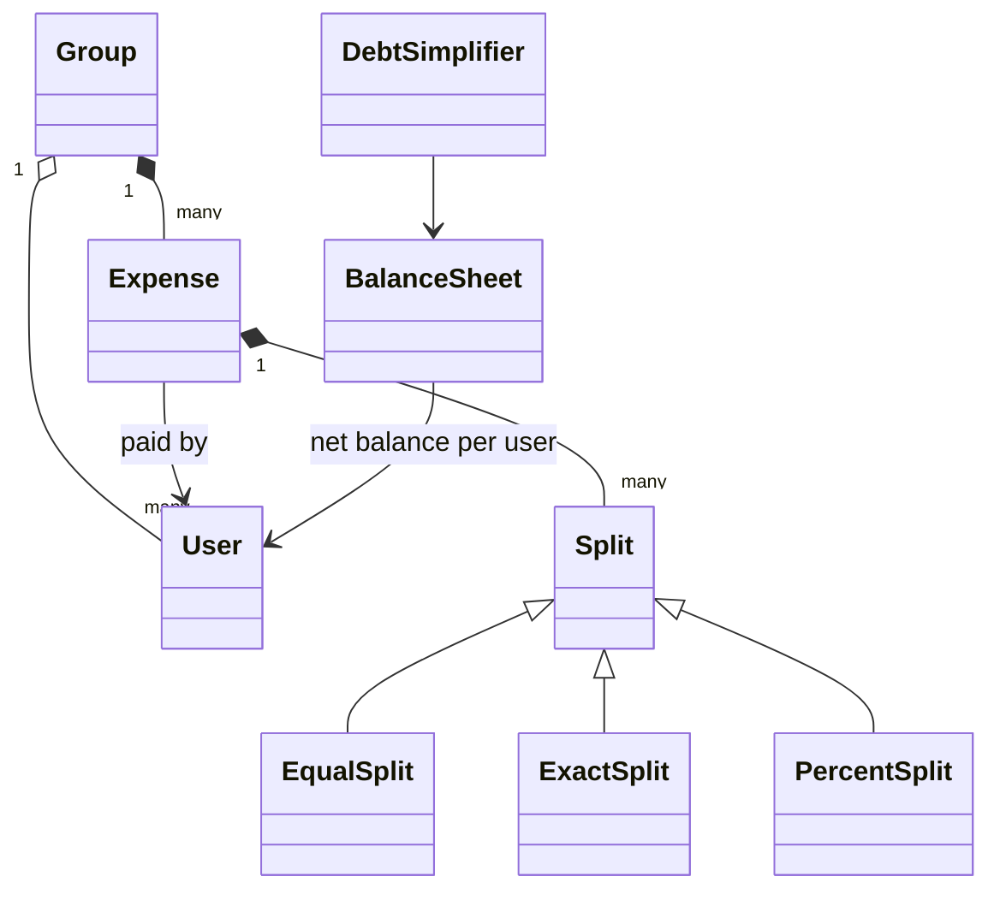

<!-- Written by `npm run lessons` from the lesson data in src/data. Edit the lesson there, not this page. -->

# Design Splitwise (expense sharing)

**System Design · Unit 7: Low-level design questions · Lesson 3 of 6 · Must know**

> **In one line.** Design an expense-sharing app where friends split bills and can see who owes whom.

[Open this lesson on the site](https://learn.hamropedia.com/system-design/design-splitwise-expense-sharing/) for its animation, the practice game and tap-to-explain words.

## Why interviewers ask it

It tests clean modelling of money, validation, and a small algorithm (debt simplification), and it catches people who use floats for money.

## Functional requirements

- Users and groups.
- Add an expense paid by one person, split equally, by exact amounts, or by percentage.
- Show balances: who owes whom, and how much.
- Settle up, and simplify the debts in a group.

## Non-functional requirements

- Money must be exact: no floating-point errors.
- Splits must always add up to the total.

## Classes

- User; Group (members, expenses).
- Expense: payer, amount, splits, description.
- Split (abstract) → EqualSplit, ExactSplit, PercentSplit.
- SplitFactory: creates and validates splits.
- BalanceSheet: the net balance per user.
- DebtSimplifier: reduces the number of payments.

## Patterns used

- Strategy or Factory (split types)
- Observer (tell members about new expenses)

## From version 1 to the final design

1. Version 1: equal splits only, stored as pairwise 'A owes B' records.
2. Version 2: exact and percentage splits, behind a split strategy that validates them.
3. Version 3: one net balance per user, plus debt simplification.
4. Version 4: groups, several currencies, history and notifications.

## The design, step by step

1. Add an expense: validate the split (it sums to the total) → each participant now owes the payer their share.
2. Keep one net balance per user: positive means they're owed money, negative means they owe.
3. Simplify debts: repeatedly match the biggest debtor with the biggest creditor until everyone is at zero.

## Picture it



*A group has members and expenses; each expense is divided into splits of one of three kinds. The balance sheet and simplifier work out who pays whom.*

## Deep dives

- Store money as whole pence (or Decimal), never as float.
- Rounding: £10 split three ways is 334 + 333 + 333 pence; give the extra penny to someone in a fixed, fair way.
- The greedy simplification settles n people in at most n − 1 payments.

## In code

```python
from collections import defaultdict
import heapq

net = defaultdict(int)       # in pence: + is owed money, - owes money

def add_equal_expense(payer, amount_pence, people):
    share, remainder = divmod(amount_pence, len(people))
    for i, person in enumerate(people):
        owed = share + (1 if i < remainder else 0)    # spread the leftover pence
        net[person] -= owed
        net[payer] += owed

def simplify():
    creditors = [(-v, p) for p, v in net.items() if v > 0]
    debtors = [(v, p) for p, v in net.items() if v < 0]
    heapq.heapify(creditors)
    heapq.heapify(debtors)
    payments = []
    while creditors and debtors:
        c_amt, c = heapq.heappop(creditors)
        d_amt, d = heapq.heappop(debtors)
        pay = min(-c_amt, -d_amt)
        payments.append((d, c, pay))           # d pays c this many pence
        if -c_amt > pay:
            heapq.heappush(creditors, (c_amt + pay, c))
        if -d_amt > pay:
            heapq.heappush(debtors, (d_amt + pay, d))
    return payments
```

## Common mistakes

- Storing money as floats: 0.1 + 0.2 is not exactly 0.3, so balances drift. Use whole pence (integers).
- Splits that don't add up to the total.
- Losing the leftover pence when rounding.

> **Not true:** Settling the debts between n people always needs one payment for every pair of people.  
> **In fact:** Only the final balances matter. Matching the person who owes the most with the person owed the most settles n people in at most n − 1 payments.

## In the interview

Expenses have a payer and a list of splits, created by a split strategy that checks they add up to the total. Each expense updates a net balance per user, stored in whole pence. To settle a group, I greedily match the largest debtor with the largest creditor, which needs at most n − 1 payments.

<details>
<summary>&lt;b>Why not use floats for money?&lt;/b></summary>

0.1 + 0.2 isn't exactly 0.3 in binary floating point. Money needs whole minor units (pence) or Decimal.

</details>

<details>
<summary>&lt;b>Is the greedy method optimal?&lt;/b></summary>

It always finishes in at most n − 1 payments, which is good. Finding the true minimum is NP-hard in general, so greedy is the practical choice.

</details>

## Practise

Try each one yourself first, then open the answer and compare.

### 1. Explain

Explain how balances and debt simplification work, with an example of 3 friends.

<details>
<summary>Show one good answer</summary>

Three friends: Asha, Ben and Chen. Each person has one net balance, in pence: positive means they are owed money, negative means they owe.

1. Asha pays £30 for dinner, split equally: each share is £10. Ben and Chen each owe Asha £10, and Asha's own share cancels out. Balances: Asha +£20, Ben −£10, Chen −£10.  
2. Ben pays £12 for a taxi, split equally: £4 each. Balances: Asha +£16, Ben −£2, Chen −£14. (They always add up to zero.)

Simplifying: instead of paying back each expense separately (Ben → Asha £10, Chen → Asha £10, Asha → Ben £4, Chen → Ben £4: four payments), match the biggest debtor with the biggest creditor, again and again:  
• Chen (−£14) pays Asha (+£16) £14. Asha is now +£2, Chen is settled.  
• Ben (−£2) pays Asha (+£2) £2. Everyone is at zero.  
Two payments settle everything. The greedy method always needs at most n − 1 payments for n people.

</details>

### 2. Draw

Draw the class diagram, including the Split subclasses.

<details>
<summary>Show one good answer</summary>

An Expense owns its splits; the abstract Split has one subclass per way of splitting. SplitFactory builds the right splits and rejects any that don't add up to the total. Every expense updates the BalanceSheet, which DebtSimplifier reads to suggest the fewest payments.

```text
Group 1 ◆── * Expense
 - members: User[*]          - payer: User
                             - amount_pence
                             - description
                             - splits ◆── 1..* Split «abstract»
                                               - user: User
                                               - amount_pence
                                                 △
                               ┌─────────────────┼─────────────────┐
                           EqualSplit        ExactSplit       PercentSplit
                                             (given amount)   (given percent)

SplitFactory
 + create(kind, total, people, values) → Split[]  (checks the sum)
BalanceSheet
 - net: User → pence        ◄── updated by each new Expense
DebtSimplifier
 + simplify(balance_sheet) → [(from, to, pence)]
```

</details>

### 3. Apply

Add percentage and exact splits with validation, and test that £10 split three ways gives 334, 333 and 333 pence.

<details>
<summary>Show one good answer</summary>

Money is whole pence (integers) throughout. Each split type returns who owes what, and refuses splits that don't add up: exact amounts must sum to the total, and percentages must sum to 100. Integer division leaves a few pence over, which are handed out one each, to people in a fixed order, so the shares always add up to the total exactly.

£10 split three ways gives 334, 333 and 333 pence. £9.99 split 50/25/25 gives 500, 250 and 249: the 2 leftover pence go to the first two people.

```python
from collections import defaultdict


def equal_split(total, people):
    share, remainder = divmod(total, len(people))
    return {p: share + (1 if i < remainder else 0) for i, p in enumerate(people)}


def exact_split(total, amounts):
    if sum(amounts.values()) != total:
        raise ValueError(f"exact amounts add up to {sum(amounts.values())}, not {total}")
    return dict(amounts)


def percent_split(total, percents):
    if sum(percents.values()) != 100:
        raise ValueError(f"percentages add up to {sum(percents.values())}, not 100")
    shares = {p: total * pct // 100 for p, pct in percents.items()}
    leftover = total - sum(shares.values())
    for p in list(percents)[:leftover]:          # the leftover pence, one each, in a fixed order
        shares[p] += 1
    return shares


net = defaultdict(int)                           # pence: + is owed money, - owes money


def add_expense(payer, shares):
    for person, owed in shares.items():
        net[person] -= owed
        net[payer] += owed


shares = equal_split(1000, ["asha", "ben", "chen"])
assert sorted(shares.values()) == [333, 333, 334] and sum(shares.values()) == 1000
print(shares)                                    # {'asha': 334, 'ben': 333, 'chen': 333}
print(percent_split(999, {"asha": 50, "ben": 25, "chen": 25}))   # {'asha': 500, 'ben': 250, 'chen': 249}

for bad in (lambda: exact_split(1000, {"asha": 500, "ben": 400}),
            lambda: percent_split(1000, {"asha": 60, "ben": 30})):
    try:
        bad()
    except ValueError as error:
        print(error)
# exact amounts add up to 900, not 1000
# percentages add up to 90, not 100

add_expense("asha", equal_split(3000, ["asha", "ben", "chen"]))   # dinner, £30
add_expense("ben", equal_split(1200, ["asha", "ben", "chen"]))    # taxi, £12
print(dict(net))                                 # {'asha': 1600, 'ben': -200, 'chen': -1400}
```

</details>

### 4. Trade-offs

Store every pairwise balance, or just one net balance per user? What does each make easy or hard?

<details>
<summary>Show one good answer</summary>

Pairwise balances (for every pair of people, how much one owes the other):  
• Easy: showing "you owe Ben £6" directly, per friend and per group; settling up with one particular person; explaining where a number came from.  
• Hard: storage grows with the square of the number of people; one expense updates many pairs; and paying everything back pair by pair needs many more payments than necessary.

One net balance per user:  
• Easy: tiny storage (one number per person); an expense is a few additions; "am I owed or do I owe, overall?" is instant; simplifying to at most n − 1 payments falls straight out of it.  
• Hard: you lose who owes whom. The simplified plan might ask you to pay someone you never shared a bill with, which confuses users, and you can't show a per-friend balance without going back to the expenses.

In practice, keep the expenses as the source of truth (they can always be replayed), keep net balances per group for speed, and work out pairwise views or simplified payments when someone asks to see or settle them.

</details>

## Go further (optional)

- CODE · [Awesome Low-Level Design (questions and solutions)](https://github.com/ashishps1/awesome-low-level-design) · GitHub, free
- WATCH · [Splitwise low-level design](https://www.youtube.com/results?search_query=Splitwise+low+level+design+interview) · YouTube

---

[← Design an elevator system](design-an-elevator-system.md) · [All lessons](../../README.md) · [Design a vending machine →](design-a-vending-machine.md)
