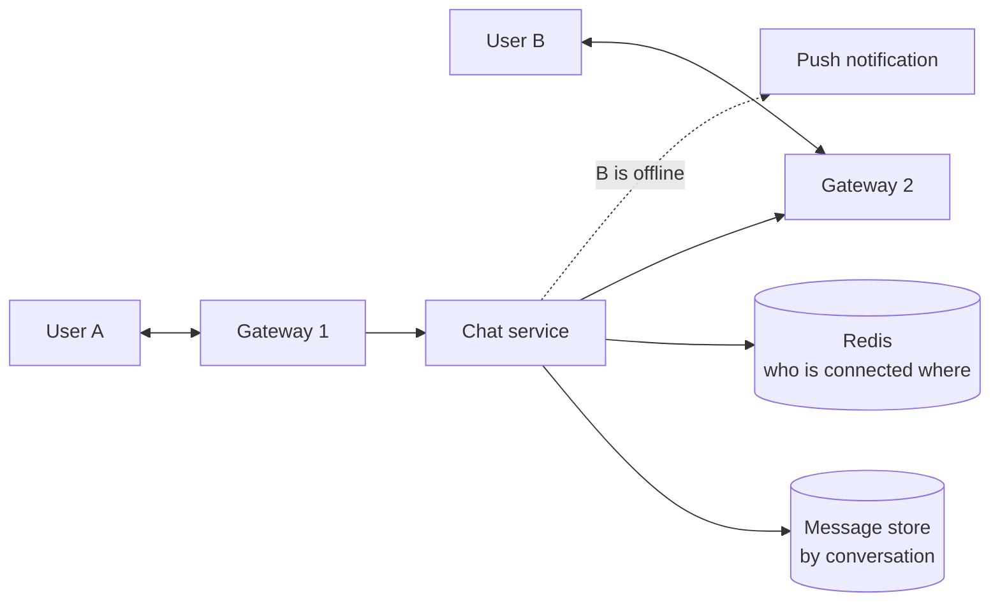

<!-- Written by `npm run lessons` from the lesson data in src/data. Edit the lesson there, not this page. -->

# Design a chat app (like WhatsApp)

**System Design · Unit 8: High-level design questions · Lesson 4 of 11 · Must know**

> **In one line.** One-to-one and group messaging, with delivery receipts and online status.

[Open this lesson on the site](https://learn.hamropedia.com/system-design/design-a-chat-app-like-whatsapp/) for its animation, the practice game and tap-to-explain words.

## Why interviewers ask it

It tests real-time connections, routing between servers, storage for enormous write volumes, ordering and offline delivery.

## Functional requirements

- Send and receive messages in real time, one-to-one and in groups.
- Message history across devices; delivery to users who were offline.
- Sent, delivered and read receipts; online and last-seen status.

## Non-functional requirements

- Low latency (under about 200 ms).
- Messages are never lost, and stay in order within a conversation.
- Billions of messages a day.

## Estimates

- 500 million daily users × 40 messages ≈ 20 billion messages a day ≈ 230,000 per second on average.
- 20 billion × about 100 bytes ≈ 2 TB of text a day.

## API

- WebSocket events: send_message {conversation_id, client_msg_id, text}, ack, receipt
- REST: GET /conversations/{id}/messages?before=cursor

## Data model

- messages: partition key conversation_id, sort key message_id (time-ordered), in a Cassandra-style store
- conversations and members; user → connected gateway (Redis)

## From version 1 to the final design

1. Version 1: one server; clients poll a database for new messages.
2. Version 2: WebSockets to that server, pushing instead of polling.
3. Version 3: many gateway servers plus a registry of who is connected where, with messages routed between gateways.
4. Version 4: a partitioned message store, push notifications for offline users, receipts, presence and groups.

## The design, step by step

1. Each client keeps a WebSocket connection to a chat gateway server.
2. Sending: gateway → chat service gives the message a time-ordered ID and stores it, then routes it.
3. Routing: look up the recipient's gateway in Redis and push to it; if they're offline, keep it stored and send a push notification.
4. Groups: send a copy to each member (small groups), or have members fetch it (very large groups).
5. Receipts and presence are small events that travel the same path.

## Picture it



*The chat service stores every message first, then routes it to the recipient's gateway, or sends a push notification if they're offline.*

## Deep dives

- Ordering: a sequence number per conversation; clients sort by it.
- Retries without duplicates: the client creates a message ID, so resending is idempotent.
- Presence: heartbeats with a TTL in Redis; don't broadcast every status change to everyone.
- End-to-end encryption: the server only ever stores ciphertext.

## Common mistakes

- Polling for new messages at scale: millions of clients asking "anything new?" every few seconds, mostly for nothing.
- Forgetting offline users: their messages must be stored and delivered when they reconnect.
- Having no plan for message order or duplicates: retries and several servers can deliver a message twice, or out of order.

> **Not true:** Delivery: clients poll every few seconds, which scales well to millions of users.  
> **In fact:** Almost every poll would come back empty, yet each one costs a request. Keep a WebSocket open to each client, and push messages as they arrive.

## In the interview

Clients hold WebSocket connections to gateway servers, and Redis maps each user to their gateway. The chat service stores every message in a Cassandra-style store, partitioned by conversation, with a time-ordered ID. Then it routes the message to the recipient's gateway. If they're offline, it keeps the message and sends a push notification. Client-generated message IDs make retries safe.

<details>
<summary>&lt;b>How do you handle a group with 100,000 members?&lt;/b></summary>

Don't write a copy for every member. Store the message once and let members fetch it, or deliver lazily as they come online.

</details>

<details>
<summary>&lt;b>How does a new phone get old messages?&lt;/b></summary>

History is stored on the server by conversation; the device syncs from the last message ID it has.

</details>

## Practise

Try each one yourself first, then open the answer and compare.

### 1. Explain

Explain how a message reaches a user on a different gateway, and what happens if they're offline.

<details>
<summary>Show one good answer</summary>

Asha (on gateway 1) sends Ben (on gateway 7) a message:  
1. Asha's app sends it over her WebSocket, with a message id it created itself (client_msg_id), so a resend can't create a duplicate.  
2. Gateway 1 passes it to the chat service, which gives it a time-ordered id and the next sequence number for the conversation, and stores it in the message store. Only then does Asha get an acknowledgement ("sent", one tick).  
3. The chat service looks Ben up in the routing store (Redis: user → gateway). He is on gateway 7, so it forwards the message there, and gateway 7 pushes it down Ben's WebSocket.  
4. Ben's app acknowledges it, and "delivered" (two ticks) travels back the same way to Asha; "read" follows when he opens the chat.

If Ben is offline: Redis has no gateway for him (his entry expired when his heartbeats stopped). The message is already safely stored, so nothing is lost. The chat service asks the push service to send a notification. When Ben reconnects, his app sends the last sequence number it has for each conversation and fetches everything after it, in order; then the delivered receipts go back to Asha.

</details>

### 2. Draw

Draw the clients, gateways, Redis routing and presence, chat service, message store and push service.

<details>
<summary>Show one good answer</summary>

Gateways hold the long-lived connections and nothing else; the chat service decides where each message goes, using the routing table in Redis. A message is stored before it is acknowledged, so a crash anywhere after that point loses nothing.

```text
Asha ══ WebSocket ══ Gateway 1        Gateway 7 ══ WebSocket ══ Ben
                        │                 ▲
                        │ send            │ 4. push to Ben
                        ▼                 │
                     Chat service ────────┘
                      │  │  │  3. where is Ben?
                      │  │  └──────► Redis
                      │  │            · user → gateway
                      │  │            · presence (heartbeat, TTL)
                      │  │ 2. store first
                      │  └─────────► Message store
                      │              (partition: conversation)
                      │ Ben offline?
                      └────────────► Push service ──► APNs / FCM
```

</details>

### 3. Apply

Choose the partition key and sort key for messages, and explain the main query they serve.

<details>
<summary>Show one good answer</summary>

Partition key: the conversation (plus a time bucket); sort key: the message id, newest first.

The main query is "show the latest 50 messages in this chat", then "older ones as I scroll up". With conversation_id in the partition key, all of a chat's messages live together on the same nodes, so that query reads one partition, with no scatter across the cluster. With the time-ordered message id as the clustering (sort) key, they are already stored in order, so reading the newest 50, or the 50 before a cursor, is a single sequential read.

Why add a bucket (such as the month)? A very busy group chat that runs for years would otherwise become one enormous partition. Splitting it by month keeps partitions bounded; reading older history moves to the previous bucket.

Message ids are Snowflake-style: unique and time-ordered, so they double as the sort key and the pagination cursor.

```sql
-- Cassandra (CQL)
CREATE TABLE messages (
  conversation_id  UUID,
  bucket           INT,          -- e.g. year * 100 + month; bounds the partition size
  message_id       BIGINT,       -- Snowflake-style: unique and time-ordered
  sender_id        BIGINT,
  body             BLOB,         -- end-to-end encrypted
  PRIMARY KEY ((conversation_id, bucket), message_id)
) WITH CLUSTERING ORDER BY (message_id DESC);

-- The main query: the newest page, then older pages using a cursor
SELECT message_id, sender_id, body
FROM messages
WHERE conversation_id = ? AND bucket = ? AND message_id < ?
LIMIT 50;
```

</details>

### 4. Trade-offs

Fan-out on write or on read for group messages?

<details>
<summary>Show one good answer</summary>

Fan-out on write: when a message is sent to a group, put a copy (or a pointer) into every member's inbox, and push it to each online member straight away.  
• Reads are trivial: each member reads their own inbox, and unread counts are easy.  
• Writes multiply by the group size: one message to a 256-member group is 256 writes, and a 100,000-member channel is 100,000 writes per message.

Fan-out on read: store the message once, in the group's timeline; each member fetches from the timeline using their own "last read" cursor.  
• Writes are a single row, whatever the group size.  
• Reads do more work, and every member's unread count and receipts need separate tracking.

The usual answer depends on group size. Small groups (WhatsApp caps them at around a thousand members) use fan-out on write: the multiplication is bounded and the experience is instant. Huge broadcast channels use fan-out on read, with online members notified that "there is something new" rather than sent a copy each.

</details>

## Go further (optional)

- READ · [Hello Interview: design a chat system](https://www.google.com/search?q=Hello+Interview+design+a+chat+system) · hellointerview.com · free guides
- READ · [Hello Interview: design WhatsApp](https://www.google.com/search?q=Hello+Interview+design+WhatsApp) · hellointerview.com · free guides
- WATCH · [ByteByteGo: design WhatsApp](https://www.youtube.com/results?search_query=ByteByteGo+design+WhatsApp) · ByteByteGo · YouTube

---

[← Design a notification system](design-a-notification-system.md) · [All lessons](../../README.md) · [Design a news feed (like Twitter or Instagram) →](design-a-news-feed-like-twitter-or-instagram.md)
