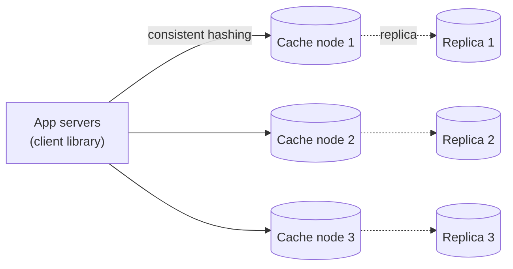

<!-- Written by `npm run lessons` from the lesson data in src/data. Edit the lesson there, not this page. -->

# Design a distributed cache

**System Design · Unit 8: High-level design questions · Lesson 11 of 11 · Should know**

> **In one line.** A shared in-memory key-value cache, like Redis or Memcached, spread across many machines.

[Open this lesson on the site](https://learn.hamropedia.com/system-design/design-a-distributed-cache/) for its animation, the practice game and tap-to-explain words.

## Why interviewers ask it

It tests partitioning, consistent hashing, eviction, replication and failure handling — the building blocks of most large systems.

## Functional requirements

- get, set and delete, with TTLs.
- Grow capacity by adding nodes.

## Non-functional requirements

- Reads in under a millisecond; very high throughput.
- Survive node failures with limited data loss.

## Estimates

- 1 TB of hot data ÷ 64 GB per node ≈ 16 nodes, plus replicas.

## API

- get(key), set(key, value, ttl), delete(key)

## Data model

- Per node: a hash map plus an LRU list for eviction.

## From version 1 to the final design

1. Version 1: one cache server with a hash map and LRU eviction.
2. Version 2: several servers using hash % N routing.
3. Version 3: consistent hashing with virtual nodes.
4. Version 4: replicas, failover, hot-key handling and stampede protection.

## The design, step by step

1. Clients, or a proxy, route each key to a node with consistent hashing and virtual nodes.
2. Each node: an in-memory hash table with LRU eviction and TTL expiry.
3. Each shard has a replica for failover.
4. Cluster membership comes from a configuration service, or nodes gossip with each other.

## Picture it



*The client library picks the node for each key with consistent hashing. Each node has a replica ready to take over if it fails.*

## Deep dives

- Hot keys: replicate them, or add a small local cache inside the app.
- Cache stampede: let one request rebuild a key while the others wait.
- Node failure: promote the replica; the misses fall on the database, so warm the cache gradually.
- Optional persistence (snapshots or an append-only file in Redis).

## Common mistakes

- hash % N routing, which causes mass misses whenever servers change.
- Having no plan for hot keys: one very popular key can overload the single cache node that holds it.
- No warm-up after a failure: an empty cache sends every request to the database at once.

> **Not true:** Routing: hash % N keeps most keys on the same server when a server is added.  
> **In fact:** Changing N changes the answer for almost every key, so nearly all lookups miss at once. Consistent hashing moves only about 1/N of the keys.

## In the interview

Keys are spread across nodes with consistent hashing and virtual nodes, so adding a node moves only a small share of the keys. Each node is an in-memory hash map with LRU eviction and TTLs, replicated for failover. Hot keys get extra replicas or a local cache, and stampedes are prevented by letting one request rebuild a key.

<details>
<summary>&lt;b>Redis or Memcached?&lt;/b></summary>

Memcached: simple, multi-threaded, strings only. Redis: rich data structures, persistence options, replication and clustering.

</details>

<details>
<summary>&lt;b>What happens when a node dies?&lt;/b></summary>

Its replica is promoted. Without replicas, its keys become misses that hit the database until the cache warms up again.

</details>

## Practise

Try each one yourself first, then open the answer and compare.

### 1. Explain

Explain how a key finds its node, and what happens when a node is added.

<details>
<summary>Show one good answer</summary>

Finding a key's node: every client (or a proxy in front of the nodes) knows the hash ring. Each node is placed on the ring at many points (virtual nodes). To find "user:42", hash the key to a point on the ring and walk clockwise to the first node's point: that node owns the key. The client then talks to that node directly. No central lookup is needed; everyone computes the same answer from the same membership list, which comes from a configuration service (or the nodes gossip it among themselves).

Adding a node: it is placed on the ring at its own virtual points. Each of those points takes over only the stretch of ring just before it, so it takes keys from its neighbours only, about 1 in N of all keys, spread evenly thanks to the virtual nodes. Every other key stays where it was.

Those moved keys aren't copied over; they simply start missing on the new node and are refilled from the database as they are requested. The hit rate dips briefly and recovers as the new node warms up. With hash % N instead, almost every key would move at once, and the database would take the full load.

</details>

### 2. Draw

Draw clients, the consistent-hash ring, and cache nodes with replicas.

<details>
<summary>Show one good answer</summary>

Each key goes to the next node clockwise on the ring, and each node has a replica on a different machine for failover. Membership (which nodes exist) comes from the configuration service, so every client builds the same ring.

```text
Clients (each with the ring + membership)
  │  hash("user:42") → a point → next node clockwise
  ▼
      ┌──────────── hash ring ────────────┐
      │    A#1     B#1     C#1     A#2    │   (many virtual
      │  ●───────●───────●───────●──── … │    points per node)
      └────┬───────┬───────┬──────────────┘
           ▼       ▼       ▼
        Node A   Node B   Node C
        hash map + LRU + TTL, in memory
           │        │        │ copies
           ▼        ▼        ▼
        Replica  Replica  Replica   (promoted if
          A'       B'       C'       a node dies)

Config service: the list of nodes ──► clients
Add node D: D's points take ~1/N of keys
from their neighbours; nothing else moves.
```

</details>

### 3. Apply

Combine your LRU cache and consistent-hash ring into a small multi-node cache simulation in Python.

<details>
<summary>Show one good answer</summary>

The simulation combines the earlier pieces: a consistent-hash ring with 100 virtual nodes each, and an OrderedDict LRU per node (200 keys each). The traffic is 50,000 requests over 2,000 keys, where a few keys are far more popular than the rest, as in real life. Every miss reads the "database" and fills the cache (cache-aside).

With 3 nodes, the hit rate settles around 79%, and every node fills to its 200-key capacity. Adding a fourth node moves 546 of the 2,000 keys (27%, close to the ideal 25%) to the new node; the next requests for those keys miss, so the hit rate dips to 77%. Once the new node warms up, the hit rate climbs to 83%, higher than before, because the cluster now holds 800 keys instead of 600.

```python
import bisect
import hashlib
import random
from collections import OrderedDict


def h(s):
    return int(hashlib.md5(s.encode()).hexdigest(), 16)


class Ring:
    def __init__(self, nodes, vnodes=100):
        self.points = sorted((h(f"{n}#{i}"), n) for n in nodes for i in range(vnodes))
        self.keys = [p for p, _ in self.points]

    def node_for(self, key):
        return self.points[bisect.bisect(self.keys, h(key)) % len(self.points)][1]


class LRUNode:
    def __init__(self, capacity):
        self.capacity, self.data = capacity, OrderedDict()

    def get(self, key):
        if key not in self.data:
            return None
        self.data.move_to_end(key)
        return self.data[key]

    def set(self, key, value):
        self.data[key] = value
        self.data.move_to_end(key)
        if len(self.data) > self.capacity:
            self.data.popitem(last=False)


class DistributedCache:
    def __init__(self, names, capacity):
        self.capacity = capacity
        self.nodes = {name: LRUNode(capacity) for name in names}
        self.ring = Ring(names)

    def add_node(self, name):
        self.nodes[name] = LRUNode(self.capacity)
        self.ring = Ring(list(self.nodes))

    def get(self, key):
        return self.nodes[self.ring.node_for(key)].get(key)

    def set(self, key, value):
        self.nodes[self.ring.node_for(key)].set(key, value)


def hit_rate(cache, requests):
    hits = 0
    for key in requests:
        if cache.get(key) is not None:
            hits += 1
        else:
            cache.set(key, f"value of {key}")    # cache-aside: fill from the database
    return round(hits / len(requests), 3)


random.seed(3)
keys = [f"user:{i}" for i in range(2_000)]
weights = [1 / (i + 1) for i in range(len(keys))]   # a few keys are very popular
traffic = random.choices(keys, weights, k=50_000)

cache = DistributedCache(["n1", "n2", "n3"], capacity=200)
print("warm-up:", hit_rate(cache, traffic[:20_000]))          # warm-up: 0.78
print("steady:", hit_rate(cache, traffic[20_000:30_000]))     # steady: 0.791
print({name: len(node.data) for name, node in cache.nodes.items()})
# {'n1': 200, 'n2': 200, 'n3': 200}

before = {k: cache.ring.node_for(k) for k in keys}
cache.add_node("n4")
print("moved:", sum(before[k] != cache.ring.node_for(k) for k in keys))   # moved: 546
print("just after:", hit_rate(cache, traffic[30_000:32_000]))  # just after: 0.769
print("warm again:", hit_rate(cache, traffic[32_000:]))        # warm again: 0.83
```

</details>

### 4. Trade-offs

Routing in the client library or through a proxy layer: compare.

<details>
<summary>Show one good answer</summary>

Routing in the client library:  
• No extra hop: the client talks straight to the right node, which gives the lowest latency (this matters when the whole point is sub-millisecond reads).  
• No proxy tier to run and scale.  
• But every client, in every language your company uses, needs a correct, identical implementation of the hashing and of membership changes; a bug or an old library version sends keys to the wrong node.  
• Membership changes must reach every client; and every client keeps connections to every node, which adds up with thousands of app servers.

Routing through a proxy layer (for example twemproxy, mcrouter, Envoy):  
• Clients stay simple: they speak plain cache protocol to a local or nearby proxy.  
• Membership and routing rules change in one place; the proxy pools connections, and can add features such as replication, failover and shadowing traffic.  
• But every request pays an extra network hop (a fraction of a millisecond), and the proxies themselves must be scaled and kept highly available, or they become the bottleneck.

A common answer: client-side routing for a few latency-critical services in one language; a proxy (often running beside each app server, to keep the hop local) when many teams and languages share the cache.

</details>

## Go further (optional)

- READ · [Hello Interview: design a key-value store](https://www.google.com/search?q=Hello+Interview+design+a+key-value+store) · hellointerview.com · free guides
- READ · [Scale with Redis Cluster](https://www.google.com/search?q=Redis+docs+scale+with+Redis+Cluster) · Redis documentation
- WATCH · [ByteByteGo: how Redis works](https://www.youtube.com/results?search_query=ByteByteGo+how+Redis+works) · ByteByteGo · YouTube

---

[← Design a real-time leaderboard](design-a-real-time-leaderboard.md) · [All lessons](../../README.md) · [Design a RAG assistant over company documents →](../unit-9-ai-ml-design/design-a-rag-assistant-over-company-documents.md)
