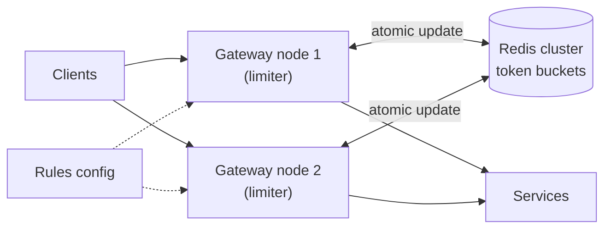

<!-- Written by `npm run lessons` from the lesson data in src/data. Edit the lesson there, not this page. -->

# Design a distributed rate limiter

**System Design · Unit 8: High-level design questions · Lesson 2 of 11 · Must know**

> **In one line.** A service that limits how many requests each client can make, enforced consistently across many API servers.

[Open this lesson on the site](https://learn.hamropedia.com/system-design/design-a-distributed-rate-limiter/) for its animation, the practice game and tap-to-explain words.

## Why interviewers ask it

It tests algorithms (token bucket and windows), shared state across servers, atomic updates and failure handling, all in one small system.

## Functional requirements

- Limit requests per user, API key or IP address per time window (for example 100 per minute).
- Different rules for different endpoints.
- Reject with 429 and tell the client when to retry.

## Non-functional requirements

- Adds very little latency (1–2 ms at most).
- Highly available, and accurate enough across servers.
- Handles millions of clients.

## Estimates

- 10 million active clients × one counter each × about 100 bytes ≈ 1 GB in Redis: it easily fits in memory.

## API

- Internal: allow(client_id, rule) → {allowed, remaining, retry_after}
- Response headers: X-RateLimit-Remaining, Retry-After

## Data model

- One Redis key per client per rule: tokens and last refill time (token bucket), or a counter with a TTL (fixed window).

## From version 1 to the final design

1. Version 1: an in-memory counter per user on one server.
2. Version 2: many servers, so the counters move to Redis.
3. Version 3: atomic updates with a Lua script, a token bucket for bursts, and rules from configuration.
4. Version 4: several regions, a fail-open fallback, and monitoring of rejected requests.

## The design, step by step

1. The limiter runs as middleware in the API gateway.
2. Rules are loaded from a config store and cached locally.
3. Counters live in a Redis cluster and are checked and updated atomically with a Lua script (or INCR plus EXPIRE for fixed windows).
4. Over the limit → 429 with Retry-After.

## Picture it



*Every gateway node checks the same buckets in Redis, so a client's limit is shared across all nodes.*

## Deep dives

- Race conditions: two servers reading and writing the same counter at once → use atomic Redis operations or a Lua script.
- Multiple regions: a limit per region (slightly inaccurate) or a global store (slower).
- Redis failure: fail open, with a local in-memory limit as a backup.
- Hot clients: spread counters across Redis nodes by client ID.

## Common mistakes

- Reading a counter and writing it back as two separate steps: two servers read the same value, and both let a request through.
- Limiting per server instead of across all servers.
- Having no answer to "what if Redis is down?". Decide in advance whether the limiter then lets requests through or blocks them.

> **Not true:** Shared counter: read it, add one and write it back as separate steps; that works across servers.  
> **In fact:** Two servers can read the same value and both let a request through, so the limit is passed. Use one atomic operation, such as Redis INCR or a Lua script.

## In the interview

I'd enforce limits in the API gateway using a token bucket per client and rule, with state in a Redis cluster updated atomically by a Lua script, adding about a millisecond. Rules come from configuration. Requests over the limit get 429 with Retry-After. If Redis is unavailable, the gateway fails open with a local backup limit.

<details>
<summary>&lt;b>Why a Lua script?&lt;/b></summary>

It runs the read, the refill and the decrement as one atomic step inside Redis, so two requests can't both take the last token.

</details>

<details>
<summary>&lt;b>How accurate is it across regions?&lt;/b></summary>

Per-region limits are fast but can let a client go slightly over the global limit; a global store is accurate but adds cross-region latency.

</details>

## Practise

Try each one yourself first, then open the answer and compare.

### 1. Explain

Explain where the limiter sits and what happens on each request.

<details>
<summary>Show one good answer</summary>

The limiter sits in the API gateway, as middleware that runs before the request is passed to any service, so blocked requests never cost the services anything.

On each request:  
1. Identify who is asking: the API key, the user ID from the token, or the IP address if there is no login.  
2. Find the rule for this endpoint and client tier (for example, "search: 100 per minute"). Rules come from a config store and are cached in the gateway's memory.  
3. Check and update the client's counter in Redis in one atomic step (a Lua script, or INCR for a fixed window), so two gateways can't both think there is room.  
4. Allowed: forward the request, adding headers such as X-RateLimit-Remaining.  
5. Not allowed: reply 429 Too Many Requests with Retry-After, and don't call the service.

The whole check should add a millisecond or two. If Redis is down, fall back to a local in-memory limit per gateway (fail open, but not unlimited).

</details>

### 2. Draw

Draw clients → gateway (with the limiter) → services, with Redis beside the gateway.

<details>
<summary>Show one good answer</summary>

The limit is checked once, at the edge, and shared through Redis, so it holds whichever gateway a request lands on. Rules are read from the config store occasionally, never on every request.

```text
Clients
  │
  ▼
Load balancer
  ├──────────────┬──────────────┐
  ▼              ▼              ▼
Gateway 1      Gateway 2      Gateway 3
[limiter]      [limiter]      [limiter]
  │  ▲             │              │
  │  │ atomic check and update    │
  └──┴──────► Redis cluster ◄─────┘
     │        (one counter per client per rule)
     │
     ├── over the limit → 429 + Retry-After
     └── allowed ──► Services

Config store ── rules, cached in each gateway
```

</details>

### 3. Apply

Implement a sliding-window-log limiter in Python, then sketch the Redis commands you would use for it.

<details>
<summary>Show one good answer</summary>

The sliding-window log keeps, per client, the times of the requests it allowed in the last window. Each new request first forgets times older than the window, then is allowed only if fewer than the limit remain. Unlike a fixed window, there is no edge where a client can fire twice the limit.

With a limit of 3 per 60 seconds: requests at 0, 10 and 20 s pass; 30 and 59 s are refused; at 60.5 s the request from 0 s has dropped out, so one more passes; at 61 s the window is full again; at 75 s the 10 s request has dropped out.

In Redis, keep one sorted set per client, with timestamps as scores, and run these steps atomically in a Lua script:  
• ZREMRANGEBYSCORE rl:{client} 0 (now − 60000): drop entries older than the window.  
• ZCARD rl:{client}: count what is left.  
• If the count is below the limit: ZADD rl:{client} now {unique request id}, then PEXPIRE rl:{client} 60000, and allow; otherwise refuse.

The cost: memory for every allowed request, per client. At high limits, a sliding-window counter (two fixed-window counts, weighted) is the cheaper approximation.

```python
from collections import deque


class SlidingWindowLog:
    def __init__(self, limit, window_s, clock):
        self.limit, self.window, self.clock = limit, window_s, clock
        self.logs = {}                              # client -> times of allowed requests

    def allow(self, client):
        now = self.clock()
        log = self.logs.setdefault(client, deque())
        while log and log[0] <= now - self.window:  # forget requests outside the window
            log.popleft()
        if len(log) < self.limit:
            log.append(now)
            return True
        return False


now = [0.0]                                         # a fake clock, in seconds
limiter = SlidingWindowLog(limit=3, window_s=60, clock=lambda: now[0])
results = []
for t in [0, 10, 20, 30, 59, 60.5, 61, 75]:
    now[0] = t
    results.append((t, limiter.allow("key-1")))
print(results)
# [(0, True), (10, True), (20, True), (30, False), (59, False), (60.5, True), (61, False), (75, True)]
```

</details>

### 4. Trade-offs

Token bucket or sliding window for an API that should allow short bursts?

<details>
<summary>Show one good answer</summary>

Token bucket.

It is built for exactly this: the bucket's size is the burst you allow, and the refill rate is the steady limit. A client that has been quiet can fire, say, 20 requests at once; a client that keeps sending requests is held to 10 a second. Per client it stores just two numbers (tokens and last refill time), so it is cheap in memory and in Redis.

Sliding window (log or counter) is about fairness over a moving window: never more than N in any 60 seconds. It allows a burst of up to N at once too, but then the client must wait for the whole window to slide before it gets capacity back, which feels stricter than a refill. The log version is exact but stores a timestamp per request; the counter version is cheap but approximate.

So: token bucket when bursts are welcome and you care about the long-run rate (most public APIs); sliding window when the hard rule is "never more than N per window" (for example, a contract with a partner, or login attempts).

</details>

## Go further (optional)

- READ · [Hello Interview: design a rate limiter](https://www.google.com/search?q=Hello+Interview+design+a+rate+limiter) · hellointerview.com · free guides
- READ · [Scaling your API with rate limiters](https://www.google.com/search?q=Stripe+blog+scaling+your+API+with+rate+limiters) · Stripe blog
- WATCH · [ByteByteGo: rate limiter system design](https://www.youtube.com/results?search_query=ByteByteGo+rate+limiter+system+design) · ByteByteGo · YouTube

---

[← Design a URL shortener (like bit.ly)](design-a-url-shortener-like-bit-ly.md) · [All lessons](../../README.md) · [Design a notification system →](design-a-notification-system.md)
