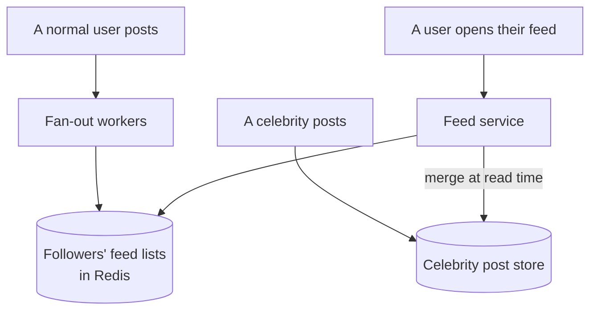

<!-- Written by `npm run lessons` from the lesson data in src/data. Edit the lesson there, not this page. -->

# Design a news feed (like Twitter or Instagram)

**System Design · Unit 8: High-level design questions · Lesson 5 of 11 · Must know**

> **In one line.** Show each user a feed of recent posts from the people they follow.

[Open this lesson on the site](https://learn.hamropedia.com/system-design/design-a-news-feed-like-twitter-or-instagram/) for its animation, the practice game and tap-to-explain words.

## Why interviewers ask it

It tests the fan-out trade-off — do the work when posting or when reading — plus caching and the celebrity problem.

## Functional requirements

- Create posts; follow and unfollow users.
- View a personalised feed (newest first, or ranked), with pagination.

## Non-functional requirements

- The feed loads fast (under about 200 ms); very read-heavy.
- Eventual consistency is fine: a post can appear a few seconds later.

## Estimates

- 300 million daily users × 10 feed views ≈ 35,000 reads per second; 2 posts each a day ≈ 7,000 writes per second.

## API

- POST /posts
- GET /feed?cursor=…

## Data model

- posts (post_id, author_id, content, created_at)
- follows (follower_id, followee_id)
- feed cache: user_id → recent post IDs (Redis)

## From version 1 to the final design

1. Version 1: fan-out on read: query the posts of everyone you follow, sorted by time.
2. Version 2: fan-out on write into per-user feed lists in Redis.
3. Version 3: a hybrid that handles celebrities differently.
4. Version 4: ranking, media through a CDN, and skipping inactive users.

## The design, step by step

1. Fan-out on write (push): when someone posts, add the post ID to each follower's feed list. Reads are fast.
2. Fan-out on read (pull): build the feed at request time from the followed users' recent posts. Writes are cheap; reads are slow.
3. Hybrid: push for normal users; for celebrities with millions of followers, pull their posts at read time and merge.
4. Post content comes from a cache and media from a CDN; a ranking service can reorder the feed.

## Picture it



*Normal posts are pushed into followers' feeds when written. Celebrity posts are pulled and merged in when a feed is read.*

## Deep dives

- The celebrity problem: pushing to 50 million followers for every post is far too expensive → use the hybrid.
- Each user's feed list keeps only the latest few hundred post IDs.
- Skip pushing to inactive users; build their feed when they log in.
- Ranking: gather candidates → score them with a model → re-rank for variety.

## Common mistakes

- Push-only fan-out that ignores celebrities: one post from an account with millions of followers means millions of writes.
- Storing whole posts in every feed instead of post IDs.
- Offset pagination on a feed that keeps changing.

> **Not true:** Fan-out: push each new post to the followers' feeds, for celebrity accounts too.  
> **In fact:** One post from an account with 50 million followers would mean 50 million writes. Push for ordinary accounts, and fetch celebrity posts when the feed is read.

## In the interview

I'd use a hybrid fan-out. When a normal user posts, workers push the post ID into each follower's feed list in Redis, so reading is a fast cache lookup. Celebrity posts aren't fanned out; their recent posts are fetched at read time and merged in. Post bodies come from a cache and media from a CDN.

<details>
<summary>&lt;b>Why not fan out on write for everyone?&lt;/b></summary>

A celebrity with 50 million followers would cause 50 million writes per post: slow and wasteful.

</details>

<details>
<summary>&lt;b>How do you paginate a feed that keeps changing?&lt;/b></summary>

With a cursor: continue from the last post ID the user saw, so new posts don't shift the pages.

</details>

## Practise

Try each one yourself first, then open the answer and compare.

### 1. Explain

Explain push, pull and hybrid fan-out, and the celebrity problem.

<details>
<summary>Show one good answer</summary>

• Push (fan-out on write): when someone posts, add the post's id to the feed list of every follower straight away. Reading a feed is then just reading one ready-made list: very fast. The cost is at write time: one post makes as many writes as the author has followers.  
• Pull (fan-out on read): store each post once. When someone opens their feed, fetch the recent posts of everyone they follow and merge them. Posting is cheap, but every feed load does a lot of work, and feeds are read far more often than posts are written.  
• Hybrid: push for ordinary users, who have hundreds of followers; pull for the few accounts with millions. At read time, the pre-built feed list is merged with the recent posts of the celebrities you follow.

The celebrity problem: with pure push, one post from an account with 50 million followers means 50 million feed writes. It overloads the fan-out workers and delays everyone else's posts, and most of those followers won't even open the app today. The hybrid avoids it: celebrities' posts are fetched when someone actually reads.

</details>

### 2. Draw

Draw the write path and the read path for the hybrid design.

<details>
<summary>Show one good answer</summary>

On write, only ordinary authors' posts are fanned out to followers' feed lists; a celebrity's post is just stored. On read, the ready-made feed list is merged with the latest posts of the few celebrities the reader follows, then hydrated (ids turned into full posts) and optionally ranked.

```text
WRITE
Author ── POST /posts ──► Post service ──► Posts DB + post cache
                             │
                             ├─ ordinary author ──► Fan-out queue
                             │                        │ workers
                             │                        ▼
                             │        each follower's feed list (Redis)
                             │        user → [latest ~500 post ids]
                             │
                             └─ celebrity ──► only their own post list

READ
Reader ── GET /feed ──► Feed service
                          1. read my feed list (Redis)
                          2. + latest posts of celebrities I follow
                          3. merge by time (or rank)
                          4. hydrate: post cache, media via CDN
                          ──► page of posts + cursor
```

</details>

### 3. Apply

Estimate how many writes one celebrity post causes with push fan-out, and compare with the hybrid.

<details>
<summary>Show one good answer</summary>

With pure push, one post from an account with 50 million followers is 50 million feed-list writes; at 5 posts a day, 250 million writes a day from one account.

To put that in proportion: all ordinary posting (7,000 posts a second × about 200 followers each) is about 1.4 million feed writes a second. One celebrity post is 50 million ÷ 1.4 million ≈ 36 seconds of the whole system's normal fan-out capacity, arriving all at once, and delaying everyone else's posts behind it.

With the hybrid: the post is written once (to the celebrity's own post list): 1 write instead of 50 million. The cost moves to reads: each follower's feed load does one extra lookup, "latest posts of the celebrities I follow", which is a few hot keys that sit in a replicated cache.

(Even with push, skipping inactive followers helps: if only 30% open the app today, that is 15 million writes, not 50; the others' feeds are built when they log in.)

```python
followers = 50_000_000
posts_per_day = 5
normal_fanout_per_s = 7_000 * 200                 # every ordinary post, ~200 followers each

print(followers * posts_per_day)                  # 250000000 feed writes a day, pure push
print(round(followers / normal_fanout_per_s, 1))  # 35.7 seconds of normal fan-out, per post
```

</details>

### 4. Trade-offs

A chronological feed or a ranked feed: what changes in the architecture?

<details>
<summary>Show one good answer</summary>

Chronological feed:  
• The feed list is just post ids in time order, so fan-out stores them sorted and reading is a range read.  
• Caching is simple, and pagination is a simple cursor ("posts older than this one").  
• Behaviour is predictable and easy to explain.

Ranked feed: the architecture grows several new parts:  
• Candidate generation: gather a few hundred possible posts (the fan-out list, plus celebrity posts, plus recommended posts from accounts you don't follow).  
• Features: a feature store with signals per post and per user (likes so far, how often you interact with the author, the post's age), fetched at read time.  
• A ranking service that scores candidates with a model, inside the latency budget (tens of milliseconds).  
• Re-ranking for variety and rules (not five posts in a row from one author; remove what you have already seen).  
• Logging of what was shown and what was clicked, to train the next model, plus experiment infrastructure for A/B tests.  
• Pagination gets harder: the ranked list changes between requests, so you store the ranked result for the session and page through that.

In short: chronological is a data-structure problem; ranked is that, plus a machine-learning system on every read.

</details>

## Go further (optional)

- READ · [Hello Interview: design a news feed system](https://www.google.com/search?q=Hello+Interview+design+a+news+feed+system) · hellointerview.com · free guides
- READ · [Hello Interview: design a news feed](https://www.google.com/search?q=Hello+Interview+design+a+news+feed) · hellointerview.com · free guides
- WATCH · [ByteByteGo: design Twitter](https://www.youtube.com/results?search_query=ByteByteGo+design+Twitter) · ByteByteGo · YouTube

---

[← Design a chat app (like WhatsApp)](design-a-chat-app-like-whatsapp.md) · [All lessons](../../README.md) · [Design a video streaming platform (like YouTube or Netflix) →](design-a-video-streaming-platform-like-youtube-or-netflix.md)
