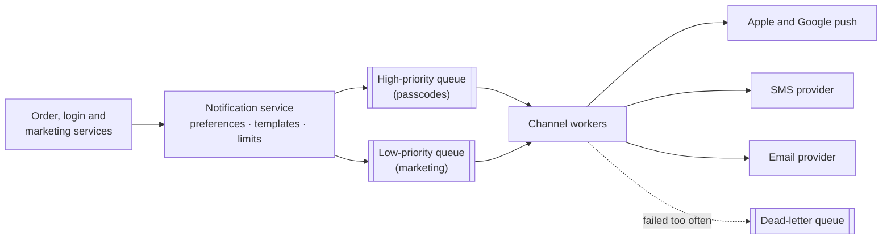

<!-- Written by `npm run lessons` from the lesson data in src/data. Edit the lesson there, not this page. -->

# Design a notification system

**System Design · Unit 8: High-level design questions · Lesson 3 of 11 · Must know**

> **In one line.** Send notifications (mobile push, SMS, email) to users reliably, at large scale.

[Open this lesson on the site](https://learn.hamropedia.com/system-design/design-a-notification-system/) for its animation, the practice game and tap-to-explain words.

## Why interviewers ask it

It tests queues, priorities, third-party integrations, retries and avoiding duplicates — everyday problems in real products.

## Functional requirements

- Services trigger notifications (order shipped, one-time passcodes, marketing).
- Channels: push, SMS, email; respect each user's preferences and opt-outs.
- Templates, scheduling, and retries on failure.

## Non-functional requirements

- Millions a day, with big spikes during campaigns.
- Passcodes must arrive in seconds; marketing can be slower.
- Delivered at least once, without spamming duplicates.

## Estimates

- 10 million push + 1 million SMS + 5 million emails a day ≈ 200 per second on average; campaigns can be 10–100 times higher.

## API

- POST /notifications {user_id, type, template_id, data, channels?, send_at?}

## Data model

- user_preferences (user_id, channel, opted_in)
- devices (user_id, push_token)
- notification_log (id, user_id, channel, status, created_at)

## From version 1 to the final design

1. Version 1: the order service calls the email provider directly.
2. Version 2: a notification service with templates and user preferences.
3. Version 3: a queue per channel, workers, retries and a dead-letter queue.
4. Version 4: priority lanes, idempotency keys, provider failover and per-user rate limits.

## The design, step by step

1. A notification service checks preferences and rate limits, and fills in the template.
2. It puts messages onto separate queues per channel (push, SMS, email) and per priority (passcodes ahead of marketing).
3. Channel workers call the providers (Apple and Google push services, an SMS gateway, an email service).
4. Retries with backoff; repeated failures go to a dead-letter queue; every status is recorded in a log.

## Picture it



*Messages are checked once, then queued by priority, so a marketing blast never delays a passcode. Workers deliver through outside providers.*

## Deep dives

- De-duplication: an idempotency key per notification, so retries don't send twice.
- Separate priority queues, so a marketing blast never delays a passcode.
- Provider failover: a second SMS provider.
- A per-user rate limit, so nobody gets spammed.

## Common mistakes

- Sending the notification inside the user's request, so a slow email or push provider keeps the user waiting. Queue it instead.
- One queue where marketing messages block passcodes.
- Retries without idempotency, so users get duplicates.

> **Not true:** One shared queue is fine for both marketing messages and login passcodes.  
> **In fact:** A marketing blast of millions would sit in front of the passcodes and delay them. Use separate queues, by priority.

## In the interview

Producers call a notification service that checks preferences, fills in templates and puts messages on queues per channel and priority. Workers deliver through providers like Apple and Google push services and SMS gateways, with retries, dead-letter queues and idempotency keys to avoid duplicates. Passcodes get a high-priority lane, so campaigns never delay them.

<details>
<summary>&lt;b>How do you avoid sending the same notification twice?&lt;/b></summary>

An idempotency key per notification, checked in a store before sending; the worker records 'sent' only after success.

</details>

<details>
<summary>&lt;b>What if a provider goes down?&lt;/b></summary>

Retry with backoff, then fail over to a backup provider, and circuit-break the failing one.

</details>

## Practise

Try each one yourself first, then open the answer and compare.

### 1. Explain

Explain the flow from 'order shipped' to a phone notification.

<details>
<summary>Show one good answer</summary>

1. The order service marks order 105 as shipped and publishes an "OrderShipped" event (through its outbox, so the event can't be lost). The notification service consumes it, or the order service calls POST /notifications, with an idempotency key such as "order-105-shipped".  
2. The notification service checks the key against its log: if this notification was already handled, it stops (no duplicates).  
3. It checks the user's preferences: is push allowed for order updates? Is the user opted out of everything? It applies a per-user rate limit.  
4. It looks up the user's active devices and their push tokens.  
5. It fills in the template ("Your order 105 has shipped") in the user's language.  
6. It puts one message per device on the push queue for normal priority, and records "queued" in the log.  
7. A push worker takes the message and calls Apple's (APNs) or Google's (FCM) push service with the device token.  
8. The provider delivers it to the phone. The worker records "sent". If the provider says the token is no longer valid, the device is marked inactive. A temporary failure is retried with backoff; after several failures, it goes to a dead-letter queue.

</details>

### 2. Draw

Draw the service, the queues per channel and priority, the workers and the providers.

<details>
<summary>Show one good answer</summary>

Separate queues per channel and priority mean a marketing blast can't delay a passcode, and each worker pool can be scaled and rate-limited to match its provider. Every step updates the delivery log.

```text
Services ── events / POST /notifications ──► Notification service
(orders, auth, marketing)                     1. de-duplicate (key)
                                              2. preferences, opt-outs
                                              3. per-user rate limit
                                              4. fill in the template
                                                 │
       ┌──────────────┬──────────────┬───────────┼───────────┐
       ▼              ▼              ▼           ▼           ▼
  push: high     push: low     SMS: high    email: high  email: low
  (passcodes)   (marketing)   (passcodes)   (receipts)  (newsletters)
       │              │              │           │           │
       ▼              ▼              ▼           ▼           ▼
  Push workers                  SMS workers   Email workers
       │                             │             │
       ▼                             ▼             ▼
  APNs / FCM                SMS gateway (+ backup)  Email provider

Failures: retry with backoff ──► dead-letter queue
Every status ──► delivery log
```

</details>

### 3. Apply

Design the data model for preferences, devices and the delivery log, with keys.

<details>
<summary>Show one good answer</summary>

• user_preferences is keyed by (user, channel, category), so a user can turn off marketing emails but keep order texts, and security messages can be treated as always on.  
• devices has its own id, because one user has several phones; the push token is unique, and tokens the provider rejects are marked inactive rather than deleted.  
• notification_log uses the notification's id as its primary key, which doubles as the idempotency key: retrying the same notification can't create a second row. It is indexed by user and time for "what did we send this person?".

At millions of rows a day, the log would be partitioned by day (and old partitions dropped after, say, 90 days), or kept in a wide-column store.

```sql
-- PostgreSQL
CREATE TABLE user_preferences (
  user_id     BIGINT  NOT NULL,
  channel     TEXT    NOT NULL CHECK (channel IN ('push', 'sms', 'email')),
  category    TEXT    NOT NULL,          -- 'security', 'orders', 'marketing'
  opted_in    BOOLEAN NOT NULL DEFAULT TRUE,
  updated_at  TIMESTAMPTZ NOT NULL DEFAULT now(),
  PRIMARY KEY (user_id, channel, category)
);

CREATE TABLE devices (
  device_id   UUID PRIMARY KEY,
  user_id     BIGINT NOT NULL,
  platform    TEXT   NOT NULL CHECK (platform IN ('ios', 'android', 'web')),
  push_token  TEXT   NOT NULL UNIQUE,
  active      BOOLEAN NOT NULL DEFAULT TRUE,     -- false once the provider rejects the token
  last_seen   TIMESTAMPTZ NOT NULL
);
CREATE INDEX devices_by_user ON devices (user_id) WHERE active;

CREATE TABLE notification_log (
  notification_id  TEXT PRIMARY KEY,             -- also the idempotency key
  user_id          BIGINT NOT NULL,
  channel          TEXT   NOT NULL,
  template_id      TEXT   NOT NULL,
  priority         TEXT   NOT NULL,              -- 'high' or 'low'
  status           TEXT   NOT NULL,              -- queued, sent, delivered, failed, skipped
  provider_msg_id  TEXT,
  attempts         INT    NOT NULL DEFAULT 0,
  created_at       TIMESTAMPTZ NOT NULL DEFAULT now(),
  updated_at       TIMESTAMPTZ NOT NULL DEFAULT now()
);
CREATE INDEX log_by_user_time ON notification_log (user_id, created_at DESC);
```

</details>

### 4. Trade-offs

One queue for everything, or separate queues per channel and priority?

<details>
<summary>Show one good answer</summary>

One queue for everything:  
• Simple: one thing to run, monitor and scale.  
• But head-of-line blocking: a 10-million-email newsletter sits in front of a one-time passcode, and the passcode arrives an hour late, so the user can't log in.  
• One slow provider (an SMS gateway limiting you to 100 a second) backs up push and email too.  
• You can't scale or rate-limit one channel without the others.

Separate queues per channel and priority:  
• Isolation: passcodes have their own fast lane; a struggling SMS provider only slows SMS.  
• Each worker pool is sized and rate-limited to match its provider's limits.  
• Retries and dead-letter queues per channel, so failures are easier to see and fix.  
• The cost: more queues to set up and monitor, routing logic, and a rule so low priority isn't left waiting forever (for example, workers take 9 high-priority messages for every 1 low).

For notifications, separate queues are clearly worth it: different channels and priorities really do have different speeds, limits and urgency.

</details>

## Go further (optional)

- READ · [Hello Interview: design a notification system](https://www.google.com/search?q=Hello+Interview+design+a+notification+system) · hellointerview.com · free guides
- WATCH · [ByteByteGo: notification system design](https://www.youtube.com/results?search_query=ByteByteGo+notification+system+design) · ByteByteGo · YouTube

---

[← Design a distributed rate limiter](design-a-distributed-rate-limiter.md) · [All lessons](../../README.md) · [Design a chat app (like WhatsApp) →](design-a-chat-app-like-whatsapp.md)
