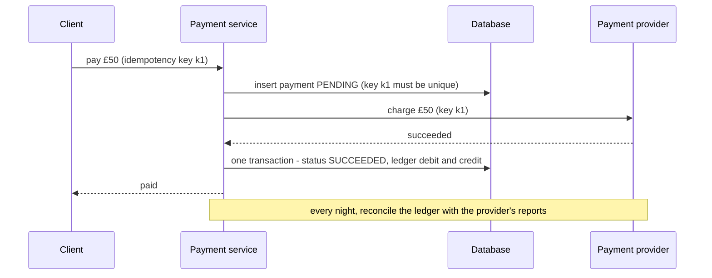

<!-- Written by `npm run lessons` from the lesson data in src/data. Edit the lesson there, not this page. -->

# Design a payment system

**System Design · Unit 8: High-level design questions · Lesson 8 of 11 · Must know**

> **In one line.** Process payments reliably: charge customers, record every money movement, and never lose money or charge twice.

[Open this lesson on the site](https://learn.hamropedia.com/system-design/design-a-payment-system/) for its animation, the practice game and tap-to-explain words.

## Why interviewers ask it

It tests correctness under failure — retries, timeouts, idempotency, transactions and audit trails — where a small bug means real money.

## Functional requirements

- Accept a payment for an order through a payment provider (PSP) that talks to the card networks.
- Record every money movement in a ledger.
- Refunds; reconciliation with the provider's reports.

## Non-functional requirements

- Correctness over speed: no double charges, no lost money.
- Strong consistency and a full audit trail.
- Secure (PCI DSS rules for card data) and highly available.

## Estimates

- 1 million payments a day ≈ 12 per second on average: the volume is modest; correctness is the hard part.

## API

- POST /payments {order_id, amount, currency, idempotency_key} → payment status
- Webhook from the provider: payment succeeded or failed

## Data model

- payments (id, order_id, amount, currency, status, idempotency_key UNIQUE)
- ledger_entries (id, account_id, payment_id, debit, credit, created_at), append-only and double-entry

## From version 1 to the final design

1. Version 1: call the payment provider and mark the order 'paid'.
2. Version 2: a payments table with statuses and idempotency keys.
3. Version 3: a double-entry ledger, written in the same transaction as the status change.
4. Version 4: webhooks, an outbox, reconciliation, and handling results that are unknown.

## The design, step by step

1. The payment service receives the request with an idempotency key; a unique constraint in the database blocks duplicates.
2. It creates a PENDING payment record, then calls the payment provider. The provider handles the card details, so you never store raw card numbers.
3. The provider's result (response or webhook) updates the status, and balanced double-entry ledger rows are written in the same transaction.
4. The order service is told through an outbox event.
5. A nightly reconciliation job compares the ledger with the provider's settlement files.

## Picture it



*The unique key stops double charges, the status and ledger change together in one transaction, and a nightly check catches any mismatch.*

## Deep dives

- Idempotency keys plus unique constraints make every retry safe.
- Double-entry ledger: every movement is a debit and an equal credit; balances are sums; entries are never edited, only added (corrections are new entries).
- Provider timeout: the result is unknown, so retry with the same idempotency key or ask the provider for the status before doing anything else.
- Store money as whole minor units (pence) together with the currency.

## Common mistakes

- Retrying a timed-out charge with a brand-new request.
- Storing money as floats: 0.1 + 0.2 is not exactly 0.3, so totals drift. Use whole pence (integers).
- Updating balances in place, with no ledger history.

> **Not true:** When a charge times out, the safe move is to send a brand-new charge request.  
> **In fact:** The first charge may have gone through, so a new request could charge the customer twice. Retry with the same idempotency key, or ask the provider for the status.

## In the interview

Correctness first. Every payment request carries an idempotency key enforced by a unique constraint. The payment service records a pending payment, then calls the payment provider. The provider holds the card data, so we never store card numbers. On the result, the service writes balanced double-entry ledger rows in one ACID transaction. Events go out through an outbox, and daily reconciliation against the provider catches any mismatch.

<details>
<summary>&lt;b>The call to the provider timed out. Did the customer pay?&lt;/b></summary>

We don't know. Never retry with a new request: retry with the same idempotency key, or ask the provider for the payment's status first.

</details>

<details>
<summary>&lt;b>Why double-entry?&lt;/b></summary>

Every debit has a matching credit, so the books always balance, mistakes show up as imbalances, and the history is a complete audit trail.

</details>

## Practise

Try each one yourself first, then open the answer and compare.

### 1. Explain

Explain how idempotency keys prevent a double charge, using a timeout example.

<details>
<summary>Show one good answer</summary>

The checkout sends POST /payments for order 77, £50, with an idempotency key the client generated once for this purchase: "pay-order-77".

1. The payment service inserts a PENDING payment row with that key. The key column is UNIQUE, so this can only succeed once.  
2. It calls the payment provider, passing the same key along.  
3. The provider charges the card, but the response is lost: a timeout. The service doesn't know whether the card was charged.  
4. The client (or the service itself) retries, with the same key.  
• At our end: the insert hits the unique constraint, so we find the existing payment instead of creating a second one, and return its status, or carry on from where it got to.  
• At the provider: they see a key they have already processed, and return the original result instead of charging again.  
5. If the result is still unknown, ask the provider "what happened to pay-order-77?" before anything else.

Without the key, the retry looks like a new purchase, and the customer is charged £100. With it, any number of retries charge exactly once.

</details>

### 2. Draw

Draw client → payment service → provider, with the ledger database, outbox and reconciliation job.

<details>
<summary>Show one good answer</summary>

Writes to the payment, the ledger and the outbox happen in one database transaction, so the order service is told exactly when, and only when, the money has really moved. Reconciliation is the safety net that compares our ledger with the provider's own records every day.

```text
Client ── POST /payments + Idempotency-Key ──► Payment service
                                                 │ 1. insert PENDING (key UNIQUE)
                                                 ▼
                                      ┌─── Payments DB ───────────────┐
                                      │ payments (idempotency_key UQ) │
                                      │ ledger_entries (append-only)  │
                                      │ outbox                        │
                                      └───────────────────────────────┘
                                                 │ 2. charge, same key
                                                 ▼
                                      Payment provider (PSP) ──► card networks
                                                 │ 3. response or webhook
                                                 ▼
                        one transaction: status + ledger rows + outbox event
                                                 │
                        outbox relay ──► "PaymentSucceeded" ──► Order service

Nightly: Reconciliation job ── compares ──► our ledger
                                      vs ──► provider's settlement file
         mismatches ──► alerts, manual review
```

</details>

### 3. Apply

Write the ledger rows (debits and credits) for a £50 purchase followed by a £20 partial refund.

<details>
<summary>Show one good answer</summary>

Double entry: every movement is written twice, a debit on one account and an equal credit on another, so each transaction balances (total debits = total credits) and the books as a whole always sum to zero. Rows are only ever added: the refund doesn't edit the purchase; it is a new transaction pointing at it.

Here the money the provider will pay us sits in a "provider receivable" account, and revenue is the shop's sales account. After both transactions, provider receivable has a £30 debit balance (50 − 20) and sales revenue a £30 credit balance: the customer has paid £30 net. Amounts are in pence, with the currency on every row.

```text
entry  txn        account               debit   credit  currency  note
─────  ─────────  ────────────────────  ──────  ──────  ────────  ─────────────────────
1      pay_P1     provider_receivable     5000             GBP    £50 purchase, order 77
2      pay_P1     sales_revenue                   5000     GBP
3      refund_R1  sales_revenue           2000             GBP    partial refund of P1
4      refund_R1  provider_receivable             2000     GBP

pay_P1:    debits 5000 = credits 5000  ✓
refund_R1: debits 2000 = credits 2000  ✓
Balances:  provider_receivable  5000 − 2000 = 3000 (debit)
           sales_revenue        5000 − 2000 = 3000 (credit)
```

</details>

### 4. Trade-offs

Why choose strong consistency and a relational database here, even if it costs some availability?

<details>
<summary>Show one good answer</summary>

Because in payments, a wrong answer is far worse than a slow one.

• Correctness is the product: a double charge or a vanished payment costs real money, customer trust, and sometimes regulatory trouble. An eventually consistent store that accepts two conflicting writes during a network split and "merges later" would mean deciding after the fact which customer charge to reverse.  
• The guarantees needed are exactly what relational databases give: ACID transactions (the payment status, the ledger rows and the outbox event commit together), unique constraints (idempotency keys), foreign keys, and checks (amounts positive, every transaction balanced).  
• Auditing and reconciliation need precise, queryable history: joins and sums over the ledger.  
• The volume is modest (about 12 payments a second on average), which one relational primary with replicas handles easily, so you don't need a distributed store's scale.

What is given up: during a failure, payments may be refused or delayed for a moment. That is recoverable: the client retries with the same idempotency key, or the order shows "payment processing". Lost or doubled money isn't recoverable so easily, so the trade is clear.

</details>

## Go further (optional)

- READ · [Hello Interview: payment system](https://www.google.com/search?q=Hello+Interview+payment+system) · hellointerview.com · free guides
- READ · [Designing robust and predictable APIs with idempotency](https://stripe.com/blog/idempotency) · Stripe blog
- WATCH · [ByteByteGo: payment system design](https://www.youtube.com/results?search_query=ByteByteGo+payment+system+design) · ByteByteGo · YouTube

---

[← Design a ride-hailing app (like Uber)](design-a-ride-hailing-app-like-uber.md) · [All lessons](../../README.md) · [Design search autocomplete →](design-search-autocomplete.md)
