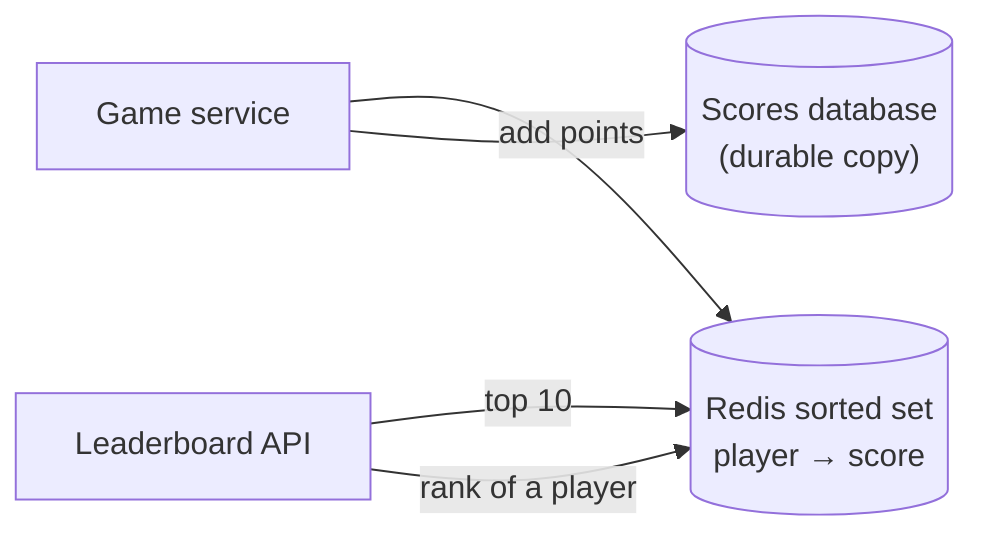

<!-- Written by `npm run lessons` from the lesson data in src/data. Edit the lesson there, not this page. -->

# Design a real-time leaderboard

**System Design · Unit 8: High-level design questions · Lesson 10 of 11 · Should know**

> **In one line.** Show live rankings of players by score, including each player's own rank.

[Open this lesson on the site](https://learn.hamropedia.com/system-design/design-a-real-time-leaderboard/) for its animation, the practice game and tap-to-explain words.

## Why interviewers ask it

It tests choosing the right data structure (a sorted set), and keeping a fast in-memory view in step with durable storage.

## Functional requirements

- Update a player's score.
- Get the top N players; get one player's rank and the players around them.

## Non-functional requirements

- Updates and reads in milliseconds.
- Millions of players.

## Estimates

- 10 million players; 5 million score updates a day ≈ 60 writes per second, with far more reads.

## API

- POST /scores {player_id, delta}
- GET /leaderboard/top?n=10
- GET /leaderboard/rank/{player_id}

## Data model

- Redis sorted set: member = player_id, score = points.
- A durable copy of every score in a database.

## From version 1 to the final design

1. Version 1: an SQL table with ORDER BY score LIMIT 10.
2. Version 2: a Redis sorted set for the top N and for ranks.
3. Version 3: a separate set per period, tie-breaking, and a durable copy for recovery.
4. Version 4: splitting the set, or approximate ranks, for very large numbers of players.

## The design, step by step

1. Score updates go to the game service, which saves them durably and updates a Redis sorted set.
2. Top N: ZREVRANGE 0 N−1. A player's rank: ZREVRANK. Both run in logarithmic time.
3. A separate sorted set per period (daily, weekly), with expiry.
4. At very large scale: split by score range, or give approximate ranks.

## Picture it



*Scores go into a sorted set that is always in order, so the top 10 and any player's rank are quick to read. The database keeps a permanent copy.*

## Deep dives

- Sorted sets are skip lists: logarithmic updates and rank lookups.
- Ties: fold a timestamp into the score, so whoever reached it first ranks higher.
- Rebuild Redis from the database after a failure.

## Common mistakes

- Recalculating ranks with SQL on every request.
- No durable copy, so a Redis restart loses the scores.
- Ignoring ties: decide how two players with the same score are ranked, for example by who reached it first.

> **Not true:** Ranks: worked out by a SQL query on each request, which keeps a live leaderboard fast.  
> **In fact:** Sorting millions of rows for every request is far too slow. A Redis sorted set keeps the order up to date as scores change, so a rank lookup is quick.

## In the interview

I'd use a Redis sorted set, with the player ID as the member and the score as the sort value. ZINCRBY updates a score, ZREVRANGE gives the top N, and ZREVRANK gives a player's rank. All three are logarithmic. Scores are also saved durably, so the set can be rebuilt. Each time period gets its own set.

<details>
<summary>&lt;b>Why not SQL with ORDER BY score?&lt;/b></summary>

Sorting 10 million rows on every request is slow; a sorted set stays in order as scores change.

</details>

<details>
<summary>&lt;b>How do you break ties?&lt;/b></summary>

Fold a tie-breaker into the score, for example score × 10¹⁰ minus the timestamp in seconds, so earlier players rank higher.

</details>

## Practise

Try each one yourself first, then open the answer and compare.

### 1. Explain

Explain why a sorted set makes rank lookups fast.

<details>
<summary>Show one good answer</summary>

A Redis sorted set keeps two structures together. A hash map gives each member's score in O(1). A skip list keeps the members ordered by score: layers of linked lists where the upper layers skip ahead, so finding a position takes about log n steps, like a balanced tree.

The trick for ranks: each forward link in the skip list also records how many elements it jumps over (its span). To find a player's rank, walk down to them and add up the spans you crossed: that is how many players are ahead of them. That is O(log n): about 23 steps for 10 million players, instead of counting them one by one.

So every leaderboard operation is fast:  
• Update a score (ZINCRBY): move one element, O(log n).  
• Top N (ZREVRANGE 0 N−1): find the end and read N elements.  
• A player's rank (ZREVRANK): O(log n).

Compare with a SQL table: "what is my rank?" is SELECT COUNT(\*) WHERE score > my score, which reads a large part of the table every time.

</details>

### 2. Draw

Draw the update path and the read path, including the durable database.

<details>
<summary>Show one good answer</summary>

Every update is saved durably before the sorted set is changed, so Redis can always be rebuilt from the database. Reads never touch the database: they are answered from the sorted set in milliseconds.

```text
UPDATE
Game client ── POST /scores {player, +40} ──► Game service
                                                │ 1. save durably
                                                ├──► Scores DB (source of truth)
                                                │ 2. update the ranking
                                                └──► Redis sorted sets
                                                     ZINCRBY lb:all-time  40 player
                                                     ZINCRBY lb:2024-w12  40 player
                                                     (weekly set has an expiry)

READ
Client ── GET /leaderboard/top?n=10 ──► Leaderboard service
                                          ZREVRANGE lb:all-time 0 9 WITHSCORES
Client ── GET /leaderboard/rank/{player} ──► ZREVRANK + ZSCORE
                                             + ZREVRANGE around that rank

RECOVERY
Redis lost ──► rebuild from Scores DB, then serve again
```

</details>

### 3. Apply

Implement a leaderboard in Python with the bisect module supporting update, top N and rank, then write the matching Redis commands.

<details>
<summary>Show one good answer</summary>

The Python version keeps a sorted list of (−score, sequence, player): the minus sign puts the highest score first, and the sequence number breaks ties in favour of whoever reached the score earlier. An update removes the old entry and inserts the new one with bisect; rank is the entry's position + 1.

Asha's two awards make her 90 points and first. Ben and Chen both have 70, but Ben got there first, so he ranks above Chen.

The bisect version is O(log n) to find an entry, but O(n) to insert into a Python list, which is fine for thousands of players, not millions. The matching Redis commands do the same in O(log n):  
• Update: ZINCRBY lb 40 asha  
• Top 3: ZREVRANGE lb 0 2 WITHSCORES  
• Rank (0-based): ZREVRANK lb chen  
• Around a player: take r = ZREVRANK lb chen, then ZREVRANGE lb (r − 1) (r + 1) WITHSCORES  
• Ties: Redis orders equal scores by name, so to favour the earliest, store score × 10¹⁰ + (a big number − the time reached), or keep the time in a second sorted set.

```python
import bisect
import itertools


class Leaderboard:
    def __init__(self):
        self.entries = []                        # sorted (-score, sequence, player)
        self.current = {}                        # player -> their entry
        self.sequence = itertools.count()        # earlier = higher on ties

    def add_points(self, player, delta):
        old = self.current.pop(player, None)
        score = delta
        if old:
            self.entries.pop(bisect.bisect_left(self.entries, old))
            score = -old[0] + delta
        entry = (-score, next(self.sequence), player)
        bisect.insort(self.entries, entry)
        self.current[player] = entry

    def top(self, n):
        return [(player, -neg) for neg, _, player in self.entries[:n]]

    def rank(self, player):                      # 1 = first
        return bisect.bisect_left(self.entries, self.current[player]) + 1

    def around(self, player, k=1):
        i = self.rank(player) - 1
        return [(p, -neg) for neg, _, p in self.entries[max(0, i - k): i + k + 1]]


board = Leaderboard()
for player, points in [("asha", 50), ("ben", 70), ("chen", 70), ("dara", 30), ("asha", 40), ("eli", 10)]:
    board.add_points(player, points)

print(board.top(3))                              # [('asha', 90), ('ben', 70), ('chen', 70)]
print(board.rank("chen"), board.rank("dara"))    # 3 4
print(board.around("chen"))                      # [('ben', 70), ('chen', 70), ('dara', 30)]
```

</details>

### 4. Trade-offs

Exact ranks for 100 million players, or approximate percentiles: what changes?

<details>
<summary>Show one good answer</summary>

Exact ranks for 100 million players:  
• One sorted set holding everyone: about 100 million × ~100 bytes ≈ 10 GB of memory, on one Redis node, which handles every update and rank query alone: a hot spot and a single point of failure.  
• It can't simply be split by player, because a rank needs the global order. Splitting by score range works (rank = the number of players in all higher ranges + your rank within your range), but the ranges must be rebalanced as scores drift, and every rank query needs those counts.

Approximate percentiles:  
• Keep a histogram: for example 10,000 score buckets, each with a count. An update is two counter changes (leave the old bucket, join the new one), memory is tiny, and it is easy to split across machines and add up.  
• A player's rank becomes "about the top 3%" (the sum of the counts above their bucket, plus an estimate within it).  
• Exact positions can still be kept for the top, say 1,000 players, in a small sorted set, which is where people actually care about the exact number.

What changes is the product: "you are #48,213,907" becomes "top 48%". Few players miss the exact number, and the system becomes far cheaper and easier to scale.

</details>

## Go further (optional)

- READ · [Hello Interview: real-time gaming leaderboard](https://www.google.com/search?q=Hello+Interview+real-time+gaming+leaderboard) · hellointerview.com · free guides
- READ · [Redis sorted sets](https://www.google.com/search?q=Redis+docs+sorted+sets) · Redis documentation

---

[← Design search autocomplete](design-search-autocomplete.md) · [All lessons](../../README.md) · [Design a distributed cache →](design-a-distributed-cache.md)
