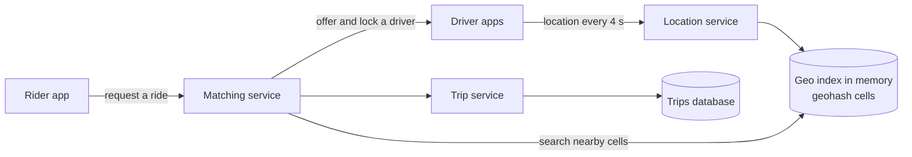

<!-- Written by `npm run lessons` from the lesson data in src/data. Edit the lesson there, not this page. -->

# Design a ride-hailing app (like Uber)

**System Design · Unit 8: High-level design questions · Lesson 7 of 11 · Should know**

> **In one line.** Match riders with nearby drivers in real time, track trips and charge fares.

[Open this lesson on the site](https://learn.hamropedia.com/system-design/design-a-ride-hailing-app-like-uber/) for its animation, the practice game and tap-to-explain words.

## Why interviewers ask it

It tests geospatial search, very high-volume updates, real-time matching and preventing double-booking.

## Functional requirements

- Drivers send their location every few seconds.
- A rider requests a ride; the system finds nearby drivers and offers the trip.
- Track the trip live; work out the fare and take payment.

## Non-functional requirements

- Matching within seconds; a very high volume of location updates.
- A driver must never be given two trips at once.

## Estimates

- 1 million active drivers × one update every 4 seconds ≈ 250,000 location writes per second.

## API

- POST /rides {pickup, dropoff}
- PUT /drivers/{id}/location
- WebSocket for live trip updates

## Data model

- Live driver locations in memory, indexed by geohash cell.
- trips (id, rider_id, driver_id, status, fare) in a relational database.

## From version 1 to the final design

1. Version 1: driver locations in a database; for each request, compute the distance to every driver.
2. Version 2: a grid or geohash cells, searching only the nearby cells.
3. Version 3: an in-memory geo index, a matching service and atomic driver locking.
4. Version 4: a trip state machine, surge pricing, payments, and analytics on location history.

## The design, step by step

1. A location service takes driver updates and keeps only the latest position in an in-memory geospatial index (geohash cells, for example Redis GEO).
2. A matching service searches nearby cells, ranks drivers by arrival time, and offers the trip to one driver at a time with a timeout.
3. The offered driver is locked with an atomic status update, so they can't be double-booked.
4. A trip service tracks the trip's state; pricing (including surge) and payment services handle the money.

## Picture it



*Driver locations flow into a fast in-memory map. A ride request searches nearby cells, then offers the trip to one driver, locked so nobody else can book them.*

## Deep dives

- Geohash: nearby places share a prefix; search the rider's cell and its neighbours.
- Location updates are short-lived: keep only the latest in memory, and stream the history to cheap storage for analytics.
- Surge pricing from supply and demand in each area.
- Driver assignment uses an atomic compare-and-set.

## Common mistakes

- Scanning every driver for every request.
- Saving every location update permanently in the main database.
- Offering one ride to several drivers without locking.

> **Not true:** Every location update from every driver should be saved for ever in the main database.  
> **In fact:** Drivers report every few seconds, which would flood the database with rows that nobody reads. Keep only the latest position in memory, and stream the history to cheap storage.

## In the interview

Drivers stream their location to a location service that keeps only the latest position in an in-memory geospatial index. A ride request searches nearby cells, ranks drivers by arrival time and offers the trip to one driver at a time, locking that driver atomically to prevent double-booking. Trips and payments live in a transactional database.

<details>
<summary>&lt;b>What is a geohash?&lt;/b></summary>

A short string that encodes latitude and longitude as nested grid cells. Nearby places share a prefix, so 'nearby' becomes a prefix lookup plus the neighbouring cells.

</details>

<details>
<summary>&lt;b>Why not save every location update in a database?&lt;/b></summary>

That's 250,000 writes a second of data that's out of date within seconds. Keep the latest in memory and stream the history to cheap storage.

</details>

## Practise

Try each one yourself first, then open the answer and compare.

### 1. Explain

Explain how 'find nearby drivers' works with geohashes.

<details>
<summary>Show one good answer</summary>

A geohash turns a latitude and longitude into a short string by repeatedly halving the map: is the point in the west or east half? Then the north or south half of that? Each answer is one bit, and the bits are written in base 32. Each extra character makes the cell smaller: 5 characters is roughly a 5 km square, 6 characters roughly 1.2 km by 0.6 km.

The useful property: points close together usually share a long prefix, so "drivers near here" becomes "drivers whose geohash starts with the same 6 characters as the rider's".

Finding nearby drivers:  
1. Every few seconds, each driver's location update moves them into the right cell in an in-memory index (Redis GEO, or cell → set of driver ids).  
2. For a ride request, compute the rider's cell at a suitable precision.  
3. Look in that cell and its 8 neighbours. Neighbours matter: a rider near the edge of a cell may be closest to a driver just across the line, whose geohash looks quite different.  
4. Work out the real distance (better, the estimated arrival time by road) for those candidates, rank them, and offer the trip to the best one first.  
5. If too few drivers are found, widen the search: a shorter prefix, or more rings of neighbours.

</details>

### 2. Draw

Draw driver app → location service → geo index, and rider → matching → trip service.

<details>
<summary>Show one good answer</summary>

Two independent flows meet in the geo index: drivers write their position into it every few seconds; the matching service reads from it when a ride is requested. Only the latest position is kept in memory; the history is streamed off to cheap storage.

```text
Driver app ── location every 4 s ──► Location service
                                       │ keep only the latest
                                       ▼
                                  Geo index (in memory)
                                  cell → drivers (Redis GEO)
                                       ▲      │ history
                                       │      └──► stream ──► analytics store
Rider app ── request a ride ──► Matching service
                                  1. rider's cell + 8 neighbours
                                  2. rank by arrival time
                                  3. offer to one driver, with a timeout
                                  4. lock the driver (atomic status update)
                                       │
                                       ▼
                                  Trip service ── trip state ──► Trips DB
                                       ├──► Pricing (surge)
                                       └──► Payments
Rider app ◄══ WebSocket: live trip updates ══ Trip service
```

</details>

### 3. Apply

Bucket 10,000 random points into a simple grid (or with a geohash library), then find the neighbours of one point.

<details>
<summary>Show one good answer</summary>

10,000 random drivers are spread over a box around London. Each goes into a grid cell of 0.01° × 0.01° (about 1.1 km by 0.7 km here): a simple stand-in for a geohash, using the same idea of a key per cell.

That makes 800 cells, about 12 drivers each. For a rider at Trafalgar Square, the search reads only the rider's cell and its 8 neighbours: 108 drivers instead of 10,000. Real distances (the haversine formula) are worked out only for those, and the nearest three are 0.15, 0.17 and 0.23 km away.

```python
import math
import random

random.seed(42)
drivers = [(random.uniform(51.40, 51.60), random.uniform(-0.30, 0.10)) for _ in range(10_000)]

CELL = 0.01                                          # degrees: about 1.1 km × 0.7 km in London


def cell(lat, lon):
    return (math.floor(lat / CELL), math.floor(lon / CELL))


grid = {}
for i, (lat, lon) in enumerate(drivers):
    grid.setdefault(cell(lat, lon), []).append(i)


def km(a, b):                                        # great-circle distance
    lat1, lon1, lat2, lon2 = map(math.radians, (*a, *b))
    h = math.sin((lat2 - lat1) / 2) ** 2 + math.cos(lat1) * math.cos(lat2) * math.sin((lon2 - lon1) / 2) ** 2
    return 6371 * 2 * math.asin(math.sqrt(h))


rider = (51.5080, -0.1281)                           # Trafalgar Square
row, col = cell(*rider)
nearby = [i for dr in (-1, 0, 1) for dc in (-1, 0, 1) for i in grid.get((row + dr, col + dc), [])]
nearest = sorted(nearby, key=lambda i: km(rider, drivers[i]))[:3]

print(len(grid), len(drivers) / len(grid))           # 800 12.5: cells, drivers per cell
print(len(nearby))                                   # 108: candidates in the 9 cells
print([round(km(rider, drivers[i]), 2) for i in nearest])   # [0.15, 0.17, 0.23] km
```

</details>

### 4. Trade-offs

Geohash or quadtree for a city where driver density is very uneven?

<details>
<summary>Show one good answer</summary>

Geohash (fixed-size cells):  
• Simple and stateless: a driver's cell is a pure function of their position, so a location update is just moving one key; easy to shard by prefix across machines.  
• Copes with 250,000 updates a second, because nothing needs rebalancing.  
• Uneven density hurts: a city-centre cell may hold thousands of drivers (the search returns far too many), while a suburban cell holds none (you must widen the search ring by ring). You can compensate by choosing the search precision by area, or with a hexagonal grid like Uber's H3.

Quadtree (cells split where it is busy):  
• Adaptive: a cell splits into four when it holds more than, say, 100 drivers, so dense areas get small cells and quiet areas big ones, and every search returns a sensible number of candidates.  
• But drivers move constantly, so the tree is always splitting and merging; it is harder to update concurrently, and harder to spread across machines.

For moving drivers with very uneven density, the common answer is geohash (or H3) with an adaptive search radius: you keep the cheap updates and handle density at query time. A quadtree shines for points that rarely move, such as restaurants or shops.

</details>

## Go further (optional)

- READ · [Hello Interview: proximity service, and nearby friends](https://www.google.com/search?q=Hello+Interview+proximity+service%2C+and+nearby+friends) · hellointerview.com · free guides
- READ · [Hello Interview: design Uber](https://www.google.com/search?q=Hello+Interview+design+Uber) · hellointerview.com · free guides
- WATCH · [ByteByteGo: design Uber](https://www.youtube.com/results?search_query=ByteByteGo+design+Uber) · ByteByteGo · YouTube

---

[← Design a video streaming platform (like YouTube or Netflix)](design-a-video-streaming-platform-like-youtube-or-netflix.md) · [All lessons](../../README.md) · [Design a payment system →](design-a-payment-system.md)
