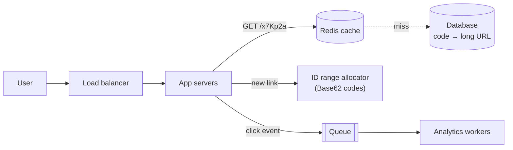

<!-- Written by `npm run lessons` from the lesson data in src/data. Edit the lesson there, not this page. -->

# Design a URL shortener (like bit.ly)

**System Design · Unit 8: High-level design questions · Lesson 1 of 11 · Must know**

> **In one line.** Turn long URLs into short links, like bit.ly/x7Kp2a, that redirect to the original.

[Open this lesson on the site](https://learn.hamropedia.com/system-design/design-a-url-shortener-like-bit-ly/) for its animation, the practice game and tap-to-explain words.

## Why interviewers ask it

It's the classic first HLD question: small enough to finish, and it covers APIs, unique IDs, caching, database choice and read-heavy scaling.

## Functional requirements

- Create a short URL for a long URL (optional custom alias and expiry).
- Redirect from the short URL to the long URL.
- Optional: click analytics.

## Non-functional requirements

- Very read-heavy: about 100 redirects per new link.
- Redirects in under about 50 ms; highly available.
- Codes must be unique and, ideally, hard to guess.

## Estimates

- 100 million new links a month ≈ 40 writes per second; × 100 reads ≈ 4,000 redirects per second on average (peak maybe 10,000–20,000).
- Over 5 years: 6 billion links × about 500 bytes ≈ 3 TB.
- Base62 with 7 characters gives 62⁷ ≈ 3.5 trillion codes, which is plenty.

## API

- POST /urls {long_url, custom_alias?, expires_at?} → 201 {short_url}
- GET /{code} → 302 redirect to long_url

## Data model

- urls: code (primary key), long_url, user_id, created_at, expires_at
- Either SQL or a key-value store works, because all reads are by code.

## From version 1 to the final design

1. Version 1: one server and one database table mapping code → URL, with a counter in the database for IDs.
2. Version 2: a Redis cache for redirects, so most requests never touch the database.
3. Version 3: many stateless app servers behind a load balancer, with ID ranges reserved per server so there's no single counter.
4. Version 4: shard the table by code when it outgrows one database, and send click analytics through a queue.

## The design, step by step

1. Write: the API generates a unique code and stores code → long URL.
2. Read: GET /{code} → check the Redis cache → on a miss, read the database → redirect.
3. Code generation: a distributed counter (ID ranges per server) encoded in Base62, or a hash of the URL cut to 7 characters, with collision checks.
4. Very popular links can also be cached at the edge.

## Picture it



*Redirects are served from the cache whenever possible. New links get codes from an ID allocator, and clicks are counted in the background.*

## Deep dives

- Counter + Base62: no collisions. Each server reserves a block of IDs from a coordinator, so servers don't fight over one counter.
- Hashing: the same URL always gets the same code (no duplicates), but collisions need check-and-retry.
- 301 (permanent; browsers cache it, so less load but no analytics) or 302 (temporary; every click reaches you, so analytics work).
- Analytics: log each click to a queue and aggregate in the background.

## Common mistakes

- Hashing the URL without handling collisions.
- No caching, for a workload that's 100 times more reads than writes.
- Using 301 redirects, then wondering why the analytics are empty.

> **Not true:** 301 redirect: each click still reaches your server, so analytics work.  
> **In fact:** Browsers remember a 301 (permanent) redirect, so later clicks never reach your server. Use 302 (temporary) when every click has to be counted.

## In the interview

It's a read-heavy key-value lookup. Writes generate a unique 7-character Base62 code from a distributed counter, with ID ranges reserved per server, and store code → URL. Reads go through a Redis cache in front of the database and return a 302, so we can count clicks; click events go onto a queue for background analytics.

<details>
<summary>&lt;b>How do you stop people guessing other people's links?&lt;/b></summary>

Use random codes, or scramble the counter with a reversible shuffle, instead of handing out sequential codes.

</details>

<details>
<summary>&lt;b>301 or 302?&lt;/b></summary>

302 if you want analytics or may change the target later; 301 if you want browsers to cache the redirect and reduce load.

</details>

## Practise

Try each one yourself first, then open the answer and compare.

### 1. Explain

Explain the full read path and write path in 2 minutes.

<details>
<summary>Show one good answer</summary>

Write path (creating a short link):  
1. POST /urls with the long URL reaches a load balancer, then one of many stateless API servers.  
2. The server checks the URL (valid, not on a blocklist) and, if given, that the custom alias is free.  
3. It takes the next number from its reserved block of IDs (each server gets a block, say 1,000 at a time, from a small allocator, so servers never compete for one counter) and encodes it in Base62: a short code like "3ORDSU".  
4. It stores code → long URL (plus owner, created and expiry times) in the database, and returns the short URL.

Read path (the redirect), about 100 times more frequent:  
1. GET /3ORDSU reaches the load balancer, then an API server.  
2. The server looks the code up in Redis; most popular codes are there (a hit in well under a millisecond).  
3. On a miss it reads the database by primary key, then fills the cache.  
4. It replies 302 with the long URL in the Location header (or 404, or 410 if expired).  
5. It puts a click event on a queue for analytics, without waiting for it.

Everything is read by one key, the code, so the database scales easily (replicas, or sharding by code), and the cache does most of the work.

</details>

### 2. Draw

Draw the architecture: load balancer, API servers, ID-range allocator, cache, database and analytics queue.

<details>
<summary>Show one good answer</summary>

Creating a link touches the ID allocator only once per block of IDs, not per link. Redirects are served from the cache whenever possible, and click analytics happen off the request path, through the queue.

```text
Client
  │
  ▼
Load balancer
  │
  ├──► API server ──┐  (stateless, many of them)
  └──► API server ──┤
                    │
  create:           │ 1. take an ID from my block
                    ├──► ID-range allocator
                    │    ("give me IDs 5,000–5,999")
                    │ 2. save code → long URL
                    ├──► Database (key: code)
                    │
  redirect:         │ 1. look up the code
                    ├──► Redis cache ── miss ──► Database
                    │ 2. reply 302 to the long URL
                    │ 3. log the click (async)
                    └──► Queue ──► Analytics workers
                                    └──► Analytics store
```

</details>

### 3. Apply

Write Base62 encode and decode functions in Python, and encode the numbers 1, 61, 62 and 3,500,000,000.

<details>
<summary>Show one good answer</summary>

Base62 uses the digits 0–9, then a–z, then A–Z: 62 symbols. Encoding repeatedly divides by 62 and keeps the remainders (like writing a number in base 10, but with 62 digits); decoding multiplies back.

1 is "1", 61 is "Z" (the last symbol), 62 is "10" (one 62 and nothing more), and 3,500,000,000 is "3ORDSU": 6 characters. Seven characters cover every number below 62⁷, about 3.5 trillion.

```python
import string

ALPHABET = string.digits + string.ascii_lowercase + string.ascii_uppercase   # 62 symbols


def encode(n):
    if n == 0:
        return ALPHABET[0]
    digits = []
    while n:
        n, remainder = divmod(n, 62)
        digits.append(ALPHABET[remainder])
    return "".join(reversed(digits))


def decode(code):
    n = 0
    for ch in code:
        n = n * 62 + ALPHABET.index(ch)
    return n


for n in (1, 61, 62, 3_500_000_000):
    print(n, encode(n), decode(encode(n)) == n)
# 1 1 True
# 61 Z True
# 62 10 True
# 3500000000 3ORDSU True
print(62 ** 7)                                   # 3521614606208: codes of up to 7 characters
```

</details>

### 4. Trade-offs

Counter-based codes or hashing the URL: compare collisions, duplicates and guessability.

<details>
<summary>Show one good answer</summary>

Counter + Base62:  
• Collisions: none. Every number is used once, so every code is unique by construction; there is no need to check the database before saving.  
• Duplicates: the same long URL shortened twice gets two codes. Fine (often wanted: different owners, different stats), or look it up first if you want one code per URL.  
• Guessability: bad by default. Codes are sequential, so anyone can count through them and scrape every link, and they reveal how many links you have. Fix: scramble the number before encoding (a reversible shuffle such as multiplying by a large prime modulo 62⁷), or add a few random characters.  
• Cost: needs coordination, though handing out ID ranges keeps that rare.

Hashing the URL (for example MD5, keep the first 7 Base62 characters):  
• Collisions: yes. With 3.5 trillion possible codes, collisions become likely after only about √3.5 trillion ≈ 1.9 million links (the birthday paradox). Every write must check whether the code is taken and, if so, retry with a salt.  
• Duplicates: the same URL always gives the same code, so de-duplication comes free.  
• Guessability: good: codes look random.  
• Cost: no coordination, but an extra read on every write.

The usual choice is counter-based with ID ranges, plus a scramble so codes aren't sequential.

</details>

## Go further (optional)

- READ · [Hello Interview: design a URL shortener](https://www.google.com/search?q=Hello+Interview+design+a+URL+shortener) · hellointerview.com · free guides
- READ · [Hello Interview: design Bitly](https://www.google.com/search?q=Hello+Interview+design+Bitly) · hellointerview.com · free guides
- WATCH · [ByteByteGo: design a URL shortener](https://www.youtube.com/results?search_query=ByteByteGo+design+a+URL+shortener) · ByteByteGo · YouTube

---

[← Design an order-matching engine (stock exchange)](../unit-7-lld-practice/design-an-order-matching-engine-stock-exchange.md) · [All lessons](../../README.md) · [Design a distributed rate limiter →](design-a-distributed-rate-limiter.md)
