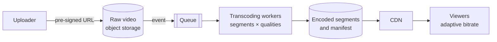

<!-- Written by `npm run lessons` from the lesson data in src/data. Edit the lesson there, not this page. -->

# Design a video streaming platform (like YouTube or Netflix)

**System Design · Unit 8: High-level design questions · Lesson 6 of 11 · Must know**

> **In one line.** Upload, process and stream videos to millions of viewers.

[Open this lesson on the site](https://learn.hamropedia.com/system-design/design-a-video-streaming-platform-like-youtube-or-netflix/) for its animation, the practice game and tap-to-explain words.

## Why interviewers ask it

It tests large-file handling, background processing pipelines, CDNs and adaptive streaming — dealing with petabytes, not just requests.

## Functional requirements

- Upload videos and process them into several resolutions.
- Stream with quality that adapts to the viewer's connection; search and view details.
- View counts and likes.

## Non-functional requirements

- Smooth playback worldwide; enormous bandwidth.
- Uploads are never lost; processing may take minutes.
- Reads are highly available.

## Estimates

- 5 million daily viewers × 5 videos × about 300 MB ≈ 7.5 PB of video sent a day — which is why CDNs are essential.

## API

- POST /videos → pre-signed upload URL
- GET /videos/{id} → details and manifest URL

## Data model

- videos (id, owner_id, title, status, manifest_url)
- Raw and encoded files in object storage.

## From version 1 to the final design

1. Version 1: upload a file to a server and serve it as it is.
2. Version 2: files in object storage, details in a database.
3. Version 3: a transcoding pipeline driven by a queue, producing several qualities.
4. Version 4: segments with HLS or DASH, adaptive bitrate, CDN delivery, and view counts in the background.

## The design, step by step

1. Upload: the client gets a pre-signed URL and uploads in parts straight to object storage.
2. An event on a queue triggers transcoding workers, which cut the video into short segments and encode several resolutions and bitrates (a graph of tasks).
3. The outputs go to object storage, with a manifest (HLS or DASH) listing the segments for each quality.
4. Playback: the player fetches the manifest and segments from a CDN and switches quality as bandwidth changes (adaptive bitrate).
5. Video details live in a database with a cache; view counts are aggregated in the background.

## Picture it



*Upload, then convert in the background, then deliver from the CDN. Viewers' players pick the quality that suits their connection.*

## Deep dives

- Adaptive bitrate: small segments (2–10 seconds) at several qualities.
- Transcoding runs in parallel per segment, with retries per task.
- Popular videos sit on the CDN; rarely watched ones are served from origin.
- Make big uploads resumable: send the file in chunks, so a dropped connection repeats one chunk, not the whole video.

## Common mistakes

- Streaming from your own servers instead of a CDN.
- Transcoding inside the upload request: it takes minutes, so the request times out. Do it in background workers.
- One quality for every device and connection.

> **Not true:** Transcoding: done inside the upload request, so the video is ready at once.  
> **In fact:** Transcoding takes minutes, so the request would time out. Accept the upload first, then transcode in background workers.

## In the interview

Uploads go straight to object storage with pre-signed URLs. A queue triggers transcoding workers that encode short segments at several bitrates and write HLS or DASH manifests. Viewers stream the segments from a CDN with adaptive bitrate. Video details live in a database behind a cache, and view counts are aggregated in the background.

<details>
<summary>&lt;b>Why split videos into segments?&lt;/b></summary>

Segments can be transcoded in parallel, cached by the CDN, and let the player switch quality in the middle of a video.

</details>

<details>
<summary>&lt;b>How do you count views at this scale?&lt;/b></summary>

Send view events to a stream, aggregate them in batches, and update the stored total periodically.

</details>

## Practise

Try each one yourself first, then open the answer and compare.

### 1. Explain

Explain the pipeline from upload to playback in 2 minutes.

<details>
<summary>Show one good answer</summary>

Upload: the app asks the API for a pre-signed upload URL and sends the video straight to object storage, in parts, so a dropped connection resumes instead of restarting. The API records the video as "processing".

Processing: the upload triggers an event on a queue. Transcoding workers split the video into short segments (a few seconds each) and encode every segment at several qualities (say 240p up to 4K, each at its own bitrate). This is a graph of tasks: split, encode in parallel, package. Each task is retried on its own if it fails. Thumbnails are made too.

Output: the encoded segments go into object storage, along with a manifest file (HLS or DASH) that lists, for each quality, the segment files in order. The video's status becomes "ready", with the manifest's URL.

Playback: the player fetches the manifest and the segments from a CDN close to the viewer. It measures how fast segments arrive and picks the quality for the next one: if the connection slows, it drops to a lower bitrate without stopping (adaptive bitrate streaming). Views and likes are counted asynchronously; video details come from a database behind a cache.

</details>

### 2. Draw

Draw the upload, the transcoding pipeline, storage, the CDN and the player.

<details>
<summary>Show one good answer</summary>

Uploads and playback both bypass the API servers for the heavy bytes: uploads go straight to object storage, and playback comes from the CDN. The transcoding pipeline sits between the two, driven by a queue.

```text
UPLOAD
Creator app ── 1. ask for an upload URL ──► API ──► Videos DB (status: processing)
     │ 2. upload in parts (pre-signed URL)
     ▼
Object storage: raw video
     │ 3. "video uploaded" event
     ▼
Queue ──► Transcoding pipeline
           split into segments
             ├─► encode 240p ┐
             ├─► encode 720p ├─ in parallel, retried per task
             └─► encode 4K   ┘
           package: HLS/DASH manifest + segments, thumbnails
     │
     ▼
Object storage: encoded segments ──► Videos DB (status: ready)

PLAYBACK
Viewer's player ── manifest + segments ──► CDN edge
     ▲                                       │ miss
     │ picks the quality for                 ▼
     │ each segment by bandwidth      Object storage (origin)
     └─────────────────────────────────────────┘
```

</details>

### 3. Apply

Estimate the storage for one 10-minute video encoded at 4 qualities: 0.5, 1, 3 and 6 Mbps.

<details>
<summary>Show one good answer</summary>

Storage = bitrate × duration. 10 minutes is 600 seconds; bitrates are in megabits a second, so divide by 8 for megabytes.

• 0.5 Mbps: 37.5 MB  
• 1 Mbps: 75 MB  
• 3 Mbps: 225 MB  
• 6 Mbps: 450 MB

Total: 787.5 MB, about 0.8 GB for one 10-minute video, and about 2.4 GB with 3 copies for durability. Add the original upload (often kept, at a high bitrate) and thumbnails. Notice that the top quality alone is more than half the total, which is why rarely watched videos are sometimes kept only at lower qualities, or re-encoded on demand.

```python
seconds = 10 * 60
bitrates_mbps = [0.5, 1, 3, 6]
megabytes = [rate * seconds / 8 for rate in bitrates_mbps]   # megabits → megabytes
print(megabytes)                          # [37.5, 75.0, 225.0, 450.0]
print(sum(megabytes), sum(megabytes) * 3) # 787.5 2362.5: MB once, and with 3 copies
```

</details>

### 4. Trade-offs

Build your own CDN (like Netflix) or use a commercial one?

<details>
<summary>Show one good answer</summary>

Use a commercial CDN (Akamai, Cloudflare, Amazon CloudFront…), and build your own only at Netflix's scale.

Commercial CDN:  
• Global reach on day one, paid per gigabyte, with nothing to build or run.  
• Proven security and DDoS protection.  
• Downsides: at enormous volume, per-gigabyte prices add up to a very large bill, and you have less control over caching, placement and hardware. Many large companies use several CDNs at once, for price and resilience.

Your own CDN (Netflix's Open Connect puts its own servers inside internet providers' networks):  
• At the scale where you are a large share of all internet traffic, owning the boxes is far cheaper per gigabyte.  
• Full control: tomorrow's popular shows are copied to the boxes overnight, when networks are quiet; tuned hardware and software.  
• Downsides: huge upfront cost, agreements with thousands of internet providers, teams to run hardware around the world, and years to build.

It only pays off when traffic is huge, predictable, and mostly a known catalogue that can be placed in advance, which describes Netflix and very few others.

</details>

## Go further (optional)

- READ · [Hello Interview: design YouTube](https://www.google.com/search?q=Hello+Interview+design+YouTube) · hellointerview.com · free guides
- WATCH · [ByteByteGo: design YouTube](https://www.youtube.com/results?search_query=ByteByteGo+design+YouTube) · ByteByteGo · YouTube
- READ · [Netflix Technology Blog](https://www.google.com/search?q=Netflix+technology+blog) · Netflix

---

[← Design a news feed (like Twitter or Instagram)](design-a-news-feed-like-twitter-or-instagram.md) · [All lessons](../../README.md) · [Design a ride-hailing app (like Uber) →](design-a-ride-hailing-app-like-uber.md)
