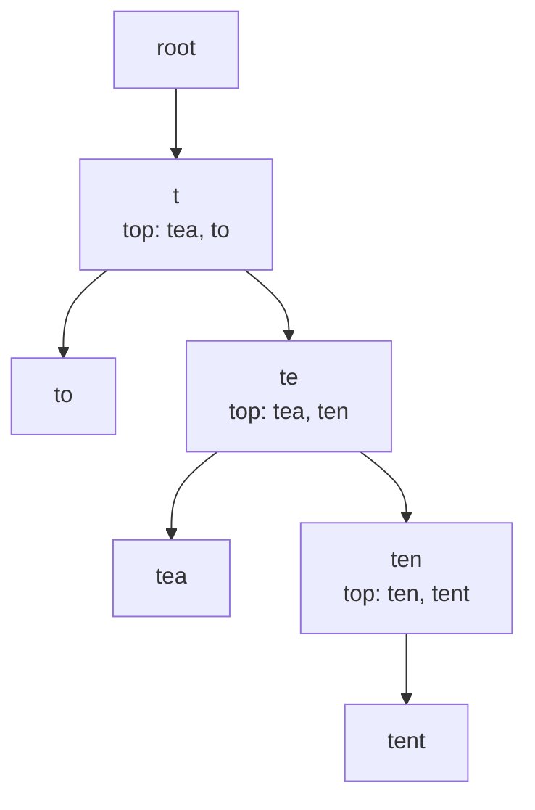

<!-- Written by `npm run lessons` from the lesson data in src/data. Edit the lesson there, not this page. -->

# Design search autocomplete

**System Design · Unit 8: High-level design questions · Lesson 9 of 11 · Should know**

> **In one line.** Suggest the top completions as the user types into a search box.

[Open this lesson on the site](https://learn.hamropedia.com/system-design/design-search-autocomplete/) for its animation, the practice game and tap-to-explain words.

## Why interviewers ask it

It tests data structures at scale (tries), precomputing results, caching, and separating serving from data processing.

## Functional requirements

- Return the top 5–10 suggestions for a prefix.
- Rank by popularity, and by freshness.

## Non-functional requirements

- Very fast: under about 100 ms per keystroke.
- Highly available; suggestions can be slightly out of date.

## Estimates

- 10 million daily users × 10 searches × about 10 keystrokes ≈ 1 billion requests a day ≈ 12,000 per second.

## API

- GET /suggest?q=pyt → ['python', 'python tutorial', …]

## Data model

- Trie: each node stores its top-k completions, precomputed.
- Search logs → counts, aggregated in the background.

## From version 1 to the final design

1. Version 1: an SQL query: LIKE 'prefix%' ORDER BY count LIMIT 5.
2. Version 2: an in-memory trie, searching the subtree on each request.
3. Version 3: top-k precomputed at every node, rebuilt by a background job.
4. Version 4: tries split across servers, edge caching, trending updates and filtering.

## The design, step by step

1. Serving: an in-memory trie (or a prefix → top-k map in Redis); a lookup just walks the prefix.
2. Data pipeline: log searches → count them every hour or day → rebuild the trie → swap the new one in.
3. Client: wait for a short pause in typing before asking, and cache recent prefixes; cache common prefixes at the edge.
4. Split the trie across servers by prefix when it gets too big.

## Picture it



*A trie. Each node already stores its most popular completions, so typing 'te' means walking two steps and reading the answer.*

## Deep dives

- Store the top-k completions at every node, so a query never has to search a whole subtree.
- Freshness: trending terms through a streaming pipeline, with older counts decaying over time.
- Filter offensive or harmful suggestions out of autocomplete before they are shown.
- Personalisation: blend global suggestions with the user's own history.

## Common mistakes

- Searching the whole subtree on every keystroke.
- Rebuilding the trie inside the serving path.
- Sending a request on every keystroke, with no pause.

> **Not true:** An autocomplete box should send a request for every single keystroke, with no pause.  
> **In fact:** Most of those requests are out of date before the reply arrives. Wait a short moment after the last keystroke, and far fewer requests are sent.

## In the interview

Suggestions are served from an in-memory trie where each node already stores its top-k completions, so a lookup is just walking the prefix. Search logs feed a background job that rebuilds the trie regularly. Clients wait for a pause in typing and cache results, and popular prefixes are cached at the edge.

<details>
<summary>&lt;b>Why store the top-k at every node?&lt;/b></summary>

Otherwise each request would have to search the whole subtree under the prefix, which is far too slow.

</details>

<details>
<summary>&lt;b>How do you handle a sudden trending term?&lt;/b></summary>

A streaming job updates counts with time decay and patches hot prefixes between full rebuilds.

</details>

## Practise

Try each one yourself first, then open the answer and compare.

### 1. Explain

Explain the serving path and the data pipeline separately.

<details>
<summary>Show one good answer</summary>

Serving path (every keystroke, must be fast):  
1. The user types "pyt". The app waits for a brief pause in typing (debouncing) and checks its own cache of recent prefixes.  
2. The request reaches a suggestion server (or an edge cache for very common prefixes).  
3. The server walks its in-memory trie: p → y → t. That node already stores its top 5 completions, worked out in advance, so it returns them directly, with no searching of the subtree.  
4. Results come back in milliseconds, and the app caches them for this prefix.

Data pipeline (in the background, every hour or day):  
1. Every search that is actually submitted is logged.  
2. A batch job counts queries over a window (say the last 7 days, with older days weighted less), and removes offensive or unsafe terms.  
3. It builds a new trie, with the top-k list at every node.  
4. The new trie is shipped to the servers and swapped in atomically; the old one keeps serving until the swap.

Keeping them separate is the key idea: serving never computes anything, and the pipeline can be slow, thorough and replaced without touching serving. Trending terms can be added through a faster streaming path.

</details>

### 2. Draw

Draw a small trie for 'tea', 'ten', 'tent' and 'to', with the top-2 completions stored at each node.

<details>
<summary>Show one good answer</summary>

Assume search counts of to 300, tea 120, ten 90 and tent 60. Every node stores the top 2 words found anywhere below it, so answering a prefix is one walk down the tree and one read, with no searching of the subtree. Words can end at inner nodes ("ten" ends at the node that also leads on to "tent").

```text
Counts: to 300, tea 120, ten 90, tent 60

(root)       top-2: to, tea
 └─ t        top-2: to, tea
    ├─ o     top-2: to            ← "to" ends here
    └─ e     top-2: tea, ten
       ├─ a  top-2: tea           ← "tea" ends here
       └─ n  top-2: ten, tent     ← "ten" ends here
          └─ t  top-2: tent       ← "tent" ends here

Query "te": walk t → e, read: [tea, ten]
```

</details>

### 3. Apply

Build a trie in Python that stores the top-3 completions at each node from a word-frequency list, and time 10,000 lookups.

<details>
<summary>Show one good answer</summary>

Building: each word is inserted letter by letter, adding (count, word) to every node on its path; then each node keeps only its top 3, with ties broken alphabetically. A lookup walks the prefix and returns the stored list. 20,000 rare made-up words pad the trie so the timing is realistic.

Results: "py" gives python, pytorch, python tutorial; "p" gives python, pandas, pytorch; an unknown prefix gives nothing. 10,000 lookups of random prefixes took about half a microsecond each on my machine (your number will differ): the work is proportional to the length of the prefix, not the number of words.

```python
import random
import time


class TrieNode:
    def __init__(self):
        self.children = {}
        self.top = []                            # the best (count, word) pairs below this node


def build(counts, k=3):
    root = TrieNode()
    for word, count in counts.items():
        node = root
        for ch in word:
            node = node.children.setdefault(ch, TrieNode())
            node.top.append((count, word))
    stack = [root]
    while stack:                                 # keep only the top k at each node
        node = stack.pop()
        node.top = sorted(node.top, key=lambda cw: (-cw[0], cw[1]))[:k]
        stack.extend(node.children.values())
    return root


def suggest(root, prefix):
    node = root
    for ch in prefix:
        node = node.children.get(ch)
        if node is None:
            return []
    return [word for _, word in node.top]


counts = {"python": 900, "pytorch": 700, "python tutorial": 500, "pycharm": 300, "pandas": 800,
          "pip": 400, "pizza": 650, "tea": 120, "ten": 90, "tent": 60, "to": 300, "typescript": 650}
random.seed(1)
for _ in range(20_000):                          # pad with rare made-up terms
    word = "".join(random.choice("abcdefghijklmnopqrstuvwxyz") for _ in range(random.randint(3, 9)))
    counts.setdefault(word, random.randint(1, 50))

root = build(counts)
print(suggest(root, "py"))       # ['python', 'pytorch', 'python tutorial']
print(suggest(root, "p"))        # ['python', 'pandas', 'pytorch']
print(suggest(root, "zzzz9"))    # []

prefixes = [w[:random.randint(1, len(w))] for w in random.sample(sorted(counts), 10_000)]
start = time.perf_counter()
for prefix in prefixes:
    suggest(root, prefix)
print(f"{(time.perf_counter() - start) / len(prefixes) * 1e6:.1f} µs per lookup")   # about 0.5 on my machine
```

</details>

### 4. Trade-offs

A trie in memory, prefix keys in Redis, or a search engine: compare.

<details>
<summary>Show one good answer</summary>

In-memory trie on each suggestion server:  
• Fastest: microseconds per lookup, with no network hop.  
• Every server holds a full copy, so memory per server is large, and updating means building a new trie and swapping it in on every server. If it grows too big, you must split it by prefix yourself.

Prefix keys in Redis (key "sugg:pyt" → its top-k list):  
• Simple and shared: every server reads the same data, and updating one prefix is one write, so it is easy to refresh trending terms continuously.  
• A network round trip per lookup (about a millisecond), and one key per prefix (millions of keys).

A search engine (Elasticsearch's completion suggester, or edge n-grams):  
• The most features: typo tolerance, filters (only products in stock, only in this country), personalisation, ranking that mixes popularity with relevance.  
• Slower (milliseconds to tens of milliseconds) and heavier to run.

For pure "popular queries by prefix" at huge volume, a trie (or Redis prefix keys) wins. When suggestions must tolerate typos or depend on filters, use the search engine, often with a cache of the most common prefixes in front.

</details>

## Go further (optional)

- READ · [Hello Interview: design a search autocomplete system](https://www.google.com/search?q=Hello+Interview+design+a+search+autocomplete+system) · hellointerview.com · free guides
- WATCH · [ByteByteGo: design search autocomplete](https://www.youtube.com/results?search_query=ByteByteGo+design+search+autocomplete) · ByteByteGo · YouTube

---

[← Design a payment system](design-a-payment-system.md) · [All lessons](../../README.md) · [Design a real-time leaderboard →](design-a-real-time-leaderboard.md)
