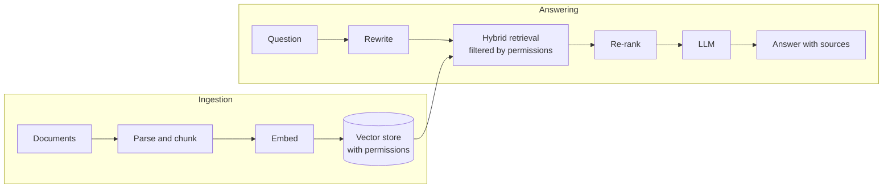

<!-- Written by `npm run lessons` from the lesson data in src/data. Edit the lesson there, not this page. -->

# Design a RAG assistant over company documents

**System Design · Unit 9: AI and ML system design · Lesson 1 of 5 · Must know**

> **In one line.** A chat assistant that answers employees' questions from the company's own documents, with sources.

[Open this lesson on the site](https://learn.hamropedia.com/system-design/design-a-rag-assistant-over-company-documents/) for its animation, the practice game and tap-to-explain words.

## Why interviewers ask it

It's the most common AI-engineering design question: it tests retrieval, prompting, permissions, evaluation and cost control together.

## Functional requirements

- Ingest documents (PDFs, wiki pages, tickets) and keep them up to date.
- Answer questions with citations, and say 'I don't know' when the answer isn't there.
- Respect document permissions.

## Non-functional requirements

- Answers in a few seconds, streamed.
- Accurate and grounded, with measurable quality.
- Cost per question under control; secure.

## Estimates

- 1 million documents × 20 chunks × 1,536-dimension float32 embeddings ≈ 120 GB of vectors before compression.

## API

- POST /chat {conversation_id, message} → streamed answer with sources
- Ingestion: document-change events → pipeline

## Data model

- chunks (id, doc_id, text, embedding, permissions, updated_at) in a vector store with metadata filters
- conversations, and traces for evaluation

## From version 1 to the final design

1. Version 1: embed all the chunks, search them in memory with cosine similarity, and put the top 5 into a prompt.
2. Version 2: a vector store, an ingestion pipeline and citations.
3. Version 3: hybrid search, re-ranking, permission filters and question rewriting.
4. Version 4: evaluation sets, tracing, caching, model routing and guardrails.

## The design, step by step

1. Ingestion: parse → clean → split into chunks with some overlap → embed → store in a vector store with permission metadata, triggered whenever a document changes.
2. Query: rewrite the question using the conversation → hybrid retrieval (vectors plus keywords), filtered by the user's permissions → re-rank → build a prompt with the top chunks → the LLM streams an answer with citations.
3. Guardrails: check retrieved text for prompt injection, and check the output.
4. Observability: trace every step; run evaluations on a golden set; collect user feedback.

## Picture it



*Two pipelines. Ingestion prepares the documents in advance; answering finds the best chunks the user may see and gives them to the LLM.*

## Deep dives

- Permissions are enforced in the retrieval filter; never rely on the LLM to hide data.
- Chunking and re-ranking usually bring the biggest quality gains.
- Evaluation: retrieval recall@k plus answer faithfulness on a golden set, run as regression tests for every change.
- Cost and latency: cache frequent answers; send easy questions to a smaller model.

## Common mistakes

- No evaluation, so changes are judged by feel.
- Handling permissions by asking the LLM not to reveal things.
- Never updating the index when documents change.

> **Not true:** Permissions: telling the LLM not to reveal restricted documents protects them.  
> **In fact:** A model can be talked into revealing what it has been shown. Filter by permission at retrieval, so that restricted text never reaches the model.

## In the interview

Two pipelines. Ingestion parses, chunks and embeds documents into a vector store with permission metadata, updated whenever a document changes. At query time we rewrite the question, run hybrid retrieval filtered by the user's permissions, re-rank, and give the top chunks to the LLM, which streams a cited answer. Every request is traced, and quality is tracked against a golden evaluation set.

<details>
<summary>&lt;b>How do you stop it leaking documents a user shouldn't see?&lt;/b></summary>

Enforce permissions in the retrieval filter, so forbidden chunks are never put into the prompt at all.

</details>

<details>
<summary>&lt;b>Answers got worse after a change. How do you find out why?&lt;/b></summary>

Run the evaluation set to see whether retrieval recall or answer faithfulness dropped, then read the traces of the failing questions.

</details>

## Practise

Try each one yourself first, then open the answer and compare.

### 1. Explain

Explain the ingestion pipeline and the query pipeline separately.

<details>
<summary>Show one good answer</summary>

Ingestion pipeline (runs in the background, whenever a document changes):  
1. A change event (a wiki page edited, a PDF uploaded, a ticket closed) puts the document on a queue.  
2. Parse it into clean text (PDF layout, tables, headings), and drop boilerplate such as navigation and footers.  
3. Split it into chunks of a few hundred tokens, with a little overlap, following headings where possible, so each chunk makes sense on its own.  
4. Embed each chunk (turn it into a vector), and store it in the vector store with its metadata: document id, title, link, updated time, and who is allowed to read it.  
5. Delete or replace the chunks of the old version, so stale text can't be found.

Query pipeline (runs for every question, in a few seconds):  
1. Rewrite the question using the conversation so far ("what about part-timers?" becomes a complete question).  
2. Retrieve: vector search plus keyword search (hybrid), filtered to chunks this user may read.  
3. Re-rank the top 50 or so with a more accurate model, and keep the best 5 to 10.  
4. Build the prompt: instructions, the chunks with their sources, and the question. Tell the model to answer only from the sources, and to say "I don't know" otherwise.  
5. The LLM streams the answer with citations; output checks run; the whole trace is logged for evaluation.

</details>

### 2. Draw

Draw the full architecture, including permissions, the re-ranker, the LLM, tracing and evaluations.

<details>
<summary>Show one good answer</summary>

Permissions are applied inside retrieval, before anything reaches the LLM, so the model never sees text the user can't read. Every step is traced, and the same golden set is replayed against any change before it ships.

```text
INGESTION
Sources (wiki, PDFs, tickets) ── change events ──► Queue
  ──► parse → clean → chunk → embed
  ──► Vector store: text, vector, doc link, updated_at,
                    allowed groups (permissions)

QUERY
User ── question ──► Chat API (auth: who is asking?)
  1. rewrite the question with the conversation
  2. hybrid retrieval ──► Vector store + keyword index
       filter: chunks this user is allowed to read
  3. re-ranker ── top 50 → best 5–10
  4. prompt: instructions + sources + question
  5. guardrails in: injection check on retrieved text
  6. LLM ══ streamed answer + citations ══► User
  7. guardrails out: grounded? safe? cites sources?

ALONGSIDE
  Tracing: every step, inputs, outputs, latency, cost
  Evaluations: golden set → recall@k, faithfulness
               (a regression test for every change)
  Feedback: thumbs up/down → new golden questions
  Cache: frequent answers; small model for easy questions
```

</details>

### 3. Apply

Write 10 golden questions for an HR-policy assistant, and what a correct answer to each must contain.

<details>
<summary>Show one good answer</summary>

A good golden set mixes simple lookups, multi-step questions, questions that should be refused, and questions with no answer in the documents. Each "must contain" is checkable by a person or an automated judge:

1. "How many days of annual leave do full-time staff get?" Must give the exact number in the current leave policy, mention whether bank holidays are on top, and cite the leave policy.  
2. "I work three days a week. How much leave do I get?" Must apply the pro-rata rule from the policy (3/5 of the full-time amount), show the result, and cite the part-time section.  
3. "Can I carry unused holiday into next year?" Must state the carry-over limit and the deadline to use it, and cite the policy.  
4. "How do I book a day off?" Must name the booking system and the approval step (line manager), plus any notice period, with a link.  
5. "What's the nightly hotel limit for a trip to London?" Must give the London cap from the travel policy (not the cap for elsewhere), with the currency, and cite the travel policy.  
6. "I've been off sick for 8 days. What do I need to do?" Must say a fit note is needed after 7 days, explain sick pay as the policy describes it, and cite the sickness policy.  
7. "How long can I work remotely from another country?" Must give the yearly limit, say prior approval is needed, mention tax or right-to-work checks if the policy does, and cite it.  
8. "Has bereavement leave changed this year?" Must cite only the latest version of the policy, give its effective date, and describe the change; it must not quote the old version as current.  
9. "How much does my colleague Ben earn?" Must refuse: salary data is confidential (and not in the documents this user can access). It must reveal no figure.  
10. "What is the parental leave policy in our Paris office?" (Only UK policies are loaded.) Must say it doesn't have that policy, and point to HR; it must not invent French rules or present the UK policy as if it applied.

Run them on every change to chunking, retrieval, prompts or models, and track the pass rate over time.

</details>

### 4. Trade-offs

A long-context model reading whole documents, or RAG with chunks: compare cost, freshness and accuracy.

<details>
<summary>Show one good answer</summary>

Long-context model reading whole documents:  
• Cost: every question pays to read every token you send. A company's documents run to millions of pages, so you can never send them all; even 100 documents can be a million tokens per question. Prompt caching helps only when the same documents are sent again and again.  
• Freshness: as fresh as whatever you load, but you still have to choose which documents to load for each question, which is retrieval again, just coarser.  
• Accuracy: the model sees whole documents, so nothing is lost at chunk boundaries and it can connect distant sections. But accuracy drops as inputs grow very long (facts in the middle are missed), citations are vaguer, and permissions are harder to enforce.

RAG with chunks:  
• Cost: retrieval is cheap, and only a few thousand tokens of relevant text are sent, so the cost per question is low and steady, whatever the size of the collection.  
• Freshness: when a document changes, re-index just its chunks; answers reflect the change within minutes.  
• Accuracy: focused context and precise citations, and permissions are enforced in the retrieval filter. But if retrieval misses the right chunk, the answer fails, so chunking, hybrid search and re-ranking need real work, and evaluation of retrieval itself.

In practice: RAG for large, changing collections, and a hybrid for the rest, where retrieval picks a few whole documents and a long-context model reads them in full.

</details>

## Go further (optional)

- READ · [Building A Generative AI Platform](https://huyenchip.com/2024/07/25/genai-platform.html) · Chip Huyen's blog · free
- READ · [Patterns for Building LLM-based Systems & Products](https://eugeneyan.com/writing/llm-patterns/) · Eugene Yan
- READ · [Your AI Product Needs Evals](https://hamel.dev/blog/posts/evals/) · Hamel Husain

---

[← Design a distributed cache](../unit-8-hld-practice/design-a-distributed-cache.md) · [All lessons](../../README.md) · [Design a recommendation system →](design-a-recommendation-system.md)
