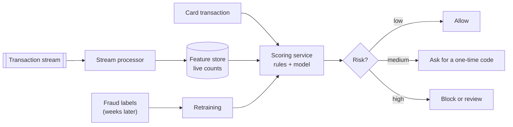

<!-- Written by `npm run lessons` from the lesson data in src/data. Edit the lesson there, not this page. -->

# Design a real-time fraud detection system

**System Design · Unit 9: AI and ML system design · Lesson 3 of 5 · Must know**

> **In one line.** Score every card transaction for fraud within milliseconds, and block or flag the risky ones.

[Open this lesson on the site](https://learn.hamropedia.com/system-design/design-a-real-time-fraud-detection-system/) for its animation, the practice game and tap-to-explain words.

## Why interviewers ask it

It tests real-time ML: low-latency features, imbalanced data, thresholds based on costs, labels that arrive late, and drift.

## Functional requirements

- Score every transaction before it's approved.
- Allow, block, or ask for extra verification (such as a one-time code), or send to manual review.
- Learn from confirmed fraud.

## Non-functional requirements

- A decision in under about 100 ms, with very high availability (fail safely).
- Very imbalanced data: fraud is far below 1%.
- Explainable decisions for regulators and customers.

## Estimates

- About 2,000 transactions per second at peak, each needing features such as 'number of transactions on this card in the last 10 minutes'.

## API

- POST /score {transaction} → {risk_score, decision, reasons}

## Data model

- Streaming aggregates per card, merchant and device (counts and sums over time windows) in a low-latency feature store.
- Labels arrive later, from chargebacks and analyst reviews.

## From version 1 to the final design

1. Version 1: hand-written rules (for example, block payments over £5,000 made abroad).
2. Version 2: a model trained offline and scored in a service.
3. Version 3: streaming features (like transaction counts in the last 10 minutes) in a feature store.
4. Version 4: rules plus model plus a review queue, thresholds tuned by cost, drift monitoring and regular retraining.

## The design, step by step

1. Transaction → scoring service: fetch real-time features (how many transactions in the last 10 minutes, distance from usual location, device) and historical features → rules engine plus an ML model (often gradient-boosted trees) → decision using thresholds.
2. A streaming pipeline (Kafka plus a stream processor) keeps the windowed counts and sums up to date.
3. Every decision and its features are logged; fraud labels arrive later (chargebacks) and are joined for retraining.
4. A case-management tool for fraud analysts.

## Picture it



*Each payment is scored in milliseconds using fresh counts from the feature store. Fraud confirmed weeks later is fed back to retrain the model.*

## Deep dives

- Class imbalance: choose the precision–recall trade-off from the cost of fraud versus the cost of blocking good customers.
- Delayed, noisy labels, and fraudsters changing tactics (drift): monitor and retrain often.
- If the model service is down or slow, fall back to rules only.
- Point-in-time correct features, so no future information leaks into training.

## Common mistakes

- Using accuracy as the metric: if 0.1% of payments are fraud, a model that flags nothing is 99.9% accurate and useless.
- Features calculated with information from the future.
- No fallback when the model service fails.

> **Not true:** Accuracy is a good metric for a fraud detection model.  
> **In fact:** If 0.1% of payments are fraud, a model that flags nothing is 99.9% accurate and useless. Use precision and recall instead.

## In the interview

Each transaction hits a low-latency scoring service. It pulls real-time features from a feature store, which a streaming pipeline keeps fresh. It runs rules plus a gradient-boosted model, and returns allow, verify or block within about 100 milliseconds. Thresholds come from the business cost of fraud versus false declines. Decisions are logged, chargeback labels are joined later, and the model is monitored for drift and retrained regularly.

<details>
<summary>&lt;b>Why not just maximise accuracy?&lt;/b></summary>

With 0.1% fraud, a model that always says 'not fraud' is 99.9% accurate and useless. Use precision, recall and cost-weighted metrics.

</details>

<details>
<summary>&lt;b>What if the model service is slow?&lt;/b></summary>

Time out and fall back to rules, with a safe default for each risk level, so payments never stall.

</details>

## Practise

Try each one yourself first, then open the answer and compare.

### 1. Explain

Explain the real-time scoring path and the learning loop.

<details>
<summary>Show one good answer</summary>

Real-time scoring path (every transaction, in under about 100 ms, before it is approved):  
1. The payment arrives at the scoring service: card, amount, merchant, device, location.  
2. It fetches features from a low-latency feature store: real-time ones kept up to date by a streaming pipeline ("transactions on this card in the last 10 minutes", "amount spent today", "distance from the usual location") and historical ones ("card age", "typical spend at this merchant type").  
3. A rules engine runs (hard rules: blocked cards, sanctions lists, impossible travel), and an ML model (often gradient-boosted trees) gives a risk score.  
4. Thresholds turn the score into a decision: allow, ask for extra verification (a one-time code), send to manual review, or block. The decision comes with reasons.  
5. If the model is down or slow, the service falls back to rules alone, so payments don't stop.

Learning loop (days to weeks):  
1. Every decision is logged with the exact features used.  
2. Labels arrive later: chargebacks, customer reports, analyst verdicts.  
3. They are joined to the logged features (point-in-time correct), and the model is retrained.  
4. The new model is evaluated against the old one, released carefully (shadow, then canary), and monitored for drift, because fraudsters change tactics.

</details>

### 2. Draw

Draw transaction → scoring service ↔ feature store, the streaming aggregates, and the label feedback loop.

<details>
<summary>Show one good answer</summary>

The scoring service must answer within the payment's time budget, so it only reads precomputed features; the streaming pipeline keeps the windowed counts fresh. Labels arrive weeks later and flow back into training through the decision log.

```text
REAL TIME
Payment ── transaction ──► Scoring service ──► decision + reasons
                             │      ▲            (allow / verify /
                             │      │             review / block)
                       features│     │
                             ▼      │
                         Feature store (low latency)
                             ▲
Transaction events ──► Kafka ──► Stream processor
                         (counts and sums per card, merchant,
                          device over 10 min, 1 h, 24 h windows)

Scoring service = rules engine + ML model (+ rules-only fallback)

LEARNING LOOP
Scoring service ── decision + features used ──► Decision log
Chargebacks, customer reports ──┐
Analyst verdicts (case tool) ───┴──► Labels (arrive late)
Decision log + labels ── point-in-time join ──► Training
  ──► evaluation ──► Model registry ──► shadow → canary → live
Monitoring: score drift, fraud caught, false positives
```

</details>

### 3. Apply

On a public credit-card fraud dataset, train logistic regression and report precision and recall at three different thresholds.

<details>
<summary>Show one good answer</summary>

The usual public dataset is Kaggle's "Credit Card Fraud Detection": 284,807 card transactions, of which 492 (0.17%) are fraud. This answer uses a synthetic stand-in with the same kind of imbalance (0.2% fraud, 100,000 rows), so it runs anywhere; to use the real file, load creditcard.csv and use its Class column as y.

Logistic regression is trained with plain gradient descent in NumPy. Fraud examples are weighted about 500 times more, otherwise the model learns that "never fraud" is 99.8% accurate. The test set has 48 frauds in 30,000 transactions:  
• threshold 0.5: flags 4,904 transactions, catches 40 of 48 frauds. Recall 0.83, but precision 0.01: 99 in 100 alerts are false.  
• threshold 0.9: flags 558, catches 22. Recall 0.46, precision 0.04.  
• threshold 0.99: flags 21, catches 7. Recall 0.15, precision 0.33.

The threshold is a business decision, not a modelling one: each missed fraud costs its amount; each false alarm costs an annoyed customer or an analyst's time. Real systems use several thresholds: auto-block only the very top, send a one-time code for the middle band, allow the rest. And accuracy is useless here: a model that never flags anything scores 99.8%.

```python
import numpy as np

rng = np.random.default_rng(0)
n, fraud_rate = 100_000, 0.002                   # about as rare as in the real dataset
y = (rng.random(n) < fraud_rate).astype(float)
X = rng.normal(size=(n, 5)) + y[:, None] * np.array([1.5, 1.0, 0.8, 0.0, 0.5])   # overlapping classes

split = int(0.7 * n)                             # train on the first 70%, test on the rest
Xtr, ytr, Xte, yte = X[:split], y[:split], X[split:], y[split:]

w, b = np.zeros(5), 0.0
pos_weight = (1 - ytr.mean()) / ytr.mean()       # each fraud counts ~500 times
sample_w = np.where(ytr == 1, pos_weight, 1.0)
for _ in range(500):                             # logistic regression, gradient descent
    p = 1 / (1 + np.exp(-(Xtr @ w + b)))
    grad = sample_w * (p - ytr)
    w -= 0.5 * (Xtr.T @ grad) / sample_w.sum()
    b -= 0.5 * grad.sum() / sample_w.sum()

scores = 1 / (1 + np.exp(-(Xte @ w + b)))
for threshold in (0.5, 0.9, 0.99):
    flagged = scores >= threshold
    caught = int(np.sum(flagged & (yte == 1)))
    precision = caught / max(int(flagged.sum()), 1)
    recall = caught / yte.sum()
    print(f"threshold {threshold}: flagged {int(flagged.sum())}, caught {caught} of {int(yte.sum())}, "
          f"precision {precision:.2f}, recall {recall:.2f}")
# threshold 0.5: flagged 4904, caught 40 of 48, precision 0.01, recall 0.83
# threshold 0.9: flagged 558, caught 22 of 48, precision 0.04, recall 0.46
# threshold 0.99: flagged 21, caught 7 of 48, precision 0.33, recall 0.15
```

</details>

### 4. Trade-offs

Rules only, ML model only, or both: when does each win?

<details>
<summary>Show one good answer</summary>

Rules only wins when:  
• you are starting out and have no labelled fraud to learn from;  
• the rule is a hard requirement: sanctions lists, blocked cards, legal limits;  
• a new attack appears today: a rule can be written and deployed in an hour, while a model needs new labels and retraining;  
• every decision must be explained in one sentence.  
But rules are brittle, rack up false positives, and fraudsters learn them quickly.

An ML model only wins when:  
• you have plenty of labelled history and patterns too subtle for hand-written rules (combinations of amount, time, device, merchant, velocity);  
• you need a better trade-off between catching fraud and annoying customers than rules can give.  
But a model alone is slow to react to brand-new attacks, harder to explain, and a single point of failure if the model service goes down.

Both (the usual production answer): rules as guardrails (hard blocks, known-bad lists, emergency fixes for a fresh attack), the model's score for everything nuanced, thresholds that route to allow, verify, review or block, and rules-only as the fallback when the model is unavailable. Analysts' verdicts feed both: new rules now, better models later.

</details>

## Go further (optional)

- READ · [A primer on machine learning for fraud detection (Stripe Radar)](https://www.google.com/search?q=Stripe+Radar+machine+learning+fraud+detection+primer) · Stripe
- READ · [CS329S: Machine Learning Systems Design (lecture notes)](https://stanford-cs329s.github.io/) · Chip Huyen, Stanford · free
- CODE · [Credit card fraud detection dataset](https://www.google.com/search?q=Kaggle+credit+card+fraud+detection+dataset) · Kaggle

---

[← Design a recommendation system](design-a-recommendation-system.md) · [All lessons](../../README.md) · [Design an LLM serving platform →](design-an-llm-serving-platform.md)
