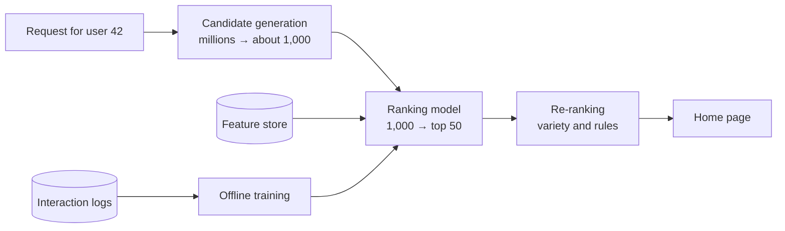

<!-- Written by `npm run lessons` from the lesson data in src/data. Edit the lesson there, not this page. -->

# Design a recommendation system

**System Design · Unit 9: AI and ML system design · Lesson 2 of 5 · Must know**

> **In one line.** Recommend items (videos, products, posts) that each user is likely to engage with.

[Open this lesson on the site](https://learn.hamropedia.com/system-design/design-a-recommendation-system/) for its animation, the practice game and tap-to-explain words.

## Why interviewers ask it

It tests the two-stage pattern (retrieve, then rank), feature consistency, feedback loops, and how to measure success.

## Functional requirements

- Personalised home-page recommendations.
- 'Similar items' on each item's page.
- Learn from clicks, watches and purchases.

## Non-functional requirements

- Results in about 100–200 ms.
- Fresh: reacts quickly to new behaviour.
- Millions of users and items.

## Estimates

- 10 million users × 1 home-page load a day × 500 candidates scored ≈ 5 billion scores a day, which is why a cheap first stage must cut the candidates down.

## API

- GET /recommendations?user_id=…&surface=home

## Data model

- Interaction logs (user, item, event, time) → feature store (user and item features) → embedding index.

## From version 1 to the final design

1. Version 1: show everyone the most popular items.
2. Version 2: item-to-item similarity ('people who watched X also watched Y').
3. Version 3: embeddings to gather candidates, plus a ranking model.
4. Version 4: a feature store, re-ranking rules, exploration and A/B testing.

## The design, step by step

1. Two stages. Candidate generation retrieves about 500–1,000 items quickly (embedding similarity with approximate nearest-neighbour search, items often bought together, popular items). Ranking then scores those candidates with a richer model using user, item and context features.
2. Re-ranking applies business rules: variety, freshness, removing items already seen.
3. Models train offline on logged interactions; features come from a feature store, defined the same way for training and serving.
4. Online A/B tests measure the real impact of every change.

## Picture it



*A cheap first stage narrows millions of items to about a thousand, then a richer model ranks them. Logs of what users did train the next model.*

## Deep dives

- Cold start: new users get popular and contextual items; new items use content features.
- Feedback loops and popularity bias: add some exploration.
- Training-serving skew: one feature definition used both offline and online.
- Metrics: offline (recall@k, NDCG) and online (click-through, watch time, retention).

## Common mistakes

- Scoring every item with a heavy model on every request.
- Judging success only by offline metrics.
- Ignoring the cold-start problem: new users and new items have no history, so they need a fallback such as popular items.

> **Not true:** Offline metrics: a better score means users will like the recommendations more.  
> **In fact:** Offline scores are measured on past behaviour, which the old system shaped. Only an online A/B test shows what real users do.

## In the interview

It is a two-stage system. Candidate generation pulls about a thousand items cheaply, using embedding similarity and simple sources. Then a ranking model scores them with user, item and context features from a feature store. A final re-ranking step applies variety and business rules. Models train offline on interaction logs, and every change is checked with an online A/B test.

<details>
<summary>&lt;b>Why two stages?&lt;/b></summary>

Scoring millions of items with a heavy model on every request is too slow. A cheap retrieval step narrows the pool, so the expensive model only scores hundreds.

</details>

<details>
<summary>&lt;b>How do you handle a brand-new user?&lt;/b></summary>

Popular and trending items, context such as country and device, then adapt quickly from their first clicks.

</details>

## Practise

Try each one yourself first, then open the answer and compare.

### 1. Explain

Explain candidate generation and ranking, and why both exist.

<details>
<summary>Show one good answer</summary>

There are millions of items, and only about 100–200 ms to answer. Scoring every item with an accurate model for every request would take far too long, so the work is split in two.

Candidate generation: a fast, rough first pass that cuts millions of items down to roughly 500–1,000 that might interest this user. Several cheap sources are merged: items whose embeddings are close to the user's (approximate nearest-neighbour search), items often bought or watched together with what they liked, and popular or trending items. It optimises for recall: don't miss the good ones; precision doesn't matter yet.

Ranking: a slower, accurate model scores only those candidates, using rich features about the user, the item and the context (time of day, device, recent behaviour), and predicts what you care about (click, watch time, purchase). It optimises for precision: put the best ones at the top.

Then a re-ranking step applies rules: variety, freshness, no items already seen.

Why both: the ranker is too expensive to run on everything, and the candidate generator is too rough to order the final list. Together they are both fast and good.

</details>

### 2. Draw

Draw logs → features → training → models, and request → candidates → ranking → re-ranking.

<details>
<summary>Show one good answer</summary>

The offline loop turns logged behaviour into features and models; the online path uses them in milliseconds. The feature store is shared by both, so a feature means the same thing in training and in serving.

```text
OFFLINE (learning)
Apps ── clicks, watches, purchases ──► Event logs
  ──► feature pipelines ──► Feature store
                              ├─ offline: history for training
                              └─ online: latest values, fast
  ──► training jobs ──► Model registry
         ├─ embedding model ──► ANN index of item vectors
         └─ ranking model

ONLINE (each request, ~100–200 ms)
GET /recommendations?user=42
  1. candidates (~500–1,000), from several sources:
       ANN search on the user's embedding
       items often bought together
       popular and trending
  2. ranking: fetch features (online store), score each
  3. re-ranking: variety, freshness, remove seen items
  ──► top 20 to the app
  └─ log what was shown ──► Event logs  (closes the loop)
```

</details>

### 3. Apply

Build item-to-item recommendations from a small ratings dataset using cosine similarity in NumPy.

<details>
<summary>Show one good answer</summary>

Each column of the ratings matrix describes one film by who rated it and how highly. Cosine similarity between two columns is high when the same people rated both films highly. Computing it for all pairs at once is one matrix product, divided by the column lengths.

Alien's nearest film is Aliens (0.96), Toy Story's is Finding Nemo (0.94), and Heat's is Ronin (0.95): the three "tastes" in the data come out clearly. For a new user who has only rated Toy Story 5, scoring every film by its similarity to what they rated recommends Finding Nemo first.

```python
import numpy as np

films = ["Alien", "Aliens", "Toy Story", "Finding Nemo", "Heat", "Ronin"]
ratings = np.array([            # rows: users, columns: films; 0 = not rated
    [5, 4, 0, 0, 1, 0],
    [4, 5, 1, 0, 0, 1],
    [0, 1, 5, 4, 0, 0],
    [1, 0, 4, 5, 0, 0],
    [0, 0, 0, 1, 5, 4],
    [1, 0, 0, 0, 4, 5],
    [5, 5, 0, 1, 0, 0],
])

norms = np.linalg.norm(ratings, axis=0)
similarity = (ratings.T @ ratings) / np.outer(norms, norms)   # film × film cosine similarity
np.fill_diagonal(similarity, 0)                               # a film isn't its own neighbour


def similar_to(film, k=2):
    i = films.index(film)
    best = np.argsort(-similarity[i])[:k]
    return [(films[j], round(float(similarity[i, j]), 2)) for j in best]


for film in ["Alien", "Toy Story", "Heat"]:
    print(film, "→", similar_to(film))
# Alien → [('Aliens', 0.96), ('Finding Nemo', 0.18)]
# Toy Story → [('Finding Nemo', 0.94), ('Aliens', 0.19)]
# Heat → [('Ronin', 0.95), ('Alien', 0.17)]

new_user = np.array([0, 0, 5, 0, 0, 0])                       # only rated Toy Story
scores = (similarity @ new_user).astype(float)
scores[new_user > 0] = -np.inf                                 # don't recommend what they've seen
print([films[j] for j in np.argsort(-scores)[:2]])             # ['Finding Nemo', 'Aliens']
```

</details>

### 4. Trade-offs

Optimising for clicks, for watch time, or for long-term retention: what can go wrong with each?

<details>
<summary>Show one good answer</summary>

• Clicks: easy to measure and fast to learn from, but they reward whatever makes people tap: sensational titles and misleading thumbnails. Click-through rises while satisfaction falls, and users learn to distrust the recommendations.  
• Watch time: closer to real interest, and harder to fake with a thumbnail. But it favours long content over good content, and endless, compulsive viewing (autoplay rabbit holes) over what people are glad they watched; it can push towards extreme or addictive material because it holds attention.  
• Long-term retention (do people come back next month?): the closest to "this product is good for people". But the signal is slow (weeks), noisy and hard to attribute to any single recommendation, so it is hard to train on directly and needs long experiments.

All three, optimised blindly, can narrow what people see (filter bubbles) and favour what is already popular.

In practice, teams combine signals (clicks, watch time, likes, "not interested", surveys asking "was this worth your time?"), train for the short-term ones, and judge launches by long-term metrics plus guardrails (diversity, complaints, quality ratings), so a model that gains clicks but hurts retention doesn't ship.

</details>

## Go further (optional)

- READ · [Recommendation systems course](https://developers.google.com/machine-learning/recommendation) · Google for Developers, free
- READ · [System Design for Recommendations and Search](https://eugeneyan.com/writing/system-design-for-discovery/) · Eugene Yan
- READ · [CS329S: Machine Learning Systems Design (lecture notes)](https://stanford-cs329s.github.io/) · Chip Huyen, Stanford · free

---

[← Design a RAG assistant over company documents](design-a-rag-assistant-over-company-documents.md) · [All lessons](../../README.md) · [Design a real-time fraud detection system →](design-a-real-time-fraud-detection-system.md)
