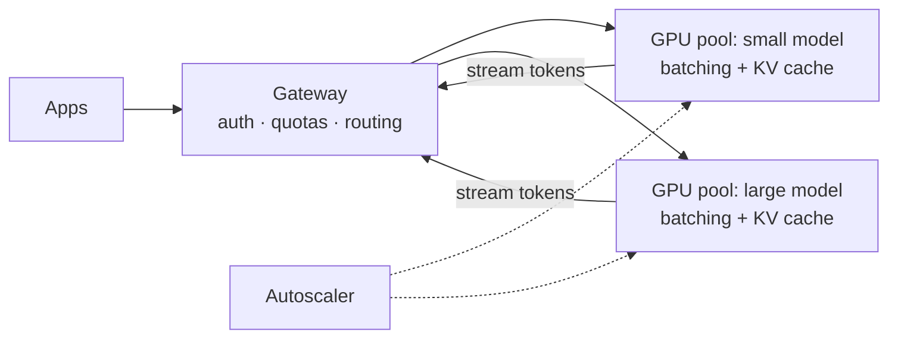

<!-- Written by `npm run lessons` from the lesson data in src/data. Edit the lesson there, not this page. -->

# Design an LLM serving platform

**System Design · Unit 9: AI and ML system design · Lesson 4 of 5 · Should know**

> **In one line.** Serve large language models to many applications with low latency and cost.

[Open this lesson on the site](https://learn.hamropedia.com/system-design/design-an-llm-serving-platform/) for its animation, the practice game and tap-to-explain words.

## Why interviewers ask it

It tests modern AI infrastructure: GPU cost, batching, memory limits, streaming, and fairness between teams.

## Functional requirements

- A chat API with streaming responses.
- Several models and versions; quotas per team.
- Usage metering.

## Non-functional requirements

- Time to first token under about 1 second, then a steady stream of tokens.
- High GPU utilisation; graceful behaviour under overload.
- Isolation between teams.

## Estimates

- A 70B-parameter model in bf16 needs about 140 GB just for weights, so each replica spans several GPUs; KV-cache memory then limits how many requests run at once.

## API

- POST /v1/chat {model, messages, max_tokens, stream} → a stream of tokens

## Data model

- Model registry (versions and hardware needs); a usage record for every request.

## From version 1 to the final design

1. Version 1: one model on one GPU server behind an API, handling one request at a time.
2. Version 2: static batching, then continuous batching with a paged KV cache.
3. Version 3: a gateway with quotas and routing, and autoscaled GPU pools per model.
4. Version 4: quantised tiers, prefix caching, speculative decoding and priority queues.

## The design, step by step

1. A gateway handles authentication, quotas, rate limits and routing to a pool of servers per model.
2. Model servers (vLLM-style) use continuous batching and a paged KV cache to keep the GPUs busy.
3. GPU pools scale automatically on queue length and latency.
4. Responses stream back through the gateway; prefix caching reuses work for repeated system prompts.
5. Metrics: time to first token, tokens per second, GPU utilisation, errors, and usage per team.

## Picture it



*The gateway sends each request to the right model's GPU pool. Pools batch many requests together and stream tokens back; the autoscaler adds GPUs when queues grow.*

## Deep dives

- Prefill (reading the prompt) and decode (generating one token at a time) have different bottlenecks.
- Continuous batching adds new requests between decode steps instead of waiting for a whole batch to finish.
- Quantised, smaller or distilled models for cheaper tiers; speculative decoding for speed.
- Overload: a bounded queue, and dropping low-priority traffic first.

## Common mistakes

- Handling one request at a time on an expensive GPU.
- Ignoring KV-cache memory when planning capacity.
- No per-team quotas, so one team can use it all and leave nothing for the others.

> **Not true:** Handling one request at a time makes full use of an expensive GPU.  
> **In fact:** A GPU can work on many requests in the same pass. Continuous batching adds new requests between decode steps, which raises throughput a great deal.

## In the interview

A gateway handles auth, quotas and routing to a GPU pool per model. Each replica runs an inference server with continuous batching and a paged KV cache to keep the GPUs busy, and streams tokens back. Pools scale on queue length and latency, and we track time to first token, tokens per second and cost per team. Quantisation, prefix caching and speculative decoding cut cost and latency.

<details>
<summary>&lt;b>Why is batching hard for LLMs?&lt;/b></summary>

Requests have different lengths and finish at different times. Continuous batching swaps finished sequences out and new ones in at every step, instead of waiting for the whole batch.

</details>

<details>
<summary>&lt;b>What limits how many requests one GPU can serve at once?&lt;/b></summary>

Mostly KV-cache memory, which grows with sequence length and with the number of requests in flight.

</details>

## Practise

Try each one yourself first, then open the answer and compare.

### 1. Explain

Explain prefill and decode, and why they behave differently.

<details>
<summary>Show one good answer</summary>

Generating a reply has two phases.

Prefill reads the prompt. All the prompt's tokens are already known, so the model processes them all at once, in parallel: big matrix multiplications that keep the GPU's compute fully busy. It produces the KV cache (the stored attention keys and values for every prompt token) and the first output token. Its cost grows with the prompt's length, and it sets the time to first token. It is limited by compute.

Decode then generates the answer one token at a time, each depending on the one before. Each step does very little arithmetic per sequence (one new token), but must read all the model's weights and that sequence's whole KV cache from GPU memory. So decode is limited by memory bandwidth, not compute: one sequence alone leaves most of the GPU idle. It sets the speed of the stream (tokens per second).

That is why they are optimised differently: decode gets continuous batching (many sequences share each pass over the weights, so the memory read is shared), and memory-efficient KV caches (paged attention) so more sequences fit. Prefill gets chunking (long prompts split so they don't stall everyone's decoding), prefix caching for repeated system prompts, and sometimes its own separate GPUs.

</details>

### 2. Draw

Draw gateway → router → GPU pools with batching servers, the autoscaler and metrics.

<details>
<summary>Show one good answer</summary>

The gateway handles everything about who may call and how much; the router chooses a pool by model and priority. Each pool's servers batch continuously, and the autoscaler watches queue length and latency, not just GPU use, because time to first token is what users feel.

```text
Clients ── POST /v1/chat (stream) ──► Gateway
                                       auth, quotas per team,
                                       rate limits, metering
                                         │
                                         ▼
                                       Router
                                       by model, version, priority
                   ┌─────────────────────┼─────────────────────┐
                   ▼                     ▼                     ▼
            Pool: large model     Pool: small model     Pool: embeddings
            ┌───────────────┐     ┌───────────────┐
            │ model server  │     │ model server  │   each server:
            │ (vLLM-style)  │ ... │               │   bounded queue,
            │ continuous    │     │               │   continuous batching,
            │ batching,     │     │               │   paged KV cache,
            │ paged KV cache│     │               │   prefix cache
            └───────────────┘     └───────────────┘
                   ▲                     ▲
Autoscaler ── adds/removes GPU replicas per pool
              (on queue length, time to first token)
Metrics ◄── TTFT, tokens/s, GPU use, errors, usage per team
Tokens stream back: server ══► gateway ══► client
```

</details>

### 3. Apply

Estimate how many 4,000-token requests fit in 20 GB of KV-cache memory, if the model needs about 0.5 MB of cache per token.

<details>
<summary>Show one good answer</summary>

Each 4,000-token request needs 4,000 × 0.5 MB = 2,000 MB = 2 GB of KV cache when full. 20 GB ÷ 2 GB = 10 requests at once.

What that means: the GPU can only run 10 such conversations in parallel, however much compute it has to spare; the KV cache, not compute, sets the batch size. That is why the main levers are about memory: paged attention allocates the cache as tokens are actually generated (most requests never reach their maximum, so far more than 10 fit in practice); prefix caching stores a shared system prompt's cache once for everyone; quantising the KV cache to 8 bits halves it (20 at once); and models with grouped-query attention need much less cache per token in the first place.

```python
kv_memory_mb = 20 * 1000                         # 20 GB of KV cache
per_request_mb = 4000 * 0.5                      # 4,000 tokens × 0.5 MB each
print(per_request_mb, kv_memory_mb // per_request_mb)      # 2000.0 10.0: 10 requests at once
print(kv_memory_mb // (per_request_mb / 2))                # 20.0 with an 8-bit KV cache
```

</details>

### 4. Trade-offs

One big model for everything, or routing between a small and a large model?

<details>
<summary>Show one good answer</summary>

One big model for everything:  
• The best quality on every request, one model to evaluate, deploy and monitor, and consistent behaviour.  
• But it is expensive and slow for the many requests that are easy (classify this ticket, extract a date, a short factual answer): you pay large-model prices and latency for small-model work, and capacity runs out sooner.

Routing between a small and a large model:  
• Much cheaper and faster on average, because most traffic is usually easy enough for the small model, and the big GPUs are saved for hard requests.  
• But you need a router: rules (by task type, by product feature) or a small classifier, and it will sometimes send a hard question to the small model, which quietly lowers quality. A cascade (try small; escalate if it is unsure) adds latency to escalated requests.  
• Two fleets to run, two models to evaluate, and answers that vary in style.

A sensible path: start with one strong model to learn the real traffic and set a quality bar with evaluations; then route the clearly easy, high-volume tasks to a small model, and check on the same evaluation set that quality holds.

</details>

## Go further (optional)

- READ · [Building A Generative AI Platform](https://huyenchip.com/2024/07/25/genai-platform.html) · Chip Huyen's blog · free
- READ · [How continuous batching enables 23x throughput in LLM inference](https://www.google.com/search?q=Anyscale+continuous+batching+23x+throughput+LLM+inference) · Anyscale blog
- PAPER · [Efficient Memory Management for LLM Serving with PagedAttention (2023)](https://arxiv.org/abs/2309.06180) · Kwon et al. · arXiv

---

[← Design a real-time fraud detection system](design-a-real-time-fraud-detection-system.md) · [All lessons](../../README.md) · [Design an ML training and feature pipeline →](design-an-ml-training-and-feature-pipeline.md)
