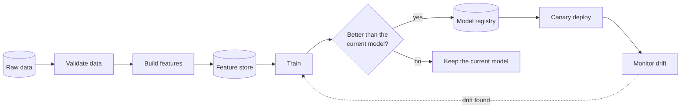

<!-- Written by `npm run lessons` from the lesson data in src/data. Edit the lesson there, not this page. -->

# Design an ML training and feature pipeline

**System Design · Unit 9: AI and ML system design · Lesson 5 of 5 · Should know**

> **In one line.** The platform that turns raw data into trained, deployed and monitored models, again and again.

[Open this lesson on the site](https://learn.hamropedia.com/system-design/design-an-ml-training-and-feature-pipeline/) for its animation, the practice game and tap-to-explain words.

## Why interviewers ask it

It tests whether you see a model as a product with a lifecycle — data, features, training, deployment and monitoring — repeated forever.

## Functional requirements

- Collect and label data; compute features.
- Train, evaluate and register models; deploy them.
- Monitor them and retrain.

## Non-functional requirements

- Reproducible: every model can be traced back to its data and code.
- The same features in training and serving.
- Safe rollouts.

## API

- Feature store: get_online_features(entity_id), get_historical_features(entities, timestamps)
- Model registry: register, promote, roll back

## Data model

- Raw data lake → cleaned tables → feature tables (offline) and an online store (low latency)
- Model registry entries: version, metrics, data snapshot, code commit

## From version 1 to the final design

1. Version 1: a notebook trains a model, and someone copies the file to a server.
2. Version 2: scripts in a scheduled pipeline, and a model registry.
3. Version 3: data validation, a feature store and evaluation gates.
4. Version 4: canary releases, drift monitoring, automatic retraining and full lineage.

## The design, step by step

1. An orchestrated pipeline (for example Airflow): ingest → validate the data → build features → train → compare with the current model → register.
2. A feature store: one definition per feature, an offline store for training (with point-in-time correct joins) and an online store for fast serving.
3. Deploy with shadow or canary releases; monitor data drift, prediction drift and business metrics.
4. Retrain on a schedule, or when drift is detected.

## Picture it



*A loop: data becomes features, features train a model, only a better model is deployed, and drift sends it back round to retrain.*

## Deep dives

- Training-serving skew: compute each feature once and use it in both places.
- Point-in-time joins stop future data leaking into training.
- Data validation catches broken upstream data before it trains a bad model.
- Lineage: every model links to its data version, code commit and settings.

## Common mistakes

- Different feature code in training and in serving.
- No data validation: a broken upstream feed, with missing values or changed units, quietly trains a bad model.
- No way to roll back a bad model.

> **Not true:** Writing the feature code twice, once for training and once for serving, is harmless if both follow the same idea.  
> **In fact:** Two versions drift apart, and the model then sees different numbers in production from those it trained on. Compute each feature once and use it in both places.

## In the interview

An orchestrated pipeline validates data, builds features, trains, compares against the production model and registers the winner with full lineage. A feature store keeps one definition per feature for both training (point-in-time correct) and serving (low latency). New models roll out through shadow or canary releases, are monitored for drift, and are retrained on a schedule or on a trigger.

<details>
<summary>&lt;b>What is training-serving skew?&lt;/b></summary>

Features computed differently in training and in production, so the live model sees different inputs from the ones it learned on.

</details>

<details>
<summary>&lt;b>Shadow or canary deployment?&lt;/b></summary>

Shadow runs the new model on live traffic without using its answers. Canary lets it make a small share of real decisions, and expands if the metrics hold.

</details>

## Practise

Try each one yourself first, then open the answer and compare.

### 1. Explain

Explain why a feature store exists.

<details>
<summary>Show one good answer</summary>

A feature store exists to stop the same feature being computed two different ways.

Without one, a data scientist writes "orders in the last 30 days" in a SQL notebook to train a model, and an engineer later rewrites it in the serving code. The two versions differ slightly (time zones, cancelled orders, a 30-day window that includes today or not), so the model sees different numbers in production than it was trained on: training–serving skew. Accuracy quietly drops, and nobody can see why.

A feature store keeps one definition per feature, and serves it two ways from the same pipeline:  
• an offline store with the full history, so training can ask "what was this value at the moment of each past example?" (point-in-time correct, with no future data leaking in);  
• an online store with the latest value for each user or item, readable in milliseconds when the model serves a request.

On top of that: features can be shared between teams instead of rebuilt, backfilled when a definition changes, and monitored for drift.

</details>

### 2. Draw

Draw data → validation → features → training → registry → deployment → monitoring → retraining.

<details>
<summary>Show one good answer</summary>

The pipeline is a loop: monitoring decides when to retrain, and every arrow from training onwards is gated (validation, comparison with the current model, canary), so a bad model or bad data never goes straight to users.

```text
Raw data (events, databases, logs)
  │
  ▼
Data validation ── schema, ranges, missing values ── fail? stop + alert
  │
  ▼
Feature pipelines ──► Feature store
                       ├─ offline (history, point-in-time joins) ──┐
                       └─ online (latest values, ms reads)         │
  ┌────────────────────────────────────────────────────────────────┘
  ▼
Training (data snapshot + code commit + settings recorded)
  │
  ▼
Evaluation ── better than the current model? no → stop
  │
  ▼
Model registry (version, metrics, lineage)
  │
  ▼
Deployment: shadow → canary → full   (instant rollback)
  │   serving reads the online store
  ▼
Monitoring: data drift, prediction drift, business metrics
  │
  └──► schedule or drift trigger ──► retrain (back to the top)
```

</details>

### 3. Apply

Write a point-in-time join in SQL or Python that gets each user's features as they were at the time of each label.

<details>
<summary>Show one good answer</summary>

For each label (did this user churn, as of this date?), take the most recent feature value recorded at or before the label's time, never after. The correlated subquery finds that latest earlier timestamp per label, and the join fetches the value.

The important row is user 1's label on 1 April. It gets the feature from 10 March (2 orders), not the one from 5 April (0 orders). The 5 April value was measured after the user had already churned; a naive "latest value" join would hand the model a feature that gives the answer away, and it would look brilliant in training and fail in production.

```python
import sqlite3

db = sqlite3.connect(":memory:")
db.executescript("""
CREATE TABLE labels   (user_id INT, label_time TEXT, churned INT);
CREATE TABLE features (user_id INT, feature_time TEXT, orders_last_30d INT);
INSERT INTO labels VALUES (1, '2024-03-01', 0), (1, '2024-04-01', 1), (2, '2024-03-15', 0);
INSERT INTO features VALUES
  (1, '2024-02-20', 5), (1, '2024-03-10', 2), (1, '2024-04-05', 0),
  (2, '2024-03-01', 7), (2, '2024-03-20', 9);
""")

point_in_time = """
SELECT l.user_id, l.label_time, l.churned, f.feature_time, f.orders_last_30d
FROM labels l
LEFT JOIN features f
  ON f.user_id = l.user_id
 AND f.feature_time = (
       SELECT MAX(f2.feature_time)
       FROM features f2
       WHERE f2.user_id = l.user_id
         AND f2.feature_time <= l.label_time      -- only what was known then
     )
ORDER BY l.user_id, l.label_time
"""
for row in db.execute(point_in_time):
    print(row)
# (1, '2024-03-01', 0, '2024-02-20', 5)
# (1, '2024-04-01', 1, '2024-03-10', 2)   not the 2024-04-05 value from the future
# (2, '2024-03-15', 0, '2024-03-01', 7)   not the 2024-03-20 one
```

</details>

### 4. Trade-offs

Retrain on a fixed schedule, or only when drift is detected?

<details>
<summary>Show one good answer</summary>

Fixed schedule (say every Sunday):  
• Simple and predictable: the compute cost, the release rhythm and the review process are all planned.  
• But it retrains when nothing has changed (wasted compute, and needless risk from every release), and too late when something changes fast: a new fraud tactic on Monday is unaddressed until Sunday.

Only when drift is detected:  
• Retrains when the world has actually changed, and quickly.  
• But drift detection is noisy: input distributions shift all the time without hurting accuracy (seasonality, a marketing campaign), causing false alarms, while real accuracy drops can hide in a stable-looking distribution. True accuracy needs labels, which often arrive weeks later.  
• Danger: a broken upstream pipeline looks exactly like drift. Retraining automatically on corrupted data ships a broken model, so data validation must run before any retrain.  
• Harder to plan compute and reviews for.

The common answer is both: a regular schedule as the baseline, plus drift and performance triggers for early retraining, and always the same gates (data validation, comparison with the current model, canary release) before anything goes live.

</details>

## Go further (optional)

- READ · [Made With ML](https://madewithml.com/) · Goku Mohandas, free
- READ · [CS329S: Machine Learning Systems Design (lecture notes)](https://stanford-cs329s.github.io/) · Chip Huyen, Stanford · free
- READ · [Rules of Machine Learning](https://developers.google.com/machine-learning/guides/rules-of-ml) · Google for Developers, free

---

[← Design an LLM serving platform](design-an-llm-serving-platform.md) · [All lessons](../../README.md)
